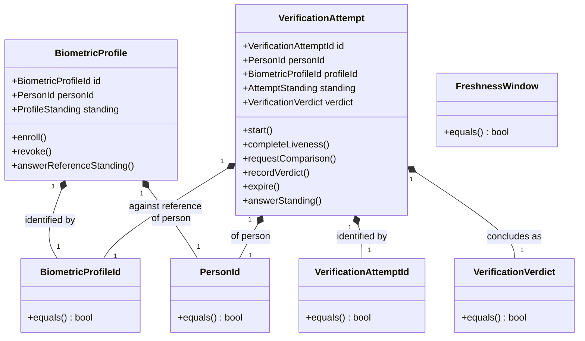
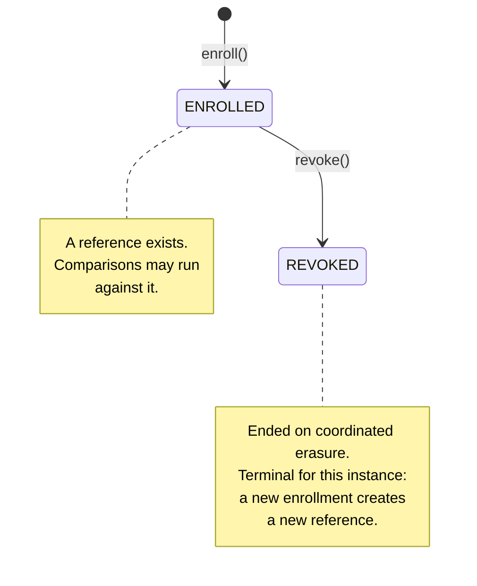
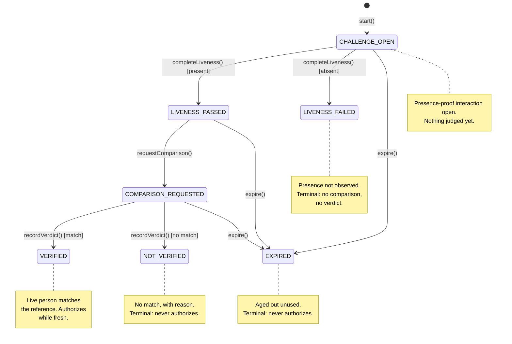
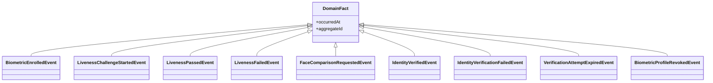

# Biometric Identity Verification — Domain Model

This is the domain model of a Supporting Subdomain. It describes business meaning only:
aggregates, their operations, value objects, domain facts (events), business rules,
and business rejections. It names no framework, library, storage, transport, or module structure.

Source: `event-storming.md` in this same folder (v0.1.0).
Reference input `docs/BrainStorming/VotoChain_DDD_Subdomains.md` §4 + §5 + §12 + §15 was treated as hypothesis;
deviations are logged under Hotspots.

> This context verifies **physical identity** (a live person matching a reference face).
> Channel possession (email/phone) belongs to `Verification (OTP)`. Consent for biometric
> processing lives in `Consent & Compliance`; this context verifies assuming that consent stands.

## Aggregate Overview

Two small aggregates with different rates of change. The reference (`BiometricProfile`) lives
once per person and changes rarely; attempts (`VerificationAttempt`) are born and die in minutes.
Attempts reference the profile by identity only — never by embedding. Both reference the person
by identity only.

---

## Aggregate: BiometricProfile

### Identity & Lifecycle

| Property | Meaning |
|----------|---------|
| `id` | Identity of this reference. Stable for its whole life, never reused |
| `personId` | The person it describes (identity reference only; the person record lives elsewhere) |
| `standing` | Where the reference stands (see state machine) |

### State Machine: ProfileStanding

### Invariants (Always True)

| # | Invariant |
|---|-----------|
| 1 | At most one live (`ENROLLED`) reference exists per person |
| 2 | The reference never holds anything viewable as a face. It holds only what matching needs — nothing raw (see Open Questions for the exact boundary) |
| 3 | `REVOKED` is terminal for this instance. Re-enrollment after revocation creates a new reference; revoked history stays ended |
| 4 | Revocation never rewrites past verdicts. Attempts already concluded stay history |

### Mutating Operations

| Operation | Preconditions | Facts Produced |
|-----------|---------------|----------------|
| `enroll()` | Person exists; consent for biometric processing stands; no live reference for the same person | `BiometricEnrolledEvent` |
| `revoke()` | Standing is `ENROLLED`; revocation asked by erasure coordination | `BiometricProfileRevokedEvent` |

### Answering Operations (Read, but Owned by the Aggregate)

| Operation | Preconditions | Answers |
|-----------|---------------|---------|
| `answerReferenceStanding()` | Always answerable | Whether a live reference exists for the person |

### Read Needs (What the Domain Must Be Able to Answer)

| Need | Returns |
|------|---------|
| Reference profile | Whether a live reference exists for the person (never content details beyond standing) |

---

## Aggregate: VerificationAttempt

### Identity & Lifecycle

| Property | Meaning |
|----------|---------|
| `id` | Identity of this attempt. Stable for its whole life, never reused |
| `personId` | The person presenting themselves (identity reference only) |
| `profileId` | The reference this attempt is judged against (identity reference only) |
| `standing` | Where the attempt stands (see state machine) |
| `verdict` | The frozen binary outcome, once recorded |

### State Machine: AttemptStanding

### Invariants (Always True)

| # | Invariant |
|---|-----------|
| 1 | Each attempt belongs to exactly one person and is judged against exactly one reference. It is never transferred |
| 2 | Liveness first: no comparison without a passed liveness in the same attempt |
| 3 | One attempt concludes at most once. `VERIFIED`, `NOT_VERIFIED`, `LIVENESS_FAILED`, and `EXPIRED` are all terminal |
| 4 | The verdict is binary and frozen at recording: verified or not, with reason and freshness. Later events never edit it |
| 5 | A verdict authorizes only while fresh. Past the freshness window it answers history, never permission |
| 6 | Revocation closes open attempts (they end as expired/ended) but never rewrites concluded verdicts |

### Mutating Operations

| Operation | Preconditions | Facts Produced |
|-----------|---------------|----------------|
| `start()` | Person exists; consent for biometric processing stands; a live reference exists for the person | `LivenessChallengeStartedEvent` |
| `completeLiveness()` | Standing is `CHALLENGE_OPEN`; presence observed or not | `LivenessPassedEvent` or `LivenessFailedEvent` |
| `requestComparison()` | Standing is `LIVENESS_PASSED`; reference still live | `FaceComparisonRequestedEvent` |
| `recordVerdict()` | Standing is `COMPARISON_REQUESTED`; match judged against this context's own bar | `IdentityVerifiedEvent` or `IdentityVerificationFailedEvent` |
| `expire()` | Standing is not terminal; freshness window elapsed (or reference revoked while open) | `VerificationAttemptExpiredEvent` |

### Answering Operations (Read, but Owned by the Aggregate)

| Operation | Preconditions | Answers |
|-----------|---------------|---------|
| `answerStanding()` | Always answerable | Verified now or not, with reason and freshness — the answer Voting consumes |

### Read Needs (What the Domain Must Be Able to Answer)

| Need | Returns |
|------|---------|
| Current verification standing | Verified now or not, with reason and freshness |
| Attempt history (scrutiny) | The attempts and verdicts behind a past authorization |

---

## Value Objects

No identity; defined entirely by attributes; immutable; invalid values are unrepresentable.

### BiometricProfileId / VerificationAttemptId / PersonId

- The stable identities of references, attempts, and persons.
- Equality is by value. Distinct kinds are never interchangeable.
- Person identity is held as a reference only; what it means for a person to exist is judged where the person record lives.

### VerificationVerdict

- The frozen outcome of one concluded attempt: the conclusion (`VERIFIED`, `NOT_VERIFIED`), the reason when not verified, and the freshness (concluded moment plus window).
- Once frozen it is history. A fresh `VERIFIED` answers permission; anything else answers explanation.

### LivenessOutcome

- `PRESENT` or `ABSENT` — what the presence-proof interaction observed. Decided once per attempt, never revised.

### FailureReason

- Why an attempt did not verify: `LIVENESS_NOT_OBSERVED`, `NO_MATCH`, `REFERENCE_ENDED`, `ATTEMPT_EXPIRED`, `CONSENT_WITHDRAWN`.
- Told to the person in business terms; never exposes comparison internals.

### FreshnessWindow

- How long one `VERIFIED` verdict authorizes (default: one authorization, then it ages out — see Open Questions).
- The window belongs to the verdict, not to the person or the reference.

### Status Enumerations

- `ProfileStanding` — `ENROLLED`, `REVOKED`.
- `AttemptStanding` — `CHALLENGE_OPEN`, `LIVENESS_PASSED`, `LIVENESS_FAILED`, `COMPARISON_REQUESTED`, `VERIFIED`, `NOT_VERIFIED`, `EXPIRED`.
- `VerdictConclusion` — `VERIFIED`, `NOT_VERIFIED`.

---

## Domain Events (Facts)

Past tense. Immutable. Each carries enough business data that consumers do not need to ask again for the common cases. Each is produced by exactly one aggregate operation.

| Event | Payload (business data) | Produced By | Interested Parties |
|-------|-------------------------|-------------|--------------------|
| `BiometricEnrolledEvent` | `BiometricProfileId`, `PersonId` | `BiometricProfile.enroll()` | Reference standing, scrutiny record |
| `LivenessChallengeStartedEvent` | `VerificationAttemptId`, `PersonId` | `VerificationAttempt.start()` | Attempt history |
| `LivenessPassedEvent` | `VerificationAttemptId` | `VerificationAttempt.completeLiveness()` | Attempt history (comparison now allowed) |
| `LivenessFailedEvent` | `VerificationAttemptId`, `FailureReason` | `VerificationAttempt.completeLiveness()` | Attempt history, person notice |
| `FaceComparisonRequestedEvent` | `VerificationAttemptId`, `BiometricProfileId` | `VerificationAttempt.requestComparison()` | Attempt history |
| `IdentityVerifiedEvent` | `VerificationAttemptId`, `PersonId`, `FreshnessWindow` | `VerificationAttempt.recordVerdict()` | Voting (gates authorization), scrutiny record |
| `IdentityVerificationFailedEvent` | `VerificationAttemptId`, `PersonId`, `FailureReason` | `VerificationAttempt.recordVerdict()` | Voting (refuses authorization with reason), person notice |
| `VerificationAttemptExpiredEvent` | `VerificationAttemptId`, `FailureReason` | `VerificationAttempt.expire()` | Attempt history (no longer authorizes) |
| `BiometricProfileRevokedEvent` | `BiometricProfileId`, `PersonId` | `BiometricProfile.revoke()` | Consent & Compliance (revocation confirmation), attempt closure |

---

## Business Rules (Policies)

Stated as domain rules. No mechanism named.

| Rule | Whenever… | Then… |
|------|-----------|-------|
| Liveness first | A comparison is asked | It runs only in an attempt whose liveness passed; otherwise it is refused |
| Binary, fresh verdicts gate authorization | A verdict is recorded | Voting authorizes only on a fresh `VERIFIED`; everything else refuses with reason |
| Consent gates every beginning | Enrollment or an attempt start is asked | It runs only while consent for biometric processing stands |
| Erasure honored from that moment | Revocation is coordinated | The reference ends and open attempts close from that moment; concluded verdicts stay history |
| Verdicts age out | A verdict passes its freshness window | It no longer authorizes; a new interaction is required |

---

## Business Rejections

What the domain refuses, and why. These are business outcomes, not transport codes.

| Rejection | Meaning |
|-----------|---------|
| `ReferenceAlreadyExists` | Enrollment asked while a live reference already covers the same person |
| `ReferenceRequired` | Attempt start asked with no live reference for the person |
| `ConsentRequired` | Enrollment or attempt start asked while consent for biometric processing does not stand |
| `LivenessRequired` | Comparison asked in an attempt whose liveness did not pass |
| `AttemptConcluded` | Any mutation asked of an attempt in a terminal standing |
| `VerdictExpired` | A stale verdict offered as authorization |
| `ReferenceEnded` | Comparison or verdict asked against a revoked reference |
| `ProfileNotFound` | A read refers to a reference that does not exist |

---

## Hotspots & Deviations from the Reference Input

| # | Matter | Position in this model |
|---|--------|------------------------|
| H1 | Reference suggests `BiometricProfile` root — where do attempts live? | Two aggregates, not one. The reference changes rarely (enroll/revoke); attempts live minutes. One aggregate would mix two rates of change; attempts reference the profile by identity |
| H2 | Raw-image prohibition (§4.3 invariant) — how far does it reach? | Reference holds only what matching needs, nothing viewable as a face (default). Captures, crops, and descriptors boundary parked for product + legal |
| H3 | Match-confidence threshold ownership | Provider reports a score; this context judges pass/fail against its own bar (default). Keeps the binary verdict a domain judgment, not a vendor detail |
| H4 | Freshness window length | One verdict authorizes one authorization, then ages out (default). A time-boxed alternative is parked for product |
| H5 | Re-enrollment after revocation | New reference, new identity; revoked history stays ended. Links between old and new references only via the person, never by reopening |

## Open Questions

| # | Question | Standing |
|---|----------|----------|
| 1 | Exact boundary of "never contains raw images": captures, intermediate crops, facial descriptors? | Open — needs product + legal |
| 2 | Freshness window: minutes, single vote, single session? | Open — needs product decision |
| 3 | Failed-attempt discipline: how many failures before a pause, who is told, cooling period? | Open — needs product decision |
| 4 | Which comparison detail (score, threshold version) must the scrutiny record keep? | Open — needs product + legal |
| 5 | Reference per person globally or per community? | Open — correlation map suggests one profile per person; community-scoped alternatives parked |

## Repository

Interfaces in domain, one per aggregate root. Finders use ubiquitous language; wire `eventName` strings unchanged.

| Repository | Finders |
|------------|---------|
| `ProfileRepository` (`PROFILE_REPOSITORY`) | `findById(id: BiometricProfileId)`, `findLiveByPerson(personId: PersonId)`, `save(profile: BiometricProfile)` |
| `AttemptRepository` (`ATTEMPT_REPOSITORY`) | `findById(id: VerificationAttemptId)`, `findByIdOrThrow(id: VerificationAttemptId)`, `findOpenByProfile(profileId: BiometricProfileId)`, `save(attempt: VerificationAttempt)` |

## Factory / creation

Named create path vs rehydrate split (rehydrate never raises events): `BiometricProfile.enroll({ id, personId })` raises `BiometricEnrolledEvent`; `VerificationAttempt.start({ id, personId, profileId, freshness })` raises `LivenessChallengeStartedEvent`. `BiometricProfile.rehydrate(...)` / `VerificationAttempt.rehydrate(...)` rebuild stored state without events.

## Related Documentation

| Document | Link |
|----------|------|
| Event Storming (this bounded context) | `event-storming.md` |
| Consent & Compliance event storming (consent gate + erasure coordinator) | `../consent-compliance/event-storming.md` |
| Voting event storming (consumer of verdicts) | `../voting-verifiable-ledger/event-storming.md` |
| Subdomain map (input, hypothesis) | `docs/BrainStorming/VotoChain_DDD_Subdomains.md` §4 + §5 + §12 + §15 |
| Modeling example (shape reference) | `docs/References/domain-model.md` |
