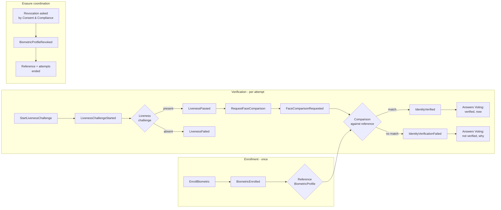
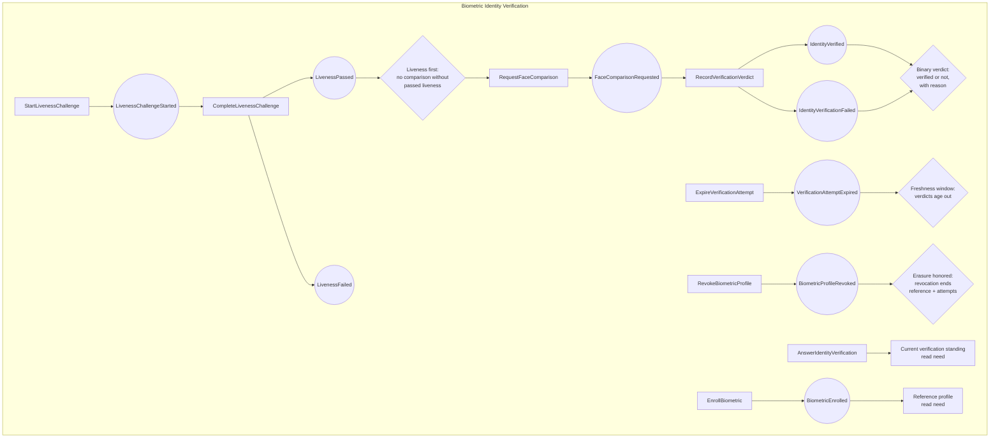

# Biometric Identity Verification — Event Storming

This is the Big Picture + Design Level storming of a Supporting Subdomain. Pure domain language only.
It names no framework, library, storage, transport, or module structure.

Reference input `docs/BrainStorming/VotoChain_DDD_Subdomains.md` §4 (+ §5 generic provider, §12 consent,
§15 correlation) was treated as hypothesis, not truth. Deviations are logged as Hotspots.

> Do not confuse with `Verification (OTP)` — this context verifies **physical identity**
> (a live person matching a reference face); OTP validates **possession of a channel**
> (email/phone). Consent for processing biometric data lives in `Consent & Compliance`;
> this context only verifies assuming consent was already granted.

## Big Picture

## Design Level

## Commands

| # | Command | Intent | Actor |
|---|---------|--------|-------|
| 1 | `EnrollBiometric` | Establish the person's reference `BiometricProfile`, once | Person (assisted) |
| 2 | `StartLivenessChallenge` | Open a short presence-proof interaction | Person |
| 3 | `CompleteLivenessChallenge` | Close the interaction with present/absent outcome | Liveness observation |
| 4 | `RequestFaceComparison` | Ask whether a live capture matches the reference | Verification flow (after passed liveness) |
| 5 | `RecordVerificationVerdict` | Freeze the binary outcome of one attempt | Verification flow |
| 6 | `ExpireVerificationAttempt` | Age out an attempt whose freshness window elapsed | Time |
| 7 | `RevokeBiometricProfile` | End the reference and all open attempts on coordinated erasure | Consent & Compliance coordination |
| 8 | `AnswerIdentityVerification` | Answer whether the person is verified now, and why | Voting (authorization gate) |

## Domain Events (Facts)

| # | Fact | Meaning |
|---|------|---------|
| 1 | `BiometricEnrolled` | A reference `BiometricProfile` now exists for the person. Never holds raw images |
| 2 | `LivenessChallengeStarted` | A presence-proof interaction opened |
| 3 | `LivenessPassed` | Real physical presence observed in this interaction |
| 4 | `LivenessFailed` | Presence not observed; this interaction is over |
| 5 | `FaceComparisonRequested` | A match question asked against the reference (only after passed liveness) |
| 6 | `IdentityVerified` | One attempt concluded: the live person matches the reference, within the freshness window |
| 7 | `IdentityVerificationFailed` | One attempt concluded: no match (or liveness failed), with reason |
| 8 | `VerificationAttemptExpired` | An attempt aged out unused; it can no longer authorize anything |
| 9 | `BiometricProfileRevoked` | The reference ended plus open attempts closed, on coordinated erasure |

## Policies (Whenever / Then)

| # | Whenever… | Then… |
|---|-----------|-------|
| P1 | Liveness passed for this interaction | A face comparison may be requested; without passed liveness it is refused |
| P2 | A verification verdict is recorded | It is binary — verified or not, with reason — and Voting authorizes only on a fresh `verified` |
| P3 | Revocation is coordinated (erasure confirmed) | The reference ends and open attempts close from that moment; past verdicts stay history |
| P4 | A verdict ages past the freshness window | It no longer authorizes; a new interaction is required |

## Read Needs

| Need | Returns |
|------|---------|
| Reference profile | Whether a `BiometricProfile` exists for the person (never its content details beyond standing) |
| Current verification standing | Verified now or not, with reason and freshness — the answer Voting consumes |
| Attempt history (scrutiny) | The attempts and verdicts behind a past authorization |

## Needs from Other Contexts (business language, not mechanisms)

| Need | From | Why |
|------|------|-----|
| Consent granted for biometric processing | Consent & Compliance | Verification only runs while consent for this scope stands |
| Document + face-match outcome | Document OCR & Face Match Provider (generic) | The comparison detail this context orchestrates around, referenced not owned |
| Person existence | IAM (identity reference) | A profile belongs to exactly one person |
| Erasure coordination | Consent & Compliance | Revocation asked here once an erasure request is confirmed |
| Fresh verified answer | (offered to) Voting | Gates `VoteAuthorization` issuance |

## Hotspots & Open Questions

| # | Matter | Standing |
|---|--------|----------|
| H1 | Reference never holds raw images (doc §4.3 invariant) — how far does the prohibition reach (captures, intermediate crops, descriptors)? | Open — needs product + legal; default: reference holds only what matching needs, nothing viewable as a face |
| H2 | Who owns the match-confidence threshold — this context or the generic provider? | Open — default: provider reports a score, this context judges pass/fail against its own bar |
| H3 | Freshness window: how long does one `verified` verdict authorize (minutes, single vote, single session)? | Open — needs product decision; default: one verdict authorizes one authorization, then ages out |
| H4 | Re-enrollment after revocation: new reference allowed, and does history link? | Open — default: allowed as a new enrollment; revoked history stays ended |
| H5 | Failed-attempt discipline: how many failures before a pause, and who is told? | Open — needs product decision |

## Related Documentation

| Document | Link |
|----------|------|
| Voting event storming (consumer of verdicts) | `../voting-verifiable-ledger/event-storming.md` |
| Consent & Compliance event storming (sibling, consent + erasure) | `../consent-compliance/event-storming.md` |
| Subdomain map (input, hypothesis) | `docs/BrainStorming/VotoChain_DDD_Subdomains.md` §4 + §5 + §12 + §15 |
| Modeling example (shape reference) | `docs/References/event-storming.md` |
