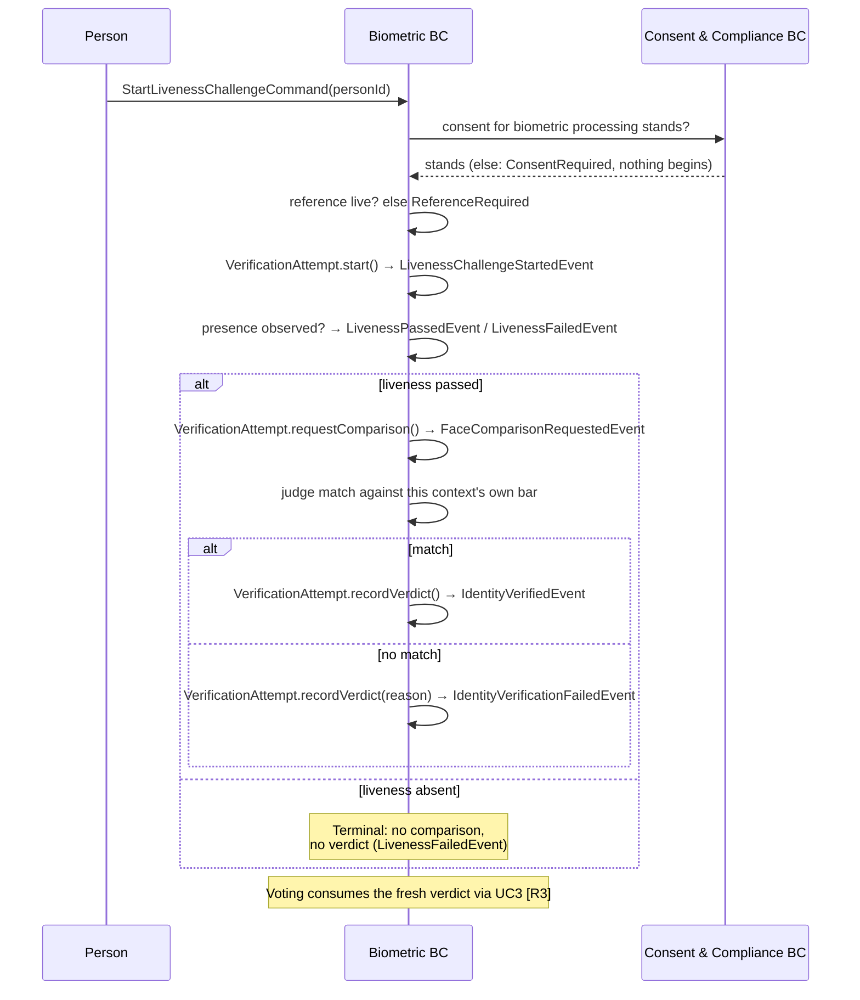

# Biometric Identity Verification — Application Layer

This document describes **orchestration**, not business meaning. It answers: in what
order do things happen, who calls whom, and what crosses this bounded context's
boundary to prove one live person. It names no framework, transport, or storage —
same discipline as `domain-model.md`.

Source of business meaning: `domain-model.md` (this same folder). This document adds
nothing new to *what the aggregates can do*; it only sequences calls to aggregates and
to other bounded contexts, per the rules already frozen in `context-mapping.md`.

A use case here is triggered either by an external request (synchronous) or by a fact
this context reacts to (event-driven). Both are documented the same way.

Naming convention (frozen for all `use-case.md` documents): commands are
`Action+Target+Command` (e.g. `CreateOrderCommand`), events are
`Target+PastAction+Event` (e.g. `OrderCreatedEvent`), queries are
`Action+Target+Criteria+Query` (e.g. `GetOrderByIdQuery`). A query name may grow
whenever the criteria need declaring.

> This context verifies **physical identity** (a live person matching a reference).
> Channel possession (email/phone) belongs to Verification (OTP) — the two are never
> confused here.

---

## 1. Use Case Catalog

| # | Use Case | Trigger | Aggregates Touched | External BCs Consulted | Facts Produced |
|---|----------|---------|--------------------|-------------------------|-----------------|
| UC1 | EnrollBiometric | Person request (assisted) | `BiometricProfile` | Consent & Compliance (consent stands), Document OCR (single-use `MATCH` seeds the reference), IAM (person existence) | `BiometricEnrolledEvent` |
| UC2 | **VerifyIdentity** (anchor) | Person request: liveness → comparison → verdict | `VerificationAttempt` | Consent & Compliance (consent stands) | `LivenessChallengeStartedEvent`, `LivenessPassedEvent` / `LivenessFailedEvent`, `FaceComparisonRequestedEvent`, `IdentityVerifiedEvent` / `IdentityVerificationFailedEvent` |
| UC3 | AnswerIdentityVerification | Voting authorization-gate check | `VerificationAttempt` (answering operation only) | — | — (synchronous answer, no fact) |
| UC4 | ExpireAttempt | Time sweep (freshness window elapsed) | `VerificationAttempt` | — | `VerificationAttemptExpiredEvent` |
| UC5 | RevokeBiometricProfile | Reacts to erasure coordination confirmed (Consent & Compliance) | `BiometricProfile`, `VerificationAttempt` | Consent & Compliance (coordination) | `BiometricProfileRevokedEvent` (+ `VerificationAttemptExpiredEvent` per open attempt) |

UC2 is detailed fully below because the liveness-first → comparison → frozen-verdict
ordering is the orchestration most likely to be gotten wrong. UC5 gets a second
sequence because it is the one flow that touches both aggregates at once.

---

## 2. Commands & Queries Accepted (Input Contracts)

These are the intentions this bounded context accepts from outside — not to be
confused with the aggregate operations in `domain-model.md`, which are internal.

### Commands

| Command | Carries | Handled By |
|---------|---------|------------|
| `EnrollBiometricCommand` | personId | UC1 |
| `StartLivenessChallengeCommand` | personId | UC2 (entry — the attempt journey follows on observed outcomes) |
| `RevokeBiometricProfileCommand` | profileId | UC5 |

UC2's later steps (liveness outcome, comparison, verdict) proceed on observed results
inside the attempt journey, not on separate external commands — same treatment as
Relay's outcome recording. UC4 accepts no external command: it is a time-triggered
sweep. UC5 is triggered by the erasure-coordination fact from Consent & Compliance.

### Queries

| Query | Returns | Backing Read Need (domain-model.md) |
|-------|---------|--------------------------------------|
| `GetVerificationStandingByPersonQuery` | Verified now or not, with reason and freshness | "Current verification standing" |
| `GetReferenceStandingByPersonQuery` | Whether a live reference exists for the person (never content details beyond standing) | "Reference profile" |
| `GetAttemptHistoryByPersonQuery` | The attempts and verdicts behind a past authorization | "Attempt history (scrutiny)" |

UC3 is served by the attempt's answering operation `answerStanding()` — it judges the
fresh verdict and answers; it mutates nothing and produces no fact.

---

## 3. Use Case Detail — UC2: VerifyIdentity (anchor)

### Preconditions

| # | Precondition | Checked Against |
|---|---------------|------------------|
| 1 | Consent for biometric processing stands | Consent & Compliance (gated before anything begins) |
| 2 | A live (`ENROLLED`) reference exists for the person | `BiometricProfile` |
| 3 | No rule of the attempt's standing is skipped: liveness passes before any comparison is asked | `VerificationAttempt` (liveness-first, invariant 2) |

### Sequence



### Steps (Business Language)

| Step | Action | Facts / Failure |
|------|--------|------------------|
| 1 | Confirm consent for biometric processing stands | Otherwise: `ConsentRequired` — nothing begins, no attempt opened |
| 2 | Confirm a live reference exists for the person | Otherwise: `ReferenceRequired` |
| 3 | `start()` — opens one attempt bound to this person and this reference | `LivenessChallengeStartedEvent` |
| 4 | `completeLiveness()` — closes the presence-proof interaction with present/absent | `LivenessPassedEvent` or `LivenessFailedEvent` (terminal: no comparison follows) |
| 5 | `requestComparison()` — only from `LIVENESS_PASSED`, only against a still-live reference | `FaceComparisonRequestedEvent`; otherwise `LivenessRequired` / `ReferenceEnded` |
| 6 | `recordVerdict()` — freezes the binary outcome with reason and freshness | `IdentityVerifiedEvent` or `IdentityVerificationFailedEvent` |
| 7 | Voting reads the fresh verdict through UC3 (`answerStanding()`) | Only a fresh `VERIFIED` authorizes; stale verdicts answer history (`VerdictExpired`) |

### What This Use Case Does *Not* Do

- Does not judge consent (Consent & Compliance owns it — this context only checks that it stands).
- Does not validate channel possession (OTP's concern — physical identity only).
- Does not let Voting re-judge liveness or comparison (Voting consumes the verdict answer via R3, never the mechanics).
- Does not carry anything image-like across any boundary (captures and comparisons stay inside; only the verdict fact leaves).

### Concurrency & Idempotency

- Each attempt concludes at most once: a second verdict recording against an already
  terminal attempt fails (`AttemptConcluded`) — verdicts are frozen, never edited.
- A verdict authorizes only while fresh: two authorizations racing one aging verdict
  resolve by freshness at answer time — the one answered before expiry authorizes, the
  one after does not (`VerdictExpired`), and a new interaction is required.
- Revocation landing mid-attempt closes the open attempt (`expire()` with
  `REFERENCE_ENDED`) but never rewrites an already-concluded verdict (invariant 6).

### Open Orchestration Questions

- Freshness window length — one authorization then ages out by default, time-boxed
  alternative parked (domain-model.md, Open Question #2) — needs product decision.
- Failed-attempt discipline — how many failures before a pause, who is told, cooling
  period (Open Question #3) — needs product decision.
- Which comparison detail (score, threshold version) the scrutiny record must keep
  (Open Question #4) — needs product + legal.

---

## 4. Use Case Detail — UC5: RevokeBiometricProfile

Second sequence: the one flow touching both aggregates at once.

```mermaid
sequenceDiagram
    participant Consent as Consent & Compliance BC
    participant BIO as Biometric BC

    Consent->>BIO: erasure confirmed → RevokeBiometricProfileCommand(profileId)
    BIO->>BIO: BiometricProfile.revoke() → BiometricProfileRevokedEvent
    BIO->>BIO: every open attempt: expire() → VerificationAttemptExpiredEvent (REFERENCE_ENDED)
    BIO-->>Consent: revocation confirmation (this owner's part done)
    Note over BIO: Concluded verdicts stay history;<br/>re-enrollment creates a new reference
```

Erasure is honored from that moment: the reference ends and open attempts close, past
verdicts stay history, and a later re-enrollment creates a new reference rather than
reopening the revoked one (domain-model.md, H5).

---

## 5. ACL Published (What This BC Exposes)

| Capability | Consumer (per context-mapping.md) | Notes |
|---|---|---|
| Verified-now answer (`answerStanding()`) | Voting (authorization gate, UC3, R3) | Fresh `VERIFIED` with reason and freshness — fact only, no mechanics |
| Revocation confirmation | Consent & Compliance (erasure coordination) | `BiometricProfileRevokedEvent` confirms this owner's part once revoked |

## 6. ACL Consumed (What This BC Depends On)

| Dependency | Pattern (context-mapping.md) | Used In |
|---|---|---|
| Consent & Compliance → Biometric (consent stands / erasure coordination) | Partnership / coordination | UC1, UC2 (gate: `may-process-now?`), UC5 (revocation asked once erasure confirmed) |
| Document OCR → Biometric (single-use `MATCH`) | Customer/Supplier (R7) | UC1 — the verdict crosses once and seeds the lasting reference; nothing image-like crosses |
| IAM → Biometric (person existence) | Identity reference | UC1, UC2 — a profile and an attempt each belong to exactly one person |

Every row here is a consequence of a relationship already frozen in
`context-mapping.md` — this table only says *which use case* is the one that actually
makes the call.

---

## Related Documentation

| Document | Link |
|----------|------|
| Domain model (source of aggregate behavior) | `domain-model.md` |
| Event Storming | `event-storming.md` |
| Context map + relationship catalog (source of R1–R14) | `context-mapping.md` |
| Consolidated ubiquitous language | `ubiquitous-language.md` |
