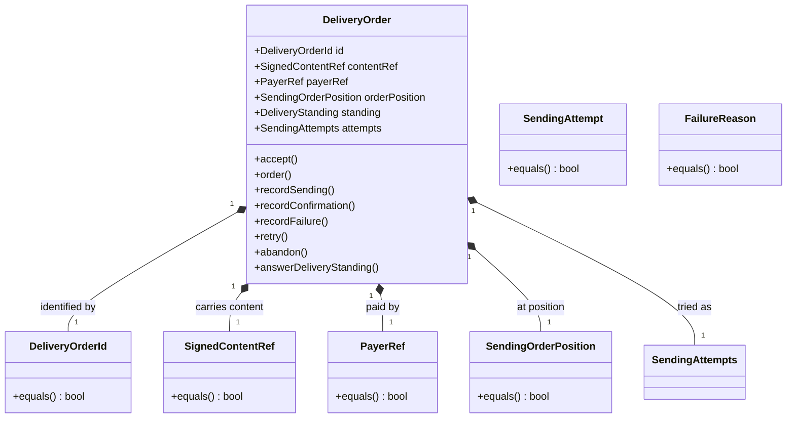
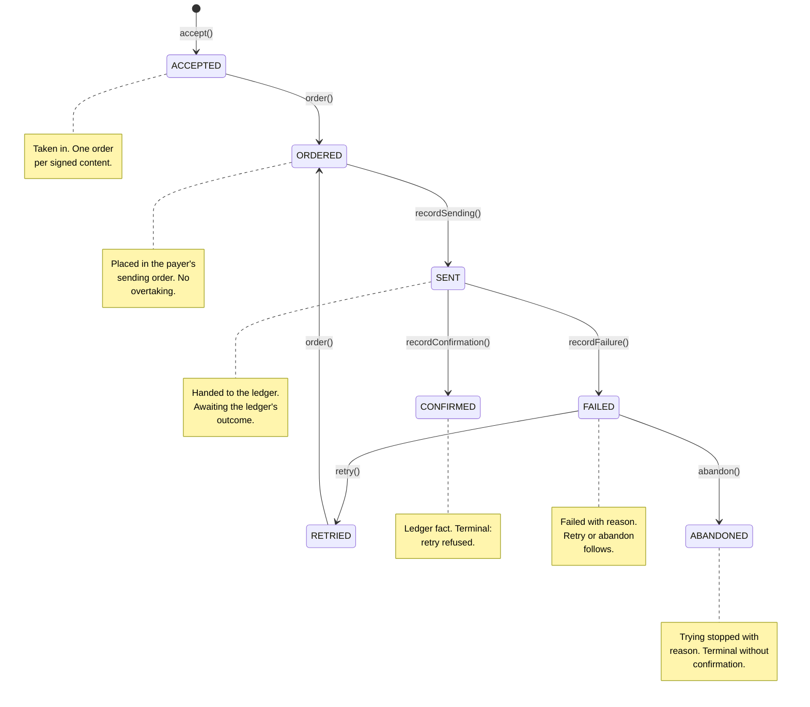
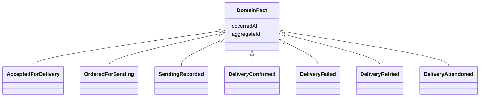

# Blockchain Relay & Transaction Delivery — Domain Model

This is the domain model of a Supporting Subdomain. It describes business meaning only:
the aggregate, its operations, value objects, domain facts (events), business rules,
and business rejections. It names no framework, library, storage, transport, or module structure.

Source: `event-storming.md` in this same folder (v0.1.0).
Reference input `docs/BrainStorming/VotoChain_DDD_Subdomains.md` §6 (+ §2 voting orchestration,
§15 correlation) was treated as hypothesis; deviations are logged under Hotspots.

> This context carries **already-signed** vote content to the shared ledger and reports what happened.
> It never signs vote content, never decides what a vote means, and never tallies.

## Aggregate Overview

One small aggregate. Each delivery order is a consistency boundary for exactly one signed content's
journey to the ledger. Sendings, failures, and retries live inside this boundary as an ordered list of
attempts — not as separate aggregates — because retry must preserve the at-most-once on-ledger effect,
which is one consistency decision. The order references the signed content and the payer capability by
identity only — never by embedding.

---

## Aggregate: DeliveryOrder

### Identity & Lifecycle

| Property | Meaning |
|----------|---------|
| `id` | Identity of this delivery order. Stable for its whole life, never reused |
| `contentRef` | The already-signed vote content carried (identity reference only; content owned by Voting) |
| `payerRef` | The payer capability paying for sending (identity reference only; never the voter's signing capability) |
| `orderPosition` | This order's position in its payer's sending order |
| `standing` | Where the delivery stands (see state machine) |
| `attempts` | The ordered list of sendings tried, each with position, outcome, and reason |

### State Machine: DeliveryStanding

### Invariants (Always True)

| # | Invariant |
|---|-----------|
| 1 | One order carries exactly one signed content, and one signed content has at most one open order. Content arrives signed or it is refused — this boundary never signs and never rewords |
| 2 | Orders sharing one payer are sent in sending-order position with no overtaking: a later order never passes an earlier one from the same payer |
| 3 | Each retry preserves the at-most-once on-ledger effect. Retries are recorded inside the same order, never as a second order for the same content |
| 4 | `CONFIRMED` is terminal: confirmed stays confirmed, and retry after confirmation is refused |
| 5 | `ABANDONED` is terminal without confirmation, and always carries a reason |
| 6 | The payer is never the voter's signing capability. Signing and paying stay separated across contexts |

### Mutating Operations

| Operation | Preconditions | Facts Produced |
|-----------|---------------|----------------|
| `accept()` | Content arrives already signed; no open order for the same content | `AcceptedForDelivery` |
| `order()` | Standing is `ACCEPTED` or `RETRIED`; position is the payer's next free position | `OrderedForSending` |
| `recordSending()` | Standing is `ORDERED` | `SendingRecorded` |
| `recordConfirmation()` | Standing is `SENT`; ledger confirms exactly this order | `DeliveryConfirmed` |
| `recordFailure()` | Standing is `SENT`; ledger outcome observed as failure | `DeliveryFailed` |
| `retry()` | Standing is `FAILED`; failure is retryable; retry bound not reached | `DeliveryRetried` |
| `abandon()` | Standing is `FAILED`; failure is terminal or retry bound reached; reason recorded | `DeliveryAbandoned` |

### Answering Operations (Read, but Owned by the Aggregate)

| Operation | Preconditions | Answers |
|-----------|---------------|---------|
| `answerDeliveryStanding()` | Always answerable | Awaiting, confirmed, failed (with reason), or abandoned (with reason) — the answer Voting consumes |

### Read Needs (What the Domain Must Be Able to Answer)

| Need | Returns |
|------|---------|
| Delivery standing | Awaiting, confirmed, failed (with reason), or abandoned (with reason) |
| Sending order per payer | Which orders are placed, sent, and still awaiting — explains why a later order waits |
| Attempt history (scrutiny) | The sendings, failures, retries, and confirmation behind a past delivery |

---

## Value Objects

No identity; defined entirely by attributes; immutable; invalid values are unrepresentable.

### DeliveryOrderId / SignedContentRef / PayerRef

- The stable identities of delivery orders, signed contents, and payer capabilities.
- Equality is by value. Distinct kinds are never interchangeable.
- Content is owned by Voting and the payer capability lives in Wallet Custody; both are held here as references only.

### SendingOrderPosition

- This order's sequential position in its payer's sending order (the domain rephrase of the
  per-payer sequence counter: order + no-overtaking kept, mechanism name dropped).
- Positions are dense per payer: the next order takes the next free position.

### SendingCost

- What sending this order costs (the domain rephrase of the network fee: cost-of-sending kept,
  pricing detail left to observe).
- A cost that cannot be covered is a failure with reason, never a silent wait.

### SendingAttempt

- One recorded try inside an order: its position, its outcome (sent / failed), and its reason.
- Immutable and append-only; retries add attempts, never edit past ones.

### FailureReason

- Why a sending did not confirm: `LEDGER_REJECTED`, `COST_EXHAUSTED`, `RETRY_LIMIT_REACHED`, `ORDER_SUPERSEDED`.
- Told in business terms; the retry-vs-abandon decision is answerable from this object plus the retry bound.

### Status Enumerations

- `DeliveryStanding` — `ACCEPTED`, `ORDERED`, `SENT`, `CONFIRMED`, `FAILED`, `RETRIED`, `ABANDONED`.

---

## Domain Events (Facts)

Past tense. Immutable. Each carries enough business data that consumers do not need to ask again for the common cases. Each is produced by exactly one aggregate operation.

| Event | Payload (business data) | Produced By | Interested Parties |
|-------|-------------------------|-------------|--------------------|
| `AcceptedForDelivery` | order, content reference, payer reference | `DeliveryOrder.accept()` | Sending order, scrutiny record |
| `OrderedForSending` | order, payer reference, order position | `DeliveryOrder.order()` | Sending order (why a later order waits) |
| `SendingRecorded` | order, attempt | `DeliveryOrder.recordSending()` | Attempt history (awaiting outcome) |
| `DeliveryConfirmed` | order, content reference | `DeliveryOrder.recordConfirmation()` | Voting (counts only confirmed), scrutiny record |
| `DeliveryFailed` | order, attempt, reason | `DeliveryOrder.recordFailure()` | Delivery flow (retry or abandon), person notice |
| `DeliveryRetried` | order, new attempt | `DeliveryOrder.retry()` | Sending order, attempt history |
| `DeliveryAbandoned` | order, reason | `DeliveryOrder.abandon()` | Voting (abandoned with reason), person notice |

---

## Business Rules (Policies)

Stated as domain rules. No mechanism named.

| Rule | Whenever… | Then… |
|------|-----------|-------|
| Signed only | Content arrives for delivery | It is carried only if already signed; this boundary never signs and never rewords |
| Ordered sending | Orders share one payer | They go in sending-order position with no overtaking |
| Confirmation is terminal | A confirmation is recorded | It stays: the order is a ledger fact, and retry after confirmation is refused |
| Retry preserves at-most-once | A failure is retryable | The order is tried again inside the same boundary so its on-ledger effect happens at most once; terminal failures abandon with reason |

---

## Business Rejections

What the domain refuses, and why. These are business outcomes, not transport codes.

| Rejection | Meaning |
|-----------|---------|
| `UnsignedContentRefused` | Intake asked for content that is not already signed |
| `OrderAlreadyAccepted` | Accept asked while an open order already exists for the same content |
| `OvertakingRefused` | Ordering asked at a position that would pass an earlier order from the same payer |
| `OrderConcluded` | Any mutation asked of a `CONFIRMED` or `ABANDONED` order |
| `RetryAfterConfirmationRefused` | Retry asked after confirmation |
| `RetryLimitReached` | Retry asked past the retry bound — the order must abandon with reason |
| `OrderNotFound` | A read refers to an order that does not exist |

---

## Hotspots & Deviations from the Reference Input

| # | Matter | Position in this model |
|---|--------|------------------------|
| H1 | Reference lists relay mechanics (ordered work list, sequence counter, network fee) | All rephrased as domain language carried from storming: payer's sending order, sending order position, sending cost. Ordering + no-overtaking + cost kept; mechanism names dropped |
| H2 | One aggregate or order + attempt? | One aggregate. Retry's at-most-once effect is one consistency decision; attempts live inside as an immutable append-only list, not as separate boundaries |
| H3 | Retry bound shape (count, time, or both) | Bounded retries, then abandon with reason (default). Exact bound open — needs product decision |
| H4 | Cost exhaustion: wait, abandon, or ask for more? | Failure with reason (default: abandon or wait per reason). Needs product decision |

## Open Questions

| # | Question | Standing |
|---|----------|----------|
| 1 | Retry bound: how many retries, over how long, before abandonment? | Open — needs product decision |
| 2 | Cost exhaustion: an order cannot be covered — wait, abandon, or ask for more? | Open — needs product decision |
| 3 | In-flight deliveries at erasure time: is confirmation still recorded as ledger fact? | Open — needs product + legal (ledger facts cannot be un-happened) |
| 4 | Which failure/abandonment reasons must the voter be told, and in which form? | Open — needs product decision |
| 5 | Sending order scope: per payer only, or also global fairness across payers? | Open — needs product decision |

## Related Documentation

| Document | Link |
|----------|------|
| Event Storming (this bounded context) | `event-storming.md` |
| Wallet event storming (sibling, signs what this context carries) | `../cryptographic-wallet-custody/event-storming.md` |
| Wallet domain model (sibling) | `../cryptographic-wallet-custody/domain-model.md` |
| Voting event storming (consumer of delivery standing) | `../voting-verifiable-ledger/event-storming.md` |
| Subdomain map (input, hypothesis) | `docs/BrainStorming/VotoChain_DDD_Subdomains.md` §2 + §6 + §15 |
| Modeling example (shape reference) | `docs/References/domain-model.md` |
