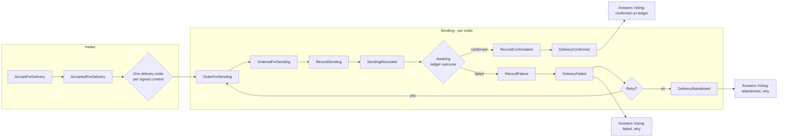
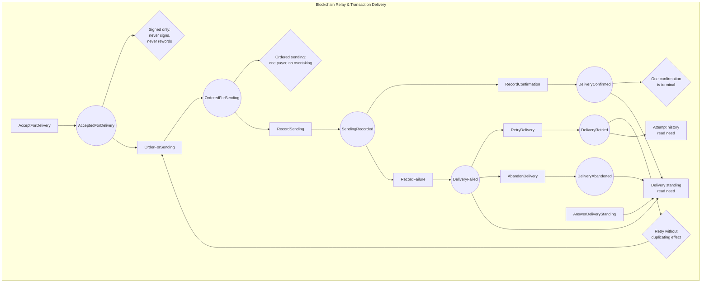

# Blockchain Relay & Transaction Delivery — Event Storming

This is the Big Picture + Design Level storming of a Supporting Subdomain. Pure domain language only.
It names no framework, library, storage, transport, or module structure.

Reference input `docs/BrainStorming/VotoChain_DDD_Subdomains.md` §6 (+ §2 voting orchestration,
§15 correlation) was treated as hypothesis, not truth. Deviations are logged as Hotspots.

> This context carries **already-signed** vote content to the shared ledger and reports what happened.
> It never signs vote content, never decides what a vote means, and never tallies. Signing belongs to
> `Cryptographic Wallet Custody`; meaning and counting belong to `Voting & Verifiable Ledger`.

## Big Picture

## Design Level

## Commands

| # | Command | Intent | Actor |
|---|---------|--------|-------|
| 1 | `AcceptForDelivery` | Take in one already-signed vote content for transport | Voting (delivery need) |
| 2 | `OrderForSending` | Place the order in its payer's sending order (no overtaking) | Delivery flow (once accepted or retried) |
| 3 | `RecordSending` | Record that the order was handed to the ledger | Delivery flow |
| 4 | `RecordConfirmation` | Record the ledger's confirmation of exactly this order | Ledger outcome (observed) |
| 5 | `RecordFailure` | Record that the sending failed, with reason | Ledger outcome (observed) |
| 6 | `RetryDelivery` | Try the failed order again without duplicating its on-ledger effect | Delivery flow (on retryable failure) |
| 7 | `AbandonDelivery` | Stop trying an order that will not succeed, with reason | Delivery flow (on terminal failure or retry limit) |
| 8 | `AnswerDeliveryStanding` | Answer where one delivery stands: awaiting, confirmed, failed, or abandoned | Voting (delivery gate) |

## Domain Events (Facts)

| # | Fact | Meaning |
|---|------|---------|
| 1 | `AcceptedForDelivery` | One signed content taken in; one delivery order now exists for it |
| 2 | `OrderedForSending` | The order placed in its payer's sending order position |
| 3 | `SendingRecorded` | The order handed to the ledger; awaiting the ledger's outcome |
| 4 | `DeliveryConfirmed` | The ledger confirmed exactly this order. Terminal: the vote is now a ledger fact |
| 5 | `DeliveryFailed` | The sending failed with reason; retry or abandonment follows |
| 6 | `DeliveryRetried` | A failed order tried again; on-ledger effect still at most once |
| 7 | `DeliveryAbandoned` | Trying stopped with reason; terminal without confirmation |

## Policies (Whenever / Then)

| # | Whenever… | Then… |
|---|-----------|-------|
| P1 | Content arrives for delivery | It is carried only if already signed; this context never signs and never rewords content |
| P2 | Orders share one payer | They are sent in sending-order position with no overtaking; a later order never passes an earlier one from the same payer |
| P3 | A confirmation is recorded | It is terminal for that order: confirmed stays confirmed, and retry after confirmation is refused |
| P4 | A failure is retryable | The order is tried again such that its on-ledger effect happens at most once; terminal failures abandon with reason |

## Read Needs

| Need | Returns |
|------|---------|
| Delivery standing | Awaiting, confirmed, failed (with reason), or abandoned (with reason) — the answer Voting consumes |
| Sending order per payer | Which orders are placed, sent, and still awaiting — explains why a later order waits |
| Attempt history (scrutiny) | The sendings, failures, retries, and confirmation behind a past delivery |

## Needs from Other Contexts (business language, not mechanisms)

| Need | From | Why |
|------|------|-----|
| Already-signed vote content | Voting | Transport only; signing happened before intake |
| Payer capability (pays for sending) | Cryptographic Wallet Custody (separate payer capability) | Sending is paid by the payer, never by the voter's signing capability |
| Ledger outcome (confirmed / failed) | Shared ledger (observed, referenced not owned) | Confirmation shifts truth from intent to ledger fact |
| (Offers) Delivery standing | (offered to) Voting | Voting counts only confirmed deliveries |

## Hotspots & Open Questions

| # | Matter | Standing |
|---|--------|----------|
| H1 | Reference "ordered work list backed by an in-memory store" rephrased as "payer's sending order" | Deliberate rephrase: ordering + no-overtaking kept, mechanism dropped. No behavior change intended |
| H2 | Reference "Nonce" rephrased as "sending order position" | Deliberate rephrase: sequential per-payer position kept as domain language |
| H3 | Reference "Gas" rephrased as "sending cost" | Deliberate rephrase: cost-of-sending kept, network pricing detail left to observe |
| H4 | Retry limits: how many retries, over how long, before abandonment? | Open — needs product decision; default: bounded retries, then abandon with reason |
| H5 | Cost exhaustion: an order cannot be paid for — wait, abandon, or ask for more? | Open — needs product decision |
| H6 | In-flight deliveries at erasure time: confirmation still recorded as ledger fact? | Open — needs product + legal (ledger facts cannot be un-happened) |

## Related Documentation

| Document | Link |
|----------|------|
| Wallet event storming (sibling, signs what this context carries) | `../cryptographic-wallet-custody/event-storming.md` |
| Voting event storming (consumer of delivery standing) | `../voting-verifiable-ledger/event-storming.md` |
| Subdomain map (input, hypothesis) | `docs/BrainStorming/VotoChain_DDD_Subdomains.md` §2 + §6 + §15 |
| Modeling example (shape reference) | `docs/References/event-storming.md` |
