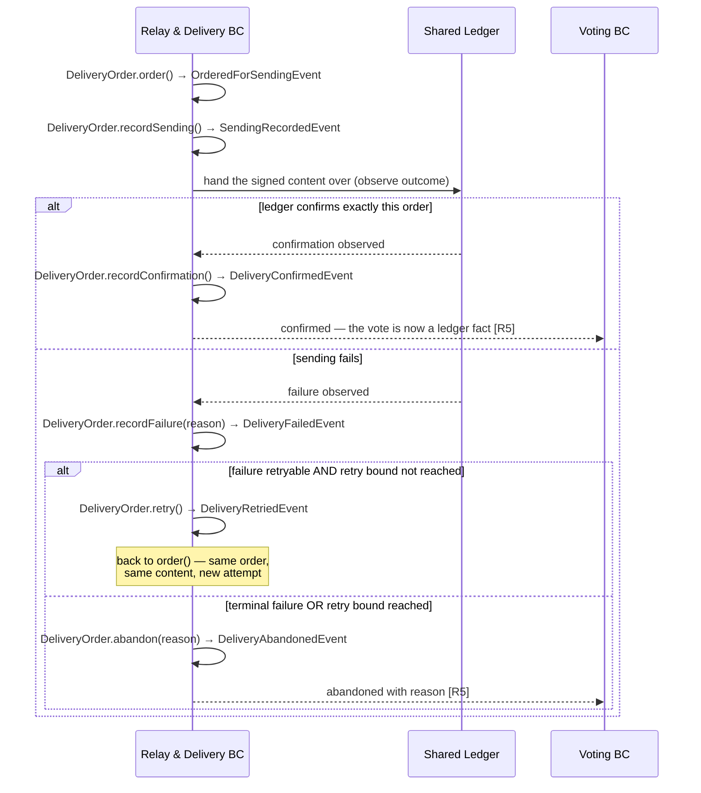

# Blockchain Relay & Transaction Delivery — Application Layer

This document describes **orchestration**, not business meaning. It answers: in what
order do things happen, who calls whom, and what crosses this bounded context's
boundary to carry one signed content to the ledger. It names no framework, transport,
or storage — same discipline as `domain-model.md`.

Source of business meaning: `domain-model.md` (this same folder). This document adds
nothing new to *what the aggregate can do*; it only sequences calls to the aggregate
and to other bounded contexts, per the rules already frozen in `context-mapping.md`.

A use case here is triggered either by an external request (synchronous) or by a fact
this context reacts to (event-driven). Both are documented the same way.

Naming convention (frozen for all `use-case.md` documents): commands are
`Action+Target+Command` (e.g. `CreateOrderCommand`), events are
`Target+PastAction+Event` (e.g. `OrderCreatedEvent`), queries are
`Action+Target+Criteria+Query` (e.g. `GetOrderByIdQuery`). A query name may grow
whenever the criteria need declaring.

---

## 1. Use Case Catalog

| # | Use Case | Trigger | Aggregates Touched | External BCs Consulted | Facts Produced |
|---|----------|---------|--------------------|-------------------------|-----------------|
| UC1 | AcceptDelivery | Voting request, with already-signed content | `DeliveryOrder` | Voting (the signed content) | `AcceptedForDeliveryEvent` |
| UC2 | **DeliverOrder** (anchor) | Follows acceptance (or a retry decision): order → send → ledger outcome → confirm, retry, or abandon | `DeliveryOrder` | Shared ledger (outcome observed) | `OrderedForSendingEvent`, `SendingRecordedEvent`, then `DeliveryConfirmedEvent` or `DeliveryFailedEvent` (+ `DeliveryRetriedEvent` / `DeliveryAbandonedEvent`) |
| UC3 | AnswerDeliveryStanding | Voting delivery-gate check | `DeliveryOrder` (answering operation only) | — | — (synchronous answer, no fact) |

UC2 is detailed fully below because the ordered-sending + at-most-once-retry +
terminal-confirmation loop is the orchestration in this context most likely to be
gotten wrong: overtaking a payer's earlier order, duplicating the on-ledger effect on
retry, or retrying after confirmation would each break a load-bearing invariant. This
context holds a single aggregate, so there is no second multi-aggregate sequence to
detail.

---

## 2. Commands & Queries Accepted (Input Contracts)

These are the intentions this bounded context accepts from outside — not to be
confused with the aggregate operations in `domain-model.md`, which are internal.

### Commands

| Command | Carries | Handled By |
|---------|---------|------------|
| `AcceptForDeliveryCommand` | signed content reference, payer reference | UC1 |

UC2's steps are triggered by the context's own flow and by observed ledger outcomes
(recorded via `recordSending()`, `recordConfirmation()`, `recordFailure()`), not by
external commands: ordering, sending, retrying, and abandoning are reactions inside
the delivery journey, each guarded by the aggregate's standing.

### Queries

| Query | Returns | Backing Read Need (domain-model.md) |
|-------|---------|--------------------------------------|
| `GetDeliveryStandingByOrderQuery` | Awaiting, confirmed, failed (with reason), or abandoned (with reason) | "Delivery standing" |
| `GetSendingOrderByPayerQuery` | Which orders are placed, sent, and still awaiting — explains why a later order waits | "Sending order per payer" |
| `GetAttemptHistoryByOrderQuery` | The sendings, failures, retries, and confirmation behind a past delivery | "Attempt history (scrutiny)" |

UC3 is served by the aggregate's answering operation `answerDeliveryStanding()` — it
judges standing and answers; it mutates nothing and produces no fact.

---

## 3. Use Case Detail — UC2: DeliverOrder (anchor)

### Preconditions

| # | Precondition | Checked Against |
|---|---------------|------------------|
| 1 | Order exists and standing is `ACCEPTED` (fresh) or `RETRIED` (bounded retry) | `DeliveryOrder` |
| 2 | No open order already exists for the same signed content | `DeliveryOrder` (one order per content, invariant 1) |
| 3 | The order's position is its payer's next free position — no earlier order from the same payer is passed | `DeliveryOrder.orderPosition` + payer's sending order |

### Sequence

### Steps (Business Language)

| Step | Action | Facts / Failure |
|------|--------|------------------|
| 1 | Confirm standing `ACCEPTED` or `RETRIED` and the payer's next free position; refuse overtaking | Otherwise: `OvertakingRefused` (position would pass an earlier order) or `OrderConcluded` (already `CONFIRMED`/`ABANDONED`) |
| 2 | `order()` — places the order in its payer's sending order | `OrderedForSendingEvent` |
| 3 | `recordSending()` — records the handover to the ledger with this attempt | `SendingRecordedEvent` |
| 4 | Observe the ledger's outcome for exactly this order | Confirmation and failure are observed facts, never invented here |
| 5a | On confirmation: `recordConfirmation()` — terminal | `DeliveryConfirmedEvent`; Voting counts only this (R5) |
| 5b | On failure: `recordFailure(reason)` — with a business reason (`LEDGER_REJECTED`, `COST_EXHAUSTED`, `RETRY_LIMIT_REACHED`, `ORDER_SUPERSEDED`) | `DeliveryFailedEvent` |
| 6 | On retryable failure within bound: `retry()` — same order, new attempt, on-ledger effect still at most once | `DeliveryRetriedEvent`, back to step 1 |
| 7 | On terminal failure or exhausted bound: `abandon(reason)` — terminal without confirmation | `DeliveryAbandonedEvent`, answered to Voting with reason |

### What This Use Case Does *Not* Do

- Does not sign or reword content (UC1 already refused anything not already signed — `UnsignedContentRefused`).
- Does not open a second order for the same content on retry (`OrderAlreadyAccepted` — retries live inside the same order as appended attempts).
- Does not retry after confirmation (`RetryAfterConfirmationRefused` — confirmed stays confirmed).
- Does not decide what the vote means or tally it (Voting's concern — this context answers standing only).

### Concurrency & Idempotency

- Two orders sharing one payer are ordered by position, never by arrival speed: a later
  order that would pass an earlier unordered one fails at step 1 (`OvertakingRefused`)
  and waits for its position — position assignment, not wall-clock order, decides.
- A confirmation and a retry racing each other resolve by standing: if
  `recordConfirmation()` lands first, the order is `CONFIRMED` and a late retry fails
  (`RetryAfterConfirmationRefused`); a retry is only meaningful from `FAILED`.
- Observing the same ledger outcome twice (duplicate confirmation/failure observation)
  records once: the second observation finds a standing that no longer accepts it
  (`SENT` already left) and is ignored, not appended as a second attempt.

### Open Orchestration Questions

- Retry bound shape — how many retries, over how long, before abandonment
  (domain-model.md, Open Question #1) — needs product decision.
- Cost exhaustion — an order that cannot be covered waits, abandons, or asks for more
  (Open Question #2) — needs product decision.
- In-flight deliveries at erasure time — whether confirmation is still recorded as
  ledger fact (Open Question #3) — needs product + legal, since ledger facts cannot
  be un-happened.

---

## 4. ACL Published (What This BC Exposes)

| Capability | Consumer (per context-mapping.md) | Notes |
|---|---|---|
| Delivery standing answer (`answerDeliveryStanding()`) | Voting (delivery gate, UC3) | Awaiting, confirmed, failed (with reason), or abandoned (with reason) |
| `DeliveryConfirmedEvent` | Voting (UC6 HandleDeliveryOutcome, R5) | Only confirmed counts toward the tally — intent vs. fact |
| `DeliveryFailedEvent` / `DeliveryAbandonedEvent` | Voting + person notice | With reason; Voting records `TransactionFailedEvent`, notice goes via Notifications |

## 5. ACL Consumed (What This BC Depends On)

| Dependency | Pattern (context-mapping.md) | Used In |
|---|---|---|
| Voting → Relay (already-signed content) | Customer/Supplier (R5) | UC1 — intake carries signed-only content; this context never signs or rewords |
| Wallet Custody → Relay (payer capability reference) | Separate Ways (R6) | UC1/UC2 — sending is paid by the payer capability, never by the voter's signing capability; no direct Wallet↔Relay integration |
| Shared ledger (outcome observed) | Observed, referenced not owned | UC2 steps 4–5 — confirmation/failure shift truth from intent to ledger fact |

Every row here is a consequence of a relationship already frozen in
`context-mapping.md` — this table only says *which use case* is the one that actually
makes the call.

---

## Related Documentation

| Document | Link |
|----------|------|
| Domain model (source of aggregate behavior) | `domain-model.md` |
| Event Storming | `event-storming.md` |
| Context map + relationship catalog (source of R1–R14) | `context-mapping.md` |
| Consolidated ubiquitous language | `ubiquitous-language.md` |
