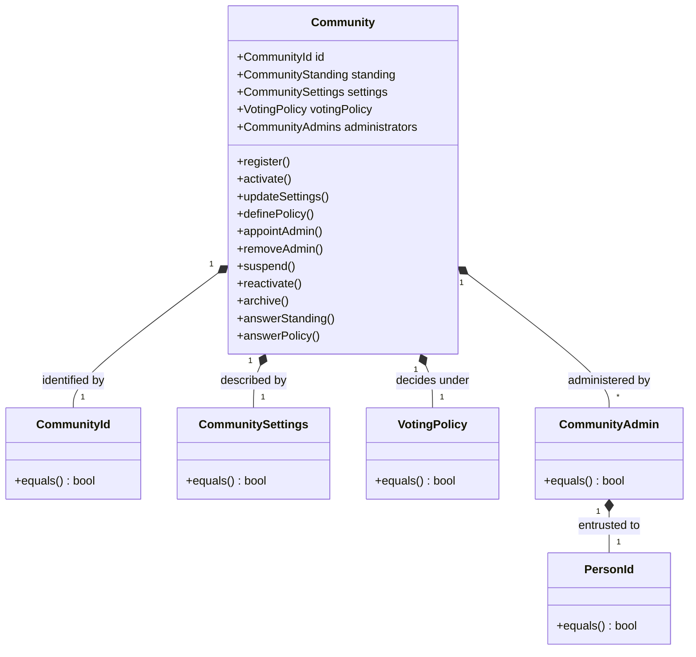
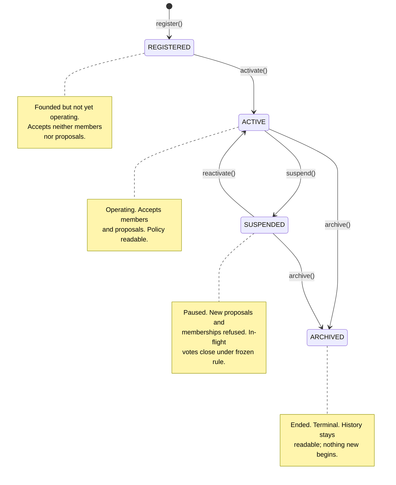
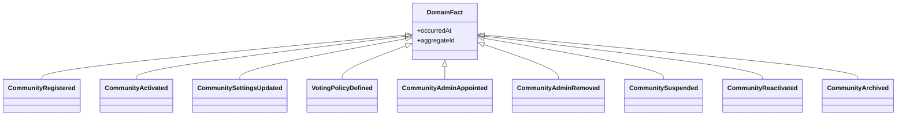

# Community Management — Domain Model

This is the domain model of a Supporting Subdomain. It describes business meaning only:
the aggregate, its operations, value objects, domain facts (events), business rules,
and business rejections. It names no framework, library, storage, transport, or module structure.

Source: `event-storming.md` in this same folder (v0.1.0).
Reference input `docs/BrainStorming/VotoChain_DDD_Subdomains.md` §8 + §15 was treated as hypothesis;
deviations are logged under Hotspots.

## Aggregate Overview

One small aggregate. The community owns its facts, its participation rule, and its
administrator list. It never holds the member list — that relationship lives in Membership.
Other contexts read standing and policy by reference and freeze copies; later changes here
never rewrite those frozen copies.

---

## Aggregate: Community

### Identity & Lifecycle

| Property | Meaning |
|----------|---------|
| `id` | Identity of this community. Stable for its whole life, never reused |
| `standing` | Where the community stands (see state machine) |
| `settings` | General community facts: name, domicile, contact |
| `votingPolicy` | The default participation rule: quorum threshold and basis plus majority rule — the source Voting copies at each proposal opening |
| `administrators` | The persons entrusted with administering this community (at least one while active) |

### State Machine: CommunityStanding

### Invariants (Always True)

| # | Invariant |
|---|-----------|
| 1 | Standing moves only along the machine above. `ARCHIVED` is terminal; nothing leaves it |
| 2 | A voting policy is defined before activation completes. An `ACTIVE` community always has a readable policy |
| 3 | At least one administrator exists while `ACTIVE`. The last administrator cannot be removed without first naming a successor or leaving `ACTIVE` |
| 4 | Settings and policy change without touching standing history. Administration, configuration, and standing evolve independently |
| 5 | The community never contains memberships. It knows its administrators, not its members |
| 6 | Policy versions supersede; they never edit the past. Already-frozen copies elsewhere stay untouched |
| 7 | Standing answers and policy answers are always consistent with the current state — never promised for a future state |

### Mutating Operations

| Operation | Preconditions | Facts Produced |
|-----------|---------------|----------------|
| `register()` | Name and domicile facts present; no live community with the same identity | `CommunityRegistered` |
| `activate()` | Standing is `REGISTERED`; voting policy defined; at least one administrator named | `CommunityActivated` |
| `updateSettings()` | Not `ARCHIVED`; facts well-formed | `CommunitySettingsUpdated` |
| `definePolicy()` | Not `ARCHIVED`; threshold and basis coherent | `VotingPolicyDefined` (supersedes the previous) |
| `appointAdmin()` | Not `ARCHIVED`; person exists; not already an administrator | `CommunityAdminAppointed` |
| `removeAdmin()` | Person is an administrator; at least one administrator remains while `ACTIVE` | `CommunityAdminRemoved` |
| `suspend()` | Standing is `ACTIVE`; reason recorded | `CommunitySuspended` |
| `reactivate()` | Standing is `SUSPENDED`; cause resolved | `CommunityReactivated` |
| `archive()` | Standing is `ACTIVE` or `SUSPENDED`; reason recorded | `CommunityArchived` |

### Answering Operations (Read, but Owned by the Aggregate)

| Operation | Preconditions | Answers |
|-----------|---------------|---------|
| `answerStanding()` | Always answerable | Current standing plus whether members and proposals are accepted now |
| `answerPolicy()` | A policy has been defined | Current threshold, basis, and majority rule |

### Read Needs (What the Domain Must Be Able to Answer)

| Need | Returns |
|------|---------|
| Community by identity | The community or nothing |
| Current voting policy | Threshold, basis, and majority rule (once defined) |
| Community standing | Standing plus whether members and proposals are accepted |
| Administrators of a community | The entrusted persons |

---

## Value Objects

No identity; defined entirely by attributes; immutable; invalid values are unrepresentable.

### CommunityId / PersonId

- The stable identities of communities and persons.
- Equality is by value. Distinct kinds are never interchangeable.
- This context holds person identities as references only; what it means for a person to exist is judged where the person record lives.

### CommunitySettings

- General community facts: name, domicile, contact.
- Well-formed means present and distinguishable (no two live communities share the same identity; naming collisions are a registration rejection, not silent overwrite).

### VotingPolicy

- The default participation rule, in three parts:
  - **Quorum threshold** — how much participation is enough (e.g., half of the basis plus one — concrete value set per definition).
  - **Quorum basis** — enough *of what* (members, units, weighted — catalog open, see Open Questions).
  - **Majority rule** — how a winner is recognized among the options.
- Each definition supersedes the previous one. Superseded versions remain history; they are never edited.
- Voting copies the current policy into each proposal at opening. That copy is then independent of this object.

### QuorumConfig

- The participation part of the voting policy: threshold plus basis.
- The part Voting freezes as its `QuorumSnapshot`. The snapshot answers "what was the rule for this vote"; this object answers "what is the rule now".

### CommunityAdmin

- One entrusted administrator: the person plus the moment of entrustment.
- Distinct from holding a part within the association (`CommunityRole` in Membership: president, board, owner) and from any system-wide grant.
- The set never empties while the community is `ACTIVE`.

### Status Enumerations

- `CommunityStanding` — `REGISTERED`, `ACTIVE`, `SUSPENDED`, `ARCHIVED`.
- `Acceptance` — `ACCEPTS_MEMBERS_AND_PROPOSALS`, `ACCEPTS_NOTHING_NEW`, `READ_ONLY_HISTORY` (derived from standing, not stored separately).

---

## Domain Events (Facts)

Past tense. Immutable. Each carries enough business data that consumers do not need to ask again for the common cases. Each is produced by exactly one aggregate operation.

| Event | Payload (business data) | Produced By | Interested Parties |
|-------|-------------------------|-------------|--------------------|
| `CommunityRegistered` | community, name, domicile | `Community.register()` | Community listing, scrutiny record |
| `CommunityActivated` | community | `Community.activate()` | Membership (registrations allowed), Voting (proposals allowed) |
| `CommunitySettingsUpdated` | community, updated facts | `Community.updateSettings()` | Community detail |
| `VotingPolicyDefined` | community, threshold, basis, majority rule, supersedes reference | `Community.definePolicy()` | Voting (copies at each opening), scrutiny record |
| `CommunityAdminAppointed` | community, person | `Community.appointAdmin()` | Administrator list, scrutiny record |
| `CommunityAdminRemoved` | community, person | `Community.removeAdmin()` | Administrator list |
| `CommunitySuspended` | community, reason | `Community.suspend()` | Membership (registrations refused), Voting (new proposals refused), member notice |
| `CommunityReactivated` | community | `Community.reactivate()` | Membership and Voting (allowed again) |
| `CommunityArchived` | community, reason | `Community.archive()` | Community listing (terminal); history remains readable |

---

## Business Rules (Policies)

Stated as domain rules. No mechanism named.

| Rule | Whenever… | Then… |
|------|-----------|-------|
| Policy change never rewrites frozen copies | A new voting policy is defined | Only future proposal openings read it; already-frozen copies stay untouched |
| Suspended refuses beginnings | A community is suspended | New proposals and new memberships are refused from that moment; in-flight votes continue to close under their frozen rule |
| Archived is terminal | A community is archived | Nothing new begins; history remains readable |
| Administrator continuity | An administrator removal is asked | It is refused when it would leave an `ACTIVE` community with no administrator |

---

## Business Rejections

What the domain refuses, and why. These are business outcomes, not transport codes.

| Rejection | Meaning |
|-----------|---------|
| `CommunityAlreadyExists` | A live community already holds the same identity |
| `PolicyUndefined` | Activation or policy answer attempted before any policy is defined |
| `CommunityNotActive` | Member registration, proposal creation, or policy-dependent action attempted while not `ACTIVE` |
| `LastAdministrator` | Removal of the administrator who would leave an `ACTIVE` community with none |
| `AdminAlreadyAppointed` | Appointment of a person who is already an administrator |
| `ArchivedIsTerminal` | Any change attempted on an `ARCHIVED` community |
| `IllegalCommunityTransition` | An operation incompatible with current standing (e.g., reactivate while active) |
| `CommunityNotFound` | A read or answer refers to a community that does not exist |

---

## Hotspots & Deviations from the Reference Input

| # | Matter | Position in this model |
|---|--------|------------------------|
| H1 | Reference splits Community from Membership — where does the member list live? | Only in Membership. Community holds administrators, never members: one community has N memberships changing on different beats than bylaws |
| H2 | Policy change vs open proposals | New policy affects only future openings. Open proposals keep their frozen copy — no retroactive rule change mid-vote |
| H3 | Suspended vs in-flight votes | New beginnings refused; in-flight votes close under frozen rule (default). Suspending administration does not erase electoral history in motion; needs expert confirmation |
| H4 | CommunityAdmin vs CommunityRole vs system-wide grant | Three distinct concepts. Collapsing them would let a technical grant imply electoral authority or vice versa |
| H5 | Who may change policy or suspend? | Recorded with reason; entitlement belongs to community administration (the administrator list). Approval-flow details parked until experts confirm |

## Open Questions

| # | Question | Standing |
|---|----------|----------|
| 1 | Who may define the voting policy or suspend (single admin, board decision, supermajority)? | Open — needs product + legal |
| 2 | Does suspension stop in-flight voting immediately, or only new proposals and authorizations? | Open — needs product decision |
| 3 | Can a community define its own roles and majority rules, or is there a fixed catalog? | Open — needs product decision |
| 4 | Which quorum bases are allowed (members, units, weighted)? | Open — constrains the policy shape |
| 5 | Dissolved or merged community: archived or transferred, and what happens to its history? | Parked — needs product + legal |

## Related Documentation

| Document | Link |
|----------|------|
| Event Storming (this bounded context) | `event-storming.md` |
| Voting event storming (consumer of policy) | `../voting-verifiable-ledger/event-storming.md` |
| Voting domain model (consumer of snapshots) | `../voting-verifiable-ledger/domain-model.md` |
| Membership event storming (sibling) | `../membership/event-storming.md` |
| Membership domain model (sibling) | `../membership/domain-model.md` |
| Subdomain map (input, hypothesis) | `docs/BrainStorming/VotoChain_DDD_Subdomains.md` §8 + §15 |
| Modeling example (shape reference) | `docs/References/domain-model.md` |
