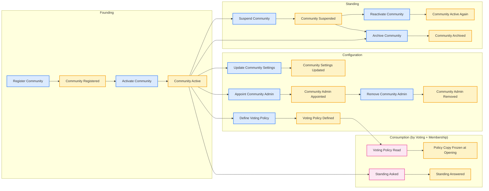

# Event Storming: Community Management (Supporting Subdomain)

## Workshop Overview

| Aspect | Details |
|--------|---------|
| **Date** | 2026-09-07 |
| **Duration** | 1 session × 2 hours (second pair, after Core Domain) |
| **Participants** | Domain Expert (Product), 2 Backend Engineers |
| **Facilitator** | Senior Engineer (DDD practitioner) |
| **Scope** | Community standing → settings → voting policy → community administrators. Out of scope: member standing (Membership), vote casting (Voting), technical login/session |
| **Tool** | Markdown + Mermaid (mirrors `docs/References/event-storming.md` conventions) |
| **Input** | `docs/BrainStorming/VotoChain_DDD_Subdomains.md` §8 + §15 (treated as hypothesis, not truth — see Hotspots) |

### Ubiquitous Language in scope (this context owns the meaning)

| Term | Domain definition (inside this BC) |
|---|---|
| **Community** | The owners' association or cooperative as its own entity, owning its configuration |
| **CommunityStanding** | Where the community stands: `REGISTERED`, `ACTIVE`, `SUSPENDED`, `ARCHIVED` |
| **CommunitySettings** | General community facts: name, address, contact |
| **VotingPolicy** | The default participation rule: quorum threshold and basis plus majority rule — the source Voting copies when opening a proposal |
| **CommunityAdmin** | A person entrusted with administering one specific community — distinct from a member's community role and from any system-wide role |
| **QuorumConfig** | The part of the voting policy stating the minimum participation condition |

> One community has N memberships, but this context never holds the member list — that relationship lives in `Membership`. Voting reads the voting policy by reference and freezes a copy at proposal opening; later changes here never rewrite that frozen copy. Membership asks whether the community accepts members; this context answers.

## Big Picture (Process Level)



### Pivotal points (candidate boundary signals)

1. `Community Active` → the community can accept members and proposals from here.
2. `Voting Policy Defined` → a readable default exists; Voting copies it at each opening.
3. `Community Suspended` → new proposals and new memberships refused; what happens to open proposals is a decision (see Hotspots).
4. `Community Archived` → terminal; history remains readable, nothing new begins.

## Design Level — Community Aggregate

> Design decision: one small aggregate, `Community`, owning its settings, its voting policy, and its administrator list. It never embeds memberships. Policy versions are explained as superseding facts, not by editing the past.

```mermaid
graph TD
    subgraph "Commands (Intent)"
        C1[RegisterCommunityCommand]
        C2[ActivateCommunityCommand]
        C3[UpdateCommunitySettingsCommand]
        C4[DefineVotingPolicyCommand]
        C5[AppointCommunityAdminCommand]
        C6[RemoveCommunityAdminCommand]
        C7[SuspendCommunityCommand]
        C8[ReactivateCommunityCommand]
        C9[ArchiveCommunityCommand]
        C10[AnswerStandingCommand]
        C11[AnswerVotingPolicyCommand]
    end

    subgraph "Aggregate: Community"
        C[Community<br/>(Aggregate Root)]
        C --- CState[Standing: CommunityStanding<br/>REGISTERED/ACTIVE/<br/>SUSPENDED/ARCHIVED]
        C --- CSettings[CommunitySettings<br/>name/address/contact]
        C --- CPolicy[VotingPolicy VO<br/>quorum + majority rule]
        C --- CAdmins[CommunityAdmins<br/>administrators of this community]
    end

    subgraph "Events (Facts)"
        E1[CommunityRegisteredEvent]
        E2[CommunityActivatedEvent]
        E3[CommunitySettingsUpdatedEvent]
        E4[VotingPolicyDefinedEvent]
        E5[CommunityAdminAppointedEvent]
        E6[CommunityAdminRemovedEvent]
        E7[CommunitySuspendedEvent]
        E8[CommunityReactivatedEvent]
        E9[CommunityArchivedEvent]
    end

    subgraph "Policies (Reactions)"
        Pol1[Policy change never rewrites frozen copies]
        Pol2[Suspended refuses new proposals and memberships]
        Pol3[Archived is terminal]
        Pol4[At least one administrator while active]
    end

    subgraph "Read Models"
        RM1[Community Detail + Standing]
        RM2[Current Voting Policy]
        RM3[Community Administrators]
    end

    subgraph "Needs from other contexts (business language)"
        Ext1[Membership - asks standing before registering a member]
        Ext2[Voting - reads policy at opening, freezes a copy]
        Ext3[Voting - asks standing before creating a proposal]
    end

    C1 --> C
    C2 --> C
    C3 --> C
    C4 --> C
    C5 --> C
    C6 --> C
    C7 --> C
    C8 --> C
    C9 --> C
    C10 --> C
    C11 --> C

    C --> E1
    C --> E2
    C --> E3
    C --> E4
    C --> E5
    C --> E6
    C --> E7
    C --> E8
    C --> E9

    E4 --> Pol1
    E7 --> Pol2
    E9 --> Pol3
    E5 --> Pol4
    E6 --> Pol4

    E1 -.-> RM1
    E2 -.-> RM1
    E3 -.-> RM1
    E7 -.-> RM1
    E8 -.-> RM1
    E9 -.-> RM1
    E4 -.-> RM2
    E5 -.-> RM3
    E6 -.-> RM3

    E7 -.-> Ext1
    E4 -.-> Ext2
    E7 -.-> Ext3

    classDef cmd fill:#dbeafe,stroke:#3b82f6,stroke-width:2px;
    classDef agg fill:#dcfce7,stroke:#22c55e,stroke-width:3px;
    classDef evt fill:#fef3c7,stroke:#f59e0b,stroke-width:2px;
    classDef pol fill:#fce7f3,stroke:#ec4899,stroke-width:2px;
    classDef rm fill:#e0e7ff,stroke:#6366f1,stroke-width:2px;
    classDef ext fill:#e5e7eb,stroke:#6b7280,stroke-width:2px;

    class C1,C2,C3,C4,C5,C6,C7,C8,C9,C10,C11 cmd;
    class C,CState,CSettings,CPolicy,CAdmins agg;
    class E1,E2,E3,E4,E5,E6,E7,E8,E9 evt;
    class Pol1,Pol2,Pol3,Pol4 pol;
    class RM1,RM2,RM3 rm;
    class Ext1,Ext2,Ext3 ext;
```

## Key Discoveries

### Aggregates Identified

| Aggregate | Root | Invariants |
|-----------|------|------------|
| **Community** | `Community` | Standing follows `REGISTERED → ACTIVE → SUSPENDED → ACTIVE`, `→ ARCHIVED` terminal; voting policy defined before activation completes; at least one administrator while `ACTIVE`; settings and policy change without touching standing history; member list never embedded |

### Commands (11)

| Command | Aggregate | Validation |
|---------|-----------|------------|
| `RegisterCommunityCommand` | Community | Name and domicile facts present; no live community with the same identity |
| `ActivateCommunityCommand` | Community | Standing is `REGISTERED`; voting policy defined; at least one administrator named |
| `UpdateCommunitySettingsCommand` | Community | Community not `ARCHIVED`; facts well-formed |
| `DefineVotingPolicyCommand` | Community | Community not `ARCHIVED`; threshold and basis coherent (e.g., basis population exists) |
| `AppointCommunityAdminCommand` | Community | Community not `ARCHIVED`; person exists; not already an administrator |
| `RemoveCommunityAdminCommand` | Community | Person is an administrator; at least one administrator remains while `ACTIVE` |
| `SuspendCommunityCommand` | Community | Standing is `ACTIVE`; reason recorded |
| `ReactivateCommunityCommand` | Community | Standing is `SUSPENDED`; cause resolved |
| `ArchiveCommunityCommand` | Community | Standing is `ACTIVE` or `SUSPENDED`; reason recorded |
| `AnswerStandingCommand` | Community | Always answerable: current standing plus whether proposals and memberships are accepted |
| `AnswerVotingPolicyCommand` | Community | Answerable once a policy has been defined: current threshold, basis, and majority rule |

### Events (9 Published)

| Event | Payload | Downstream Consumers |
|-------|---------|---------------------|
| `CommunityRegisteredEvent` | community, name, domicile | Community listing, scrutiny record |
| `CommunityActivatedEvent` | community | Membership (registrations allowed), Voting (proposals allowed) |
| `CommunitySettingsUpdatedEvent` | community, updated facts | Community detail |
| `VotingPolicyDefinedEvent` | community, threshold, basis, majority rule, supersedes reference | Voting (copies at each opening), scrutiny record |
| `CommunityAdminAppointedEvent` | community, person | Administrator list, scrutiny record |
| `CommunityAdminRemovedEvent` | community, person | Administrator list |
| `CommunitySuspendedEvent` | community, reason | Membership (registrations refused), Voting (new proposals refused), member notice |
| `CommunityReactivatedEvent` | community | Membership and Voting (allowed again) |
| `CommunityArchivedEvent` | community, reason | Community listing (terminal), history remains readable |

### Policies (Business Rules)

| Policy | Trigger | Action |
|--------|---------|--------|
| **Policy change never rewrites frozen copies** | `VotingPolicyDefinedEvent` | Only future proposal openings read the new policy; already-frozen copies stay untouched |
| **Suspended refuses beginnings** | `CommunitySuspendedEvent` | New proposals and new memberships refused from that moment; in-flight votes continue to close under their frozen rule (default, needs expert confirmation) |
| **Archived is terminal** | `CommunityArchivedEvent` | Nothing new begins; history remains readable |
| **Administrator continuity** | `CommunityAdminRemovedEvent` | Removal refused when it would leave an `ACTIVE` community with no administrator |

### Read Models

| Read Model | Source events | Consumers |
|------------|---------------|-----------|
| Community Detail + Standing | `CommunityRegistered`, `CommunityActivated`, `CommunitySettingsUpdated`, `CommunitySuspended`, `CommunityReactivated`, `CommunityArchived` | Administration, member UI |
| Current Voting Policy | `VotingPolicyDefined` (latest supersedes) | Voting (per opening), administration |
| Community Administrators | `CommunityAdminAppointed`, `CommunityAdminRemoved` | Administration, discipline authority |

### Needs from other contexts (business language, never direct model access)

| Need | Direction | Meaning |
|------|-----------|---------|
| Membership asks standing | Answered to Membership | `Does this community accept members now?` — registration and activation depend on the answer |
| Voting reads policy | Answered to Voting | `What is the current participation rule?` — Voting copies it into each proposal at opening |
| Voting asks standing | Answered to Voting | `Does this community accept proposals now?` — creation depends on the answer |

## Hotspots (Contentious Decisions)

| # | Hotspot | Decision in this artifact | Rationale |
|---|---------|---------------------------|-----------|
| H1 | **Reference §8 splits Community from Membership — where does the member list live?** | Only in Membership; Community never embeds it | Same cardinality argument as the reference: one community has N memberships, changing on different beats than bylaws |
| H2 | **Policy change vs open proposals** | New policy affects only future openings; open proposals keep their frozen copy | Prevents retroactive rule change mid-vote; keeps Community free to evolve its bylaws |
| H3 | **Suspended community vs in-flight votes** | New beginnings refused; in-flight votes close under frozen rule (default, needs expert confirmation) | Suspending administration should not erase electoral history already in motion |
| H4 | **CommunityAdmin vs CommunityRole vs system role** | Three distinct concepts: administering the community, holding a part within it, holding a system-wide grant | Collapsing them would let a technical grant imply electoral authority or vice versa |
| H5 | **Who may change policy or suspend?** | Recorded with reason; entitlement belongs to community administration (administrator list), details parked | Keeps authority visible without inventing an approval flow before experts confirm it |

## Open Questions / Parking Lot

| # | Question | Status | Owner |
|---|----------|--------|-------|
| 1 | Who may define the voting policy or suspend a community (single admin, board decision, supermajority)? | Open — needs product + legal | Product + Legal |
| 2 | Does suspension stop in-flight voting immediately, or only new proposals and authorizations? | Open — needs product decision | Product |
| 3 | Can a community define its own community roles and majority rules, or is there a fixed catalog? | Open | Product |
| 4 | What quorum bases are allowed (members, units, weighted)? | Open — constrains the policy shape | Product |
| 5 | Is a dissolved or merged community archived or transferred, and what happens to its history? | Parked | Product + Legal |

## Related Documentation

| Document | Link |
|----------|------|
| Subdomain map (input, hypothesis) | `docs/BrainStorming/VotoChain_DDD_Subdomains.md` §8 + §15 |
| Voting event storming (consumer of policy) | `../voting-verifiable-ledger/event-storming.md` |
| Membership event storming (sibling) | `../membership/event-storming.md` |
| Diagram conventions (example) | `docs/References/event-storming.md` |
