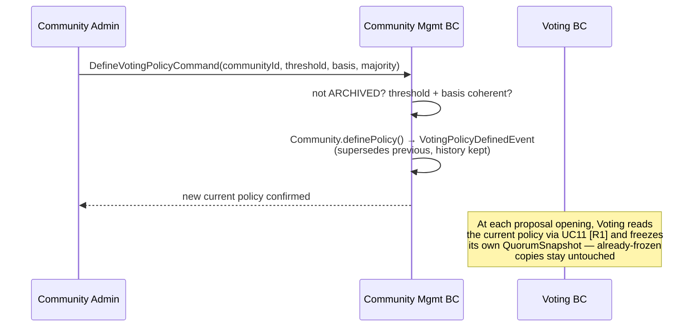

# Community Management — Application Layer

This document describes **orchestration**, not business meaning. It answers: in what
order do things happen, who calls whom, and what crosses this bounded context's
boundary to govern one community. It names no framework, transport, or storage —
same discipline as `domain-model.md`.

Source of business meaning: `domain-model.md` (this same folder). This document adds
nothing new to *what the aggregate can do*; it only sequences calls to the aggregate
and to other bounded contexts, per the rules already frozen in `context-mapping.md`.

A use case here is triggered either by an external request (synchronous) or by a fact
this context reacts to (event-driven). Both are documented the same way.

Naming convention (frozen for all `use-case.md` documents): commands are
`Action+Target+Command` (e.g. `CreateOrderCommand`), events are
`Target+PastAction+Event` (e.g. `OrderCreatedEvent`), queries are
`Action+Target+Criteria+Query` (e.g. `GetOrderByIdQuery`). A query name may grow
whenever the criteria need declaring.

---

## 1. Use Case Catalog

| # | Use Case | Trigger | Aggregates Touched | External BCs Consulted | Facts Produced |
|---|----------|---------|--------------------|-------------------------|-----------------|
| UC1 | RegisterCommunity | Founder request with name and domicile facts | `Community` | — | `CommunityRegisteredEvent` |
| UC2 | ActivateCommunity | Admin request once policy defined and an administrator named | `Community` | — | `CommunityActivatedEvent` |
| UC3 | UpdateCommunitySettings | Admin request | `Community` | — | `CommunitySettingsUpdatedEvent` |
| UC4 | **DefineVotingPolicy** (anchor) | Admin request | `Community` | — (answered outward to Voting) | `VotingPolicyDefinedEvent` (supersedes the previous) |
| UC5 | AppointCommunityAdmin | Admin request | `Community` | IAM (person existence, identity reference) | `CommunityAdminAppointedEvent` |
| UC6 | RemoveCommunityAdmin | Admin request | `Community` | — | `CommunityAdminRemovedEvent` |
| UC7 | SuspendCommunity | Admin request, with reason | `Community` | — (answered outward: beginnings refused) | `CommunitySuspendedEvent` |
| UC8 | ReactivateCommunity | Admin request once cause resolved | `Community` | — | `CommunityReactivatedEvent` |
| UC9 | ArchiveCommunity | Admin request, with reason | `Community` | — | `CommunityArchivedEvent` |
| UC10 | AnswerStanding | Membership / Voting standing check | `Community` (answering operation only) | — | — (synchronous answer, no fact) |
| UC11 | AnswerVotingPolicy | Voting policy read at proposal opening | `Community` (answering operation only) | — | — (synchronous answer, no fact) |

UC4 is detailed fully below because the supersede-chain + future-openings-only
handover is the orchestration this context's consumers depend on — and the one most
likely to be gotten wrong (editing the past, or freezing a promise instead of the
current rule). This context holds a single aggregate, so there is no second
multi-aggregate sequence to detail.

---

## 2. Commands & Queries Accepted (Input Contracts)

These are the intentions this bounded context accepts from outside — not to be
confused with the aggregate operations in `domain-model.md`, which are internal.

### Commands

| Command | Carries | Handled By |
|---------|---------|------------|
| `RegisterCommunityCommand` | name, domicile, contact facts | UC1 |
| `ActivateCommunityCommand` | communityId | UC2 |
| `UpdateCommunitySettingsCommand` | communityId, updated facts | UC3 |
| `DefineVotingPolicyCommand` | communityId, threshold, basis, majority rule | UC4 |
| `AppointCommunityAdminCommand` | communityId, personId | UC5 |
| `RemoveCommunityAdminCommand` | communityId, personId | UC6 |
| `SuspendCommunityCommand` | communityId, reason | UC7 |
| `ReactivateCommunityCommand` | communityId | UC8 |
| `ArchiveCommunityCommand` | communityId, reason | UC9 |

### Queries

| Query | Returns | Backing Read Need (domain-model.md) |
|-------|---------|--------------------------------------|
| `GetCommunityByIdQuery` | The community or nothing | "Community by identity" |
| `GetVotingPolicyByCommunityQuery` | Current threshold, basis, and majority rule (once defined) | "Current voting policy" |
| `GetStandingByCommunityQuery` | Standing plus whether members and proposals are accepted | "Community standing" |
| `GetAdministratorsByCommunityQuery` | The entrusted persons | "Administrators of a community" |

UC10 and UC11 are served by the aggregate's answering operations (`answerStanding()`,
`answerPolicy()`) — they judge current state and answer; they mutate nothing and
produce no facts.

---

## 3. Use Case Detail — UC4: DefineVotingPolicy (anchor)

### Preconditions

| # | Precondition | Checked Against |
|---|---------------|------------------|
| 1 | Community is not `ARCHIVED` | `Community.standing` |
| 2 | Threshold and basis are coherent (a basis population exists to measure against) | Incoming definition |
| 3 | The answer given outward is the rule *now* — never promised for a future state | `Community.votingPolicy` current version |

### Sequence

### Steps (Business Language)

| Step | Action | Facts / Failure |
|------|--------|------------------|
| 1 | Confirm the community is not `ARCHIVED` | Otherwise: `ArchivedIsTerminal` |
| 2 | Confirm threshold and basis cohere (the basis names something countable) | Otherwise: rejection — an incoherent rule is never stored as current |
| 3 | `definePolicy()` — the new version supersedes the previous; superseded versions remain history, never edited | `VotingPolicyDefinedEvent` with a supersedes reference |
| 4 | Confirm the new current policy outward (administration view, and UC11 readers from this moment on) | Only future proposal openings read it — open proposals keep their frozen copies (H2) |

### What This Use Case Does *Not* Do

- Does not edit past policy versions (supersede chain, never overwrite — already-frozen `QuorumSnapshot` copies elsewhere stay untouched).
- Does not push the new rule into open proposals or past votes (Voting pulls at each opening; this context never reaches into Voting's frozen copies).
- Does not promise a future rule (answers are consistent with current state only — invariant 7).
- Does not touch the member list (there is none here — administrators only, invariant 5).

### Concurrency & Idempotency

- Two `DefineVotingPolicyCommand`s racing each other serialize into a supersede chain:
  each definition supersedes the policy current at its own moment — the later one wins
  as current, the earlier one stays history. No definition is lost, none is merged.
- A proposal opening (UC11 read) racing a redefinition freezes whichever version is
  current at the opening's read instant — that frozen copy is then independent of
  whatever is defined next. There is no "re-read the policy mid-vote" step.
- Repeating the identical definition twice records two superseding versions, not one —
  each definition is a governance act with its own moment, not a set-once value.

### Open Orchestration Questions

- Who may define the policy or suspend — single admin, board decision, supermajority
  (domain-model.md, Open Question #1) — needs product + legal.
- Whether suspension stops in-flight voting immediately or only new proposals and
  authorizations (Open Question #2) — needs product decision.
- Which quorum bases are allowed — members, units, weighted (Open Question #4) —
  constrains the policy shape.

---

## 4. ACL Published (What This BC Exposes)

| Capability | Consumer (per context-mapping.md) | Notes |
|---|---|---|
| Current policy answer (`answerPolicy()`, UC11) | Voting (per proposal opening, R1) | Threshold, basis, majority rule — frozen by Voting into `QuorumSnapshot` |
| Standing answer (`answerStanding()`, UC10) | Voting (proposals allowed?) + Membership (registrations allowed?) | Current standing plus what is accepted now |
| Suspension / lifecycle facts | Membership, Voting, member notice via Notifications | `CommunitySuspendedEvent` refuses beginnings from that moment; in-flight votes close under frozen rule (default, needs confirmation) |

## 5. ACL Consumed (What This BC Depends On)

| Dependency | Pattern (context-mapping.md) | Used In |
|---|---|---|
| IAM → Community (person existence) | Identity reference | UC5 — an administrator is entrusted to a real person; only the reference is held |
| Community ⋮ Membership (separation) | Separate rates of change (H1) | No direct integration — one community has N memberships; the member list lives only in Membership |

Every row here is a consequence of a relationship already frozen in
`context-mapping.md` — this table only says *which use case* is the one that actually
makes the call.

---

## Related Documentation

| Document | Link |
|----------|------|
| Domain model (source of aggregate behavior) | `domain-model.md` |
| Event Storming | `event-storming.md` |
| Context map + relationship catalog (source of R1–R14) | `context-mapping.md` |
| Consolidated ubiquitous language | `ubiquitous-language.md` |
