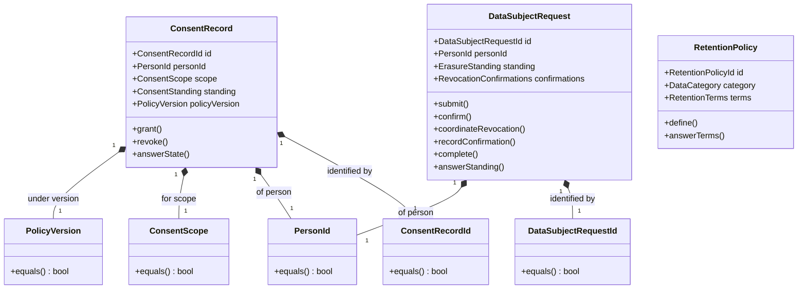
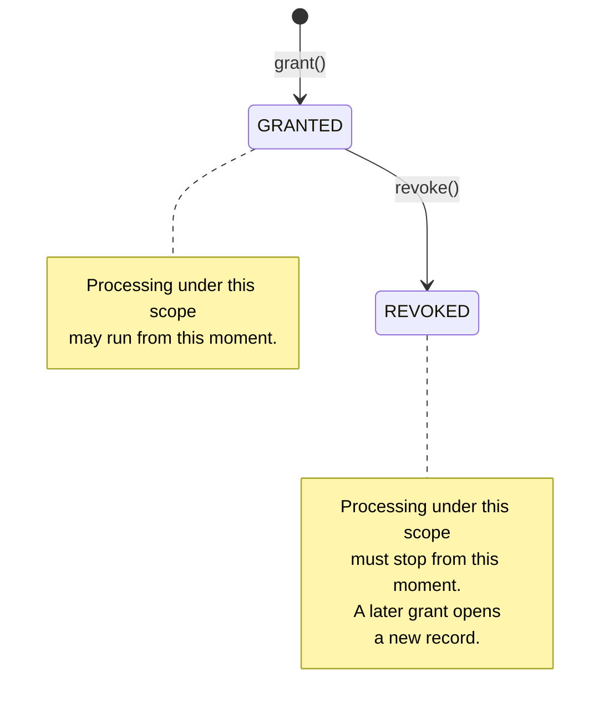
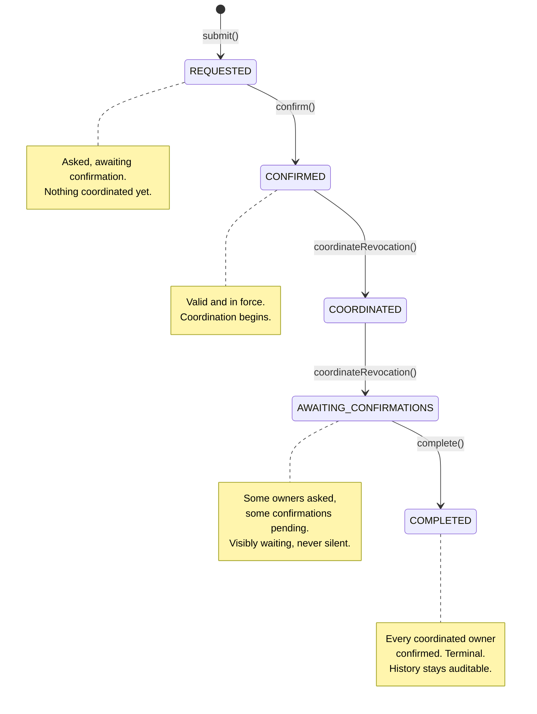
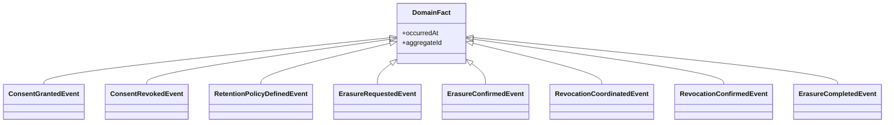

# Consent & Compliance — Domain Model

This is the domain model of a Supporting Subdomain. It describes business meaning only:
aggregates, their operations, value objects, domain facts (events), business rules,
and business rejections. It names no framework, library, storage, transport, or module structure.

Source: `event-storming.md` in this same folder (v0.1.0).
Reference input `docs/BrainStorming/VotoChain_DDD_Subdomains.md` §12 (+ §4 biometrics, §11 notifications,
§15 correlation) was treated as hypothesis; deviations are logged under Hotspots.

> This context records consent and coordinates erasure. It never owns other contexts' personal data:
> each owning context deletes its own data when coordinated.

## Aggregate Overview

Three small aggregates with different rates of change. `ConsentRecord` covers one (person, scope)
grant lifecycle; `DataSubjectRequest` covers one erasure flow from request to completion;
`RetentionPolicy` covers one data category's keeping rule. They correlate by person or category,
never by embedding.

---

## Aggregate: ConsentRecord

### Identity & Lifecycle

| Property | Meaning |
|----------|---------|
| `id` | Identity of this consent record. Stable for its whole life, never reused |
| `personId` | The person who granted (identity reference only; the person record lives elsewhere) |
| `scope` | What the consent covers (biometric processing, email notifications, …) |
| `standing` | Where the consent stands (see state machine) |
| `policyVersion` | The privacy-policy version under which consent was granted |

### State Machine: ConsentStanding

### Invariants (Always True)

| # | Invariant |
|---|-----------|
| 1 | One record covers exactly one (person, scope) grant. A later grant after revocation opens a new record; history is never reopened |
| 2 | At most one `GRANTED` record exists per (person, scope) at any moment |
| 3 | Revocation stops processing from that moment. It never rewrites the period when consent stood |
| 4 | The policy version is frozen at grant. Later policy versions affect only later grants |

### Mutating Operations

| Operation | Preconditions | Facts Produced |
|-----------|---------------|----------------|
| `grant()` | Person exists; scope is known; no live `GRANTED` record for the same (person, scope) | `ConsentGrantedEvent` |
| `revoke()` | Standing is `GRANTED` | `ConsentRevokedEvent` |

### Answering Operations (Read, but Owned by the Aggregate)

| Operation | Preconditions | Answers |
|-----------|---------------|---------|
| `answerState()` | Always answerable | Granted or not for this (person, scope), under which policy version, since when |

### Read Needs (What the Domain Must Be Able to Answer)

| Need | Returns |
|------|---------|
| Current consent per (person, scope) | Granted or not, under which policy version, since when |

---

## Aggregate: DataSubjectRequest

### Identity & Lifecycle

| Property | Meaning |
|----------|---------|
| `id` | Identity of this erasure request. Stable for its whole life, never reused |
| `personId` | The person asking (identity reference only) |
| `standing` | Where the request stands (see state machine) |
| `confirmations` | Which owning contexts were asked and which confirmed (per-owner tracking) |

### State Machine: ErasureStanding

### Invariants (Always True)

| # | Invariant |
|---|-----------|
| 1 | Each request belongs to exactly one person. It is never transferred |
| 2 | Coordination begins only once confirmed. A merely requested erasure asks nothing of owning contexts |
| 3 | One coordination fact goes to each owning context holding this person's data; one confirmation is recorded per owner |
| 4 | Completion requires every coordinated owner's confirmation. Partial completion is unrepresentable |
| 5 | `COMPLETED` is terminal. The grant → revoke → request → coordination → confirmation chain stays as an uneditable audit trail |
| 6 | This aggregate never holds personal data — only the record that revocation was asked and confirmed |

### Mutating Operations

| Operation | Preconditions | Facts Produced |
|-----------|---------------|----------------|
| `submit()` | Person exists; no open request for the same person | `ErasureRequestedEvent` |
| `confirm()` | Standing is `REQUESTED`; request is valid and in force | `ErasureConfirmedEvent` |
| `coordinateRevocation()` | Standing is `CONFIRMED`; owning contexts holding this person's data known | `RevocationCoordinatedEvent` (one per owning context) |
| `recordConfirmation()` | Standing is `COORDINATED` or `AWAITING_CONFIRMATIONS`; confirmation from a coordinated owner not yet recorded | `RevocationConfirmedEvent` (one per owner) |
| `complete()` | Every coordinated owner confirmed | `ErasureCompletedEvent` |

### Answering Operations (Read, but Owned by the Aggregate)

| Operation | Preconditions | Answers |
|-----------|---------------|---------|
| `answerStanding()` | Always answerable | Requested / confirmed / awaiting confirmations (from whom) / complete |

### Read Needs (What the Domain Must Be Able to Answer)

| Need | Returns |
|------|---------|
| Erasure request standing | Standing plus, while waiting, which owners confirmed and which are pending |
| Audit trail (scrutiny) | The grant → revoke → request → coordination → confirmation chain for a person |

---

## Aggregate: RetentionPolicy

### Identity & Lifecycle

| Property | Meaning |
|----------|---------|
| `id` | Identity of this policy line. Stable for its whole life, never reused |
| `category` | The data category it governs (biometric reference, notification log, …) |
| `terms` | How long kept, under what terms |

### Invariants (Always True)

| # | Invariant |
|---|-----------|
| 1 | One live policy line exists per data category. A new definition supersedes the previous; superseded versions remain history, never edited |
| 2 | Retention governs keeping; it never authorizes processing without consent, and a confirmed erasure wins over keeping unless a legal hold is recorded with reason (default — see Open Questions) |

### Mutating Operations

| Operation | Preconditions | Facts Produced |
|-----------|---------------|----------------|
| `define()` | Category known; terms coherent | `RetentionPolicyDefinedEvent` (supersedes the previous) |

### Answering Operations (Read, but Owned by the Aggregate)

| Operation | Preconditions | Answers |
|-----------|---------------|---------|
| `answerTerms()` | A policy has been defined for the category | How long kept, under what terms |

### Read Needs (What the Domain Must Be Able to Answer)

| Need | Returns |
|------|---------|
| Retention rule per data category | Current terms plus superseded history |

---

## Value Objects

No identity; defined entirely by attributes; immutable; invalid values are unrepresentable.

### ConsentRecordId / DataSubjectRequestId / RetentionPolicyId / PersonId

- The stable identities of consent records, erasure requests, policy lines, and persons.
- Equality is by value. Distinct kinds are never interchangeable.
- Person identity is held as a reference only; what it means for a person to exist is judged where the person record lives.

### ConsentScope

- What one consent covers: `BIOMETRIC_PROCESSING`, `EMAIL_NOTIFICATIONS`, … (catalog open — see Open Questions).
- One scope per record. Scopes are never combined into a blanket grant.

### PolicyVersion

- The privacy-policy version under which a specific consent was granted.
- Frozen at grant; explains later which terms the person agreed to.

### DataCategory

- The kind of data a retention line governs (`BIOMETRIC_REFERENCE`, `NOTIFICATION_LOG`, …).
- One live policy line per category.

### RetentionTerms

- How long and under what terms a category is kept. Superseded, never edited.

### RevocationConfirmations

- The per-owner tracking inside one erasure request: which owning contexts were asked, which confirmed, which are pending.
- Completion is answerable from this object alone: all asked and all confirmed, or visibly waiting.

### Status Enumerations

- `ConsentStanding` — `GRANTED`, `REVOKED`.
- `ErasureStanding` — `REQUESTED`, `CONFIRMED`, `COORDINATED`, `AWAITING_CONFIRMATIONS`, `COMPLETED`.

---

## Domain Events (Facts)

Past tense. Immutable. Each carries enough business data that consumers do not need to ask again for the common cases. Each is produced by exactly one aggregate operation.

| Event | Payload (business data) | Produced By | Interested Parties |
|-------|-------------------------|-------------|--------------------|
| `ConsentGrantedEvent` | ConsentRecordId, PersonId, ConsentScope, PolicyVersion | `ConsentRecord.grant()` | Biometric, Notifications (gates open), scrutiny record |
| `ConsentRevokedEvent` | ConsentRecordId, PersonId, ConsentScope | `ConsentRecord.revoke()` | Biometric, Notifications (processing stops), scrutiny record |
| `RetentionPolicyDefinedEvent` | RetentionPolicyId, DataCategory, RetentionTerms, supersedes | `RetentionPolicy.define()` | Compliance steward, scrutiny record |
| `ErasureRequestedEvent` | DataSubjectRequestId, PersonId | `DataSubjectRequest.submit()` | Compliance steward |
| `ErasureConfirmedEvent` | DataSubjectRequestId, PersonId | `DataSubjectRequest.confirm()` | Owning contexts (coordination begins), scrutiny record |
| `RevocationCoordinatedEvent` | DataSubjectRequestId, PersonId, owning context | `DataSubjectRequest.coordinateRevocation()` | One owning context (asked to revoke its own data) |
| `RevocationConfirmedEvent` | DataSubjectRequestId, PersonId, owning context | `DataSubjectRequest.recordConfirmation()` | Request standing (one owner done) |
| `ErasureCompletedEvent` | DataSubjectRequestId, PersonId | `DataSubjectRequest.complete()` | Person notice, scrutiny record |

---

## Business Rules (Policies)

Stated as domain rules. No mechanism named.

| Rule | Whenever… | Then… |
|------|-----------|-------|
| No grant, no processing | Processing under a scope is asked | It runs only while a `GRANTED` record stands for that (person, scope); a revoked scope refuses from that moment |
| Confirmed erasure coordinates everywhere | An erasure request is confirmed | Revocation is asked in every context owning this person's data — never executed here, only coordinated |
| Completion needs every owner | Confirmations arrive | The request closes only when every coordinated owner confirmed; otherwise it waits, visibly naming who is pending |
| Confirmed erasure beats keeping | A retention line says "keep" and a confirmed erasure says "delete" | Deletion wins unless a legal hold is recorded with reason (default) |
| History never rewritten | Consent or erasure is questioned later | Grants, revocations, requests, coordinations, and confirmations stay as an uneditable audit trail |

---

## Business Rejections

What the domain refuses, and why. These are business outcomes, not transport codes.

| Rejection | Meaning |
|-----------|---------|
| `ConsentAlreadyGranted` | Grant asked while a live `GRANTED` record already covers the same (person, scope) |
| `ConsentNotGranted` | Processing asked while no `GRANTED` record stands for the (person, scope) |
| `UnknownScope` | Grant asked for a scope outside the known catalog |
| `ErasureAlreadyOpen` | Submit asked while an open request already exists for the same person |
| `ErasureNotConfirmed` | Coordination asked before confirmation |
| `UnknownOwnerConfirmation` | Confirmation from a context that was never coordinated for this request |
| `ErasureIncomplete` | Completion asked while any coordinated owner is still pending |
| `RequestNotFound` | A read or confirmation refers to a request that does not exist |

---

## Hotspots & Deviations from the Reference Input

| # | Matter | Position in this model |
|---|--------|------------------------|
| H1 | Reference suggests `ConsentRecord` (or `DataSubjectRequest`) root — one aggregate or more? | Three small aggregates: grant lifecycle, erasure flow, and retention lines change on different beats (consent per person-moment, erasure per request, retention per category-version). Correlated, never embedded |
| H2 | "Coordinates but never owns" (§12.4 invariant) | Held strictly: this context records asks and confirmations only. Each owning context deletes its own data; no personal data beyond identities and scope references lives here |
| H3 | Retention vs erasure conflict | Confirmed erasure wins unless a legal hold is recorded with reason (default). Keeps one rule instead of two competing truths; needs legal confirmation |
| H4 | Partial vs full erasure | Per-scope revocation allowed; full erasure closes all scopes (default). A person may end biometrics yet keep membership; needs legal confirmation |
| H5 | In-flight votes at erasure time | Parked. Cast-vote history vs erasure timing needs product + legal before any rule is frozen |

## Open Questions

| # | Question | Standing |
|---|----------|----------|
| 1 | Consent scope catalog: fixed list or extensible, and who may add a scope? | Open — needs product + legal |
| 2 | Who confirms an erasure request, and on what grounds may it be refused (legal hold, in-flight vote)? | Open — needs product + legal |
| 3 | Retention vs erasure when a legal hold exists: form of the hold, who records it, expiry? | Open — needs legal |
| 4 | In-flight votes at erasure time: history stays or erasure waits? | Open — needs product + legal |
| 5 | Must exclusion/refusal reasons be told to the person, and in which form? | Open — needs product decision |

## Repository

- `ConsentRepository` (domain port): `findLive(personId, scope)`, `save` — live means standing `GRANTED`; the partial unique index is the backstop.
- `DataSubjectRequestRepository` (domain port): open-request lookup per person behind `getErasureStandingByPerson`, `save` — at most one open request per person.
- `RetentionPolicyRepository` (domain port): current terms per category behind `getRetentionTermsByCategory`, `save` — a new definition supersedes, never edits.

## Factory / creation

- `ConsentRecord.grant({ id, personId, scope, policyVersion })` emits `ConsentGrantedEvent`; a later grant after revocation opens a new record. Reconstitution is only via `ConsentRecord.rehydrate({...})` and emits nothing.
- `DataSubjectRequest.submit({ id, personId })` emits `ErasureRequestedEvent`; `RetentionPolicy.define({ id, category, terms, supersedes })` emits `RetentionPolicyDefinedEvent`. Reconstitution is only via their `rehydrate({...})` and emits nothing.

---

## Related Documentation

| Document | Link |
|----------|------|
| Event Storming (this bounded context) | `event-storming.md` |
| Biometric event storming (consent gate + revocation target) | `../biometric-identity-verification/event-storming.md` |
| Biometric domain model (sibling) | `../biometric-identity-verification/domain-model.md` |
| Voting event storming (downstream: authorization assumes verified + consented) | `../voting-verifiable-ledger/event-storming.md` |
| Subdomain map (input, hypothesis) | `docs/BrainStorming/VotoChain_DDD_Subdomains.md` §4 + §11 + §12 + §15 |
| Modeling example (shape reference) | `docs/References/domain-model.md` |
