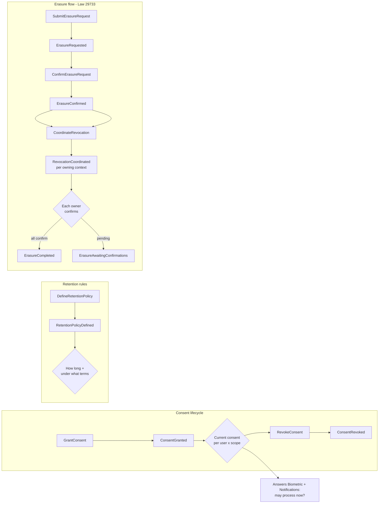
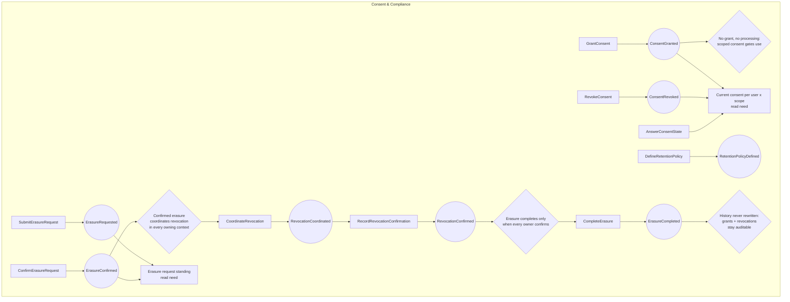

# Consent & Compliance — Event Storming

This is the Big Picture + Design Level storming of a Supporting Subdomain. Pure domain language only.
It names no framework, library, storage, transport, or module structure.

Reference input `docs/BrainStorming/VotoChain_DDD_Subdomains.md` §12 (+ §4 biometrics, §11 notifications,
§15 correlation) was treated as hypothesis, not truth. Deviations are logged as Hotspots.

> This context records consent and coordinates erasure. It never owns other contexts' personal data:
> each owning context deletes its own data when coordinated. It receives signals from Biometric Identity
> Verification (biometric-data consent) and Notifications (communication opt-in) but owns neither.

## Big Picture

## Design Level

## Commands

| # | Command | Intent | Actor |
|---|---------|--------|-------|
| 1 | `GrantConsent` | Record that the person consents, for one scope, under one policy version | Person |
| 2 | `RevokeConsent` | Record that the person withdraws consent for one scope | Person |
| 3 | `DefineRetentionPolicy` | Set how long and under what terms one data category is kept | Compliance steward |
| 4 | `SubmitErasureRequest` | Open a Law 29733 erasure request | Person |
| 5 | `ConfirmErasureRequest` | Confirm the request is valid and in force | Compliance steward |
| 6 | `CoordinateRevocation` | Ask every owning context to end use and delete its data for this person | Erasure flow (once confirmed) |
| 7 | `RecordRevocationConfirmation` | Record one owning context's confirmation that it revoked | Owning context (Biometric, Notifications, Membership, …) |
| 8 | `AnswerConsentState` | Answer whether processing for a scope may run now | Biometric, Notifications (gates) |
| 9 | `CompleteErasure` | Close the request once every owner confirmed | Erasure flow |

## Domain Events (Facts)

| # | Fact | Meaning |
|---|------|---------|
| 1 | `ConsentGranted` | Consent now stands for one (person, scope, policy version) |
| 2 | `ConsentRevoked` | Consent for one (person, scope) ended; processing under it must stop from that moment |
| 3 | `RetentionPolicyDefined` | One data category's keeping rule set (supersedes the previous) |
| 4 | `ErasureRequested` | A person asked for erasure; awaiting confirmation |
| 5 | `ErasureConfirmed` | The request is valid and in force; coordination begins |
| 6 | `RevocationCoordinated` | One owning context asked to revoke for this person (one fact per owner) |
| 7 | `RevocationConfirmed` | One owning context confirmed it revoked (one fact per owner) |
| 8 | `ErasureCompleted` | Every owning context confirmed; the request closes. History stays auditable |

## Policies (Whenever / Then)

| # | Whenever… | Then… |
|---|-----------|-------|
| P1 | Processing for a scope is asked (biometric run, notification send) | It runs only while consent for that (person, scope) stands; a revoked scope refuses from that moment |
| P2 | An erasure request is confirmed | Revocation is coordinated in every context owning this person's data |
| P3 | Revocation confirmations arrive | The request closes only when every coordinated owner confirmed; otherwise it waits, visibly |
| P4 | Consent or erasure history is questioned later | Grants, revocations, requests, and confirmations stay as an uneditable audit trail |

## Read Needs

| Need | Returns |
|------|---------|
| Current consent per (person, scope) | Granted or not, under which policy version, since when |
| Erasure request standing | Requested / confirmed / awaiting confirmations (from whom) / complete |
| Retention rule per data category | How long kept, under what terms |
| Audit trail (scrutiny) | The grant → revoke → request → coordination → confirmation chain for a person |

## Needs from Other Contexts (business language, not mechanisms)

| Need | From | Why |
|------|------|-----|
| Revocation confirmations | Each owning context (Biometric, Notifications, Membership, …) | Erasure completes only when every owner confirms its own deletion |
| Consent gates honored | Biometric Identity Verification, Notifications | They ask `may process now?` before running under a scope |
| Person existence | IAM (identity reference) | Records belong to exactly one person |
| (Offers) Current consent state | (offered to) Biometric, Notifications | Gates processing without sharing personal data |
| (Offers) Revocation asked | (offered to) each owning context | Each deletes its own data; this context never touches it |

## Hotspots & Open Questions

| # | Matter | Standing |
|---|--------|----------|
| H1 | Consent scope catalog: which scopes exist (`biometric-processing`, `email-notifications`, …) and who may add one? | Open — needs product + legal; default: small fixed catalog, additions versioned |
| H2 | Who confirms an erasure request, and on what grounds may it be refused (legal hold, in-flight vote)? | Open — needs product + legal |
| H3 | Partial vs full erasure: may a person erase biometrics but keep membership, or is erasure all-or-nothing? | Open — default: per-scope revocation allowed; full erasure closes all scopes |
| H4 | Retention vs erasure conflict: a retention rule says "keep", an erasure says "delete" — which wins, and when? | Open — default: confirmed erasure wins unless a legal hold is recorded with reason |
| H5 | In-flight votes at erasure time: do already-cast votes stay (anonymized history) or block erasure until close? | Open — needs product + legal |
| H6 | Two aggregates or one context, one model? `ConsentRecord` (grant lifecycle) and `DataSubjectRequest` (erasure flow) change on different beats | Position: two aggregates in one context, correlated by person; revisit if approval flows grow multi-step (see §16 of the map) |

## Related Documentation

| Document | Link |
|----------|------|
| Biometric event storming (sibling, consent gate + revocation target) | `../biometric-identity-verification/event-storming.md` |
| Voting event storming (downstream: authorization assumes verified + consented) | `../voting-verifiable-ledger/event-storming.md` |
| Subdomain map (input, hypothesis) | `docs/BrainStorming/VotoChain_DDD_Subdomains.md` §4 + §11 + §12 + §15 |
| Modeling example (shape reference) | `docs/References/event-storming.md` |
