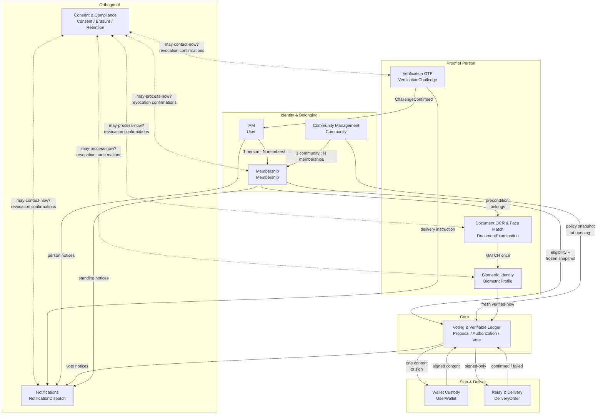

# Context Mapping: VotoChain — How the 11 Bounded Contexts Relate

This map is derived from the modeled contexts themselves — their preconditions answered
outside, their offered answers, and the facts each consumes — not from the reference
subdomain map, which was treated as hypothesis throughout. Where this map disagrees with
`docs/BrainStorming/VotoChain_DDD_Subdomains.md`, the disagreement is logged under
Deviations, and the modeled context wins.

A context never reaches into another's model. Each exposes answers and facts; each
consumer translates at the boundary into its own language. Identity crosses boundaries
by reference only — never embedded.

> Legacy System Reconciliation (RPA, reference map §13) is excluded per explicit team
> decision: out of scope, no box on this map.

## The 11 Bounded Contexts

| # | Bounded Context | Type | Aggregate(s) | Owns (one line) |
|---|---|---|---|---|
| 1 | Voting & Verifiable Ledger | **Core** | `Proposal`, `VoteAuthorization`, `Vote` | Verifiable intent → on-chain fact; only `CONFIRMED` counts |
| 2 | Cryptographic Wallet Custody | Supporting | `UserWallet` | One person's signing capability; reconstruct transiently, then forget |
| 3 | Biometric Identity Verification | Supporting | `BiometricProfile`, `VerificationAttempt` | Live-person proof; liveness first, then comparison, binary verdict |
| 4 | Blockchain Relay & Transaction Delivery | Supporting | `DeliveryOrder` | One signed content's journey to the ledger; carries signed only |
| 5 | IAM | Supporting | `User` | Technical identity: standing, session, system role; judges, never performs, proofs |
| 6 | Community Management | Supporting | `Community` | Community standing, settings, participation rule, administrators |
| 7 | Membership | Supporting | `Membership` | One (person, community) pair; eligibility answered, frozen on handover |
| 8 | Consent & Compliance | Supporting | `ConsentRecord`, `DataSubjectRequest`, `RetentionPolicy` | Opt-in judgment; erasure coordinated, never executed here |
| 9 | Document OCR & Face Match Provider | Generic | `DocumentExamination` | One document proof → single verdict `MATCH` / `NO_MATCH` / `UNREADABLE` |
| 10 | Verification (OTP) | Generic | `VerificationChallenge` | One (person, purpose) channel-possession proof; closed 3 purposes |
| 11 | Notifications | Generic | `NotificationDispatch` | One delivery intent's journey; delivery only, email-only |

## Map (Upstream → Downstream)

Reading notes:

- Voting (Core) is downstream of Membership, Community, and Biometric; upstream of
  Wallet and Relay. It orchestrates sign → deliver → confirm and owns the
  intent-vs-fact distinction.
- Notifications is a pure downstream sink: everyone may ask it to deliver; it depends
  on no one and judges nothing.
- Consent is orthogonal: it gates (`may-process-now?`, `may-contact-now?`) and
  coordinates erasure, but executes no deletion and owns no one else's data.
- Wallet and Relay never touch each other directly: the signing capability and the
  payer capability meet only inside Voting's flow, and are never mixed.

## Relationship Catalog

Each pair names its direction (U = upstream, D = downstream), the mapping pattern,
and the translation rule at the boundary — what crosses, and what explicitly does not.

| # | Upstream → Downstream | Pattern | Translation / boundary rule |
|---|---|---|---|
| R1 | Community → Voting (policy + standing) | Open Host Service + Anti-Corruption Layer (Voting side) | `VotingPolicy` / `QuorumConfig` cross once per opening and freeze as `QuorumSnapshot`; later policy changes touch future proposals only. In-flight proposals close under their frozen copy. Community standing gates new beginnings, answered per opening |
| R2 | Membership → Voting (eligibility) | Open Host Service + Anti-Corruption Layer (Voting side) | `Is this person eligible now?` crosses as `EligibilitySnapshot`, frozen at grant; past judgments are never rewritten. Only `ACTIVE` counts toward the roster. Delinquency-immediacy vs next-authorization is open (see Open Questions) |
| R3 | Biometric → Voting (verified-now) | Customer/Supplier (Voting customer) | Only a fresh `verified` authorizes, within its freshness window. Voting never re-judges liveness or comparison; it consumes the verdict answer |
| R4 | Voting → Wallet (sign this content) | Customer/Supplier (Voting customer) | One specific vote content crosses; reconstruction is transient and forgotten right after. Nothing crosses that could sign on its own |
| R5 | Voting → Relay (deliver signed-only) | Customer/Supplier (Voting customer) + Open Host Service (Relay standing) | Already-signed content crosses; Relay never signs or rewords. Only `DeliveryConfirmed` counts toward the tally — `VoteCast` is intent, confirmation is fact |
| R6 | Wallet ⋮ Relay (signer / payer split) | Separate Ways | No direct integration. The person's signing capability and the payer capability are distinct; Voting's flow keeps them apart — the two are never mixed |
| R7 | Document OCR → Biometric (`MATCH` once) | Customer/Supplier (Biometric customer) | The verdict crosses once, single-use, and seeds the lasting reference. Closed verdict set of 3; closed unreadable reasons of 5. Portraits die with the examination — nothing image-like crosses |
| R8 | Membership → Document OCR (precondition) | Conformist (OCR checks, Membership judges) | Belonging is answered outside; OCR refuses with `NoEligibleMembership` when the person belongs nowhere. OCR never judges membership itself |
| R9 | Verification → IAM (`ChallengeConfirmed`) | Open Host Service (Verification) + Anti-Corruption Layer (IAM side) | The confirmation fact crosses via `IamContextFacade.markVerified(personId)` — primitives at the boundary; the code itself never crosses. Verification's own `ChallengeConfirmedEventHandler` calls the facade; IAM never subscribes to Verification's event (skill: `@OnEvent` only in the emitting module). IAM judges standing, never re-judges the code |
| R10 | Verification → Notifications | Customer/Supplier (Verification customer) | Code delivery crosses as a delivery instruction (template + address + reason). Verification never delivers itself |
| R11 | Any context → Notifications | Open Host Service (Notifications) | Only template + address + reason + idempotency key cross. When/why stay with the requester. No business rule leaks in; same key never delivers twice |
| R12 | Consent ↔ every owning context | Partnership (coordination) + Published Language (`ErasureRequested` / `RevocationConfirmed` / `ErasureComplete`) | Gates (`may-process-now?`, `may-contact-now?`) and revocation coordination cross. Completion is answerable only when every owner confirms its own deletion. Consent never touches another context's data |
| R13 | IAM ⋮ Membership / Community / Biometric | Separate Ways (identity reference only) | Only the person identity crosses. Suspension in IAM never rewrites membership, community, or biometric standing. One `User` : N `Membership`s |
| R14 | IAM → Notifications (person notices) | Customer/Supplier (IAM customer) | Welcome, security, address-change, and standing notices cross as delivery intents. Sending is executed outside; IAM judges the standing behind the notice |
| R15 | Community → Membership (admission gate) | Open Host Service (Community) + Anti-Corruption Layer (Membership side) | `acceptsMembers` / `answerStanding` answered per registration (UC1); Membership never caches policy, only its own pair state. Standing changes never rewrite live memberships |
| R16 | Membership / Community / Verification / Biometric / OCR → IAM (existence gate) | Open Host Service (IAM) + Anti-Corruption Layer (consumer side) | `personExists` answered per gated use case, called BEFORE the unit of work (never inside `run()`); only a boolean crosses, existence never implies standing |

What never crosses a boundary: raw images, portraits, comparison artifacts, plain
codes, signing secrets, member lists, community configuration (only frozen copies),
and business rules belonging to another context.

## Shared Kernel (explicit, skill threshold 3+ contexts)

Per the skill, a VO independently needed by 3+ bounded contexts is promoted to the
Shared Kernel instead of being duplicated per BC or smuggled through facade
signatures. Facades stay primitives-only (strings); each consumer wraps with the
shared VO at its own boundary.

| Shared VO | Location | Consumed by | Rule |
|---|---|---|---|
| `PersonId` (`per-` + `of()/generate()/equals()`) | `shared/domain/model/valueobjects/person-id.value-object.ts` | IAM, Community, Membership, Verification, OCR, Biometric, Wallet, Consent (8) | Identity by reference only; suspension/revocation in one context never rewrites another's standing (R13) |
| `SignedContentRef` (opaque, owned by Voting) | `shared/domain/model/valueobjects/signed-content-ref.value-object.ts` | Voting (owner), Wallet, Relay (3) | Opaque outside Voting: carriers never inspect or sign on their own (R4/R5/R6) |

Deliberately NOT kernel (frozen copies, not shared code): `EligibilitySnapshot`
(Membership → Voting, frozen at grant), `QuorumSnapshot` (Community → Voting,
frozen at open). Past judgments/copies are never rewritten, so sharing the class
would couple lifecycles that must stay independent.

## Deviations from the Reference Map

| # | Reference position | Modeled position (wins) |
|---|---|---|
| D1 | OCR is adapter-only, no lifecycle (§5) | Full bounded context with `DocumentExamination`; executors interchangeable behind the verdict |
| D2 | Notifications email / future SMS-push; template + provider vocabulary (§11) | Email-only; no local preference aggregate; send executed outside; only minimal intent crosses |
| D3 | OTP purposes listed as examples (§10.3) | Closed set of 3: `login`, `email-verification`, `password-reset`; vote authorization lives in Voting |
| D4 | IAM manages credentials, sessions, tokens (§7) | Single `User` aggregate; proofs and session mechanics executed outside, judged inside; single open session (supersede default); one outside prover |
| D5 | Consent notifies Biometric to revoke (§12.1) | Consent coordinates, never notifies-as-command: completion only when each owner confirms its own deletion |
| D6 | Relay described via queue + worker + cost vocabulary (§6) | One `DeliveryOrder` per signed content; payer's sending order, sending cost, at-most-once retry then abandon with reason |
| D7 | `Proposal` owns `Vote` internally (§2.4) | Three small aggregates by identity reference (`Proposal`, `VoteAuthorization`, `Vote`); rejected single-owner design |

## Open Questions (carried, none blocking the map)

| # | Question | Contexts touched |
|---|---|---|
| O1 | Re-vote allowed, or one confirmed vote per (proposal, voter)? | Voting (default: single immutable vote; supersede parked) |
| O2 | Delinquency excludes from roster immediately or from next authorization? | Membership → Voting (affects in-flight votes) |
| O3 | Confirmation depth before `CONFIRMED`; who may close; ballot secrecy shape? | Voting ← Relay |
| O4 | Cost exhaustion: wait, abandon, or ask for more? Retry bound shape? | Relay → Voting |
| O5 | In-flight votes/signatures/deliveries at erasure time vs ledger facts that cannot un-happen? | Consent ↔ Voting / Wallet / Relay |
| O6 | Roster freshness: live at each authorization or periodically confirmed roll? | Membership → Voting |
| O7 | Freshness window length; match-threshold ownership; re-enrollment after revocation? | Biometric → Voting, OCR → Biometric |
| O8 | Supersede vs refuse second sign-in / second OTP request; which IAM flows consume confirmation first? | IAM ↔ Verification |
| O9 | Retry limits, template catalog ownership, bounce vocabulary? | Any → Notifications |

## Related Documentation

| Document | Link |
|----------|------|
| Consolidated ubiquitous language | `ubiquitous-language.md` |
| Core storming + model | `voting-verifiable-ledger/event-storming.md`, `voting-verifiable-ledger/domain-model.md` |
| Wallet storming + model | `cryptographic-wallet-custody/event-storming.md`, `cryptographic-wallet-custody/domain-model.md` |
| Biometric storming + model | `biometric-identity-verification/event-storming.md`, `biometric-identity-verification/domain-model.md` |
| Relay storming + model | `blockchain-relay-transaction-delivery/event-storming.md`, `blockchain-relay-transaction-delivery/domain-model.md` |
| IAM storming + model | `iam/event-storming.md`, `iam/domain-model.md` |
| Community storming + model | `community-management/event-storming.md`, `community-management/domain-model.md` |
| Membership storming + model | `membership/event-storming.md`, `membership/domain-model.md` |
| Consent storming + model | `consent-compliance/event-storming.md`, `consent-compliance/domain-model.md` |
| OCR storming + model | `document-ocr-face-match-provider/event-storming.md`, `document-ocr-face-match-provider/domain-model.md` |
| OTP storming + model | `verification/event-storming.md`, `verification/domain-model.md` |
| Notifications storming + model | `notifications/event-storming.md`, `notifications/domain-model.md` |
| Subdomain map (input, hypothesis) | `docs/BrainStorming/VotoChain_DDD_Subdomains.md` |
