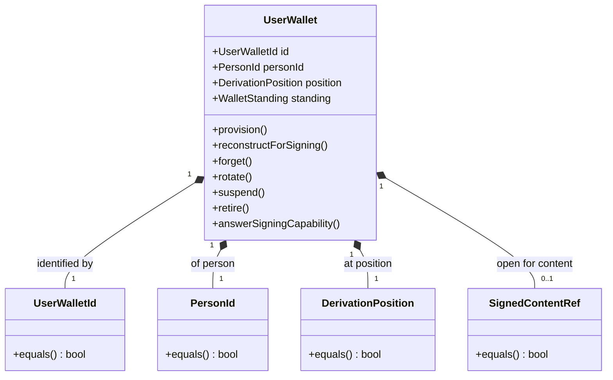
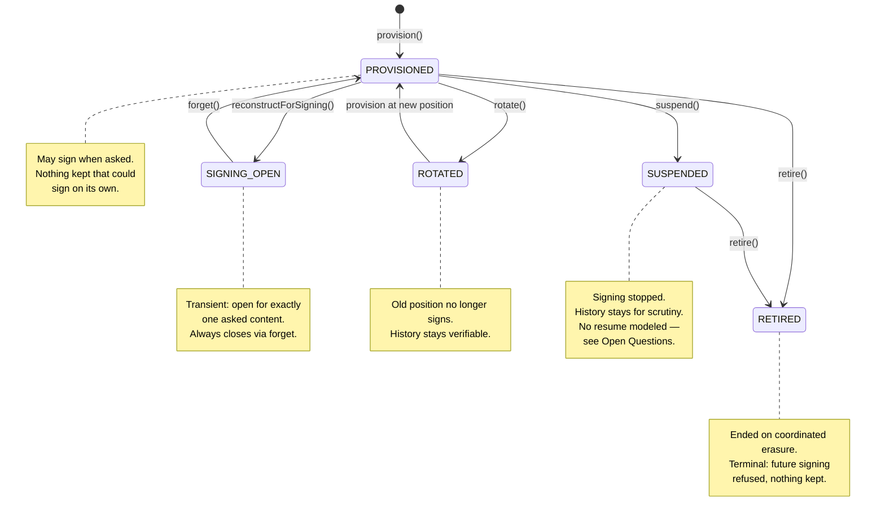
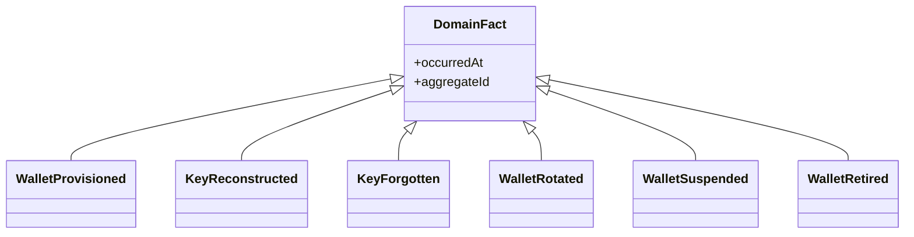

# Cryptographic Wallet Custody — Domain Model

This is the domain model of a Supporting Subdomain. It describes business meaning only:
the aggregate, its operations, value objects, domain facts (events), business rules,
and business rejections. It names no framework, library, storage, transport, or module structure.

Source: `event-storming.md` in this same folder (v0.1.0).
Reference input `docs/BrainStorming/VotoChain_DDD_Subdomains.md` §3 (+ §2 voting orchestration,
§15 correlation) was treated as hypothesis; deviations are logged under Hotspots.

> This context keeps each person's **signing capability**: what proves "this vote came from this person"
> without the person managing secrets themselves. It signs vote content only — it never pays for sending,
> never decides what a vote means, and never delivers anything anywhere.

## Aggregate Overview

One small aggregate. Each wallet is a consistency boundary for exactly one person's signing
capability. Transient signing use (reconstruct → forget) lives inside this boundary, not as a
separate aggregate: reconstruction, signing, and forgetting must succeed or fail together, and a
separate boundary would split that atomicity with no benefit. The wallet references the person and
the vote content by identity only — never by embedding.

---

## Aggregate: UserWallet

### Identity & Lifecycle

| Property | Meaning |
|----------|---------|
| `id` | Identity of this signing capability. Stable for its whole life, never reused |
| `personId` | The person it signs for (identity reference only; the person record lives elsewhere) |
| `position` | The unique derivation position this capability occupies |
| `standing` | Where the capability stands (see state machine) |
| `openFor` | The one vote content transiently open for signing, if any (identity reference only; content owned by Voting) |

### State Machine: WalletStanding

### Invariants (Always True)

| # | Invariant |
|---|-----------|
| 1 | One live (`PROVISIONED`) capability exists per person at most. Provisioning is once per person; a second live capability for the same person is unrepresentable |
| 2 | Nothing is kept anywhere that could sign on its own. Signing is possible only transiently, inside `SIGNING_OPEN`, for one asked content |
| 3 | Reconstruction is bound to exactly one vote content. It is always followed by forgetting — reuse across contents is unrepresentable |
| 4 | Each derivation position is occupied by at most one capability. Rotation moves to a fresh position; the old position never signs again |
| 5 | The person's capability signs content; a separate payer capability pays for sending. The two are never mixed inside this boundary |
| 6 | `RETIRED` is terminal. Past signatures stay verifiable history; future signing is refused |

### Mutating Operations

| Operation | Preconditions | Facts Produced |
|-----------|---------------|----------------|
| `provision()` | Person exists; no live capability for the same person; position fresh | `WalletProvisioned` |
| `reconstructForSigning()` | Standing is `PROVISIONED`; one specific vote content asked | `KeyReconstructed` |
| `forget()` | Standing is `SIGNING_OPEN` | `KeyForgotten` |
| `rotate()` | Standing is `PROVISIONED`; new position fresh | `WalletRotated` |
| `suspend()` | Standing is `PROVISIONED` | `WalletSuspended` |
| `retire()` | Not already `RETIRED`; retirement asked by erasure coordination | `WalletRetired` |

### Answering Operations (Read, but Owned by the Aggregate)

| Operation | Preconditions | Answers |
|-----------|---------------|---------|
| `answerSigningCapability()` | Always answerable | Whether the person may sign now, and with which capability and position |

### Read Needs (What the Domain Must Be Able to Answer)

| Need | Returns |
|------|---------|
| Signing capability | Whether the person may sign now, and with which capability |
| Adminship history (scrutiny) | Provisioning, rotations, suspensions, and retirement behind a past signature |

---

## Value Objects

No identity; defined entirely by attributes; immutable; invalid values are unrepresentable.

### UserWalletId / PersonId

- The stable identities of signing capabilities and persons.
- Equality is by value. Distinct kinds are never interchangeable.
- Person identity is held as a reference only; what it means for a person to exist is judged where the person record lives.

### DerivationPosition

- The unique ordered position one capability occupies (the domain rephrase of the hierarchy
  standard's per-person index: ordering + uniqueness kept, standard name dropped).
- One position, one capability. Freshness (never occupied before) is answerable from this object plus history.

### SignedContentRef

- A reference to the one vote content transiently open for signing. Owned by Voting; held here only as an identity.
- Bound at reconstruction, cleared at forgetting. Never open for two contents at once.

### Status Enumerations

- `WalletStanding` — `PROVISIONED`, `SIGNING_OPEN`, `ROTATED`, `SUSPENDED`, `RETIRED`.
- (`ROTATED` marks the moment of moving; the capability at the new position stands `PROVISIONED`.)

---

## Domain Events (Facts)

Past tense. Immutable. Each carries enough business data that consumers do not need to ask again for the common cases. Each is produced by exactly one aggregate operation.

| Event | Payload (business data) | Produced By | Interested Parties |
|-------|-------------------------|-------------|--------------------|
| `WalletProvisioned` | wallet, person, position | `UserWallet.provision()` | Signing gate, scrutiny record |
| `KeyReconstructed` | wallet, content reference | `UserWallet.reconstructForSigning()` | Signing flow (sign now, for this content only) |
| `KeyForgotten` | wallet, content reference | `UserWallet.forget()` | Scrutiny record (transient use ended) |
| `WalletRotated` | wallet, old position, new position | `UserWallet.rotate()` | Signing gate (new position), scrutiny record |
| `WalletSuspended` | wallet, reason | `UserWallet.suspend()` | Signing gate (refuse with reason), scrutiny record |
| `WalletRetired` | wallet, person | `UserWallet.retire()` | Consent & Compliance (retirement confirmation), signing gate |

---

## Business Rules (Policies)

Stated as domain rules. No mechanism named.

| Rule | Whenever… | Then… |
|------|-----------|-------|
| Nothing kept that could sign alone | A signing capability exists | Signing is possible only transiently, for one asked content; at rest nothing can sign |
| One content, then forgotten | Signing is asked for one vote content | It opens for that content only and closes immediately after — never reused across contents |
| Signer signs, payer pays | A vote is signed vs sent | The person's capability signs the content; a separate payer capability pays for sending — never mixed |
| Retirement honored from that moment | Retirement is coordinated (erasure confirmed) | The capability ends from that moment; past signatures stay verifiable, future signing is refused |

---

## Business Rejections

What the domain refuses, and why. These are business outcomes, not transport codes.

| Rejection | Meaning |
|-----------|---------|
| `CapabilityAlreadyExists` | Provision asked while a live capability already covers the same person |
| `CapabilityNotFound` | An operation refers to a capability that does not exist |
| `SigningNotAllowed_Suspended` | Reconstruction asked while standing is `SUSPENDED` |
| `SigningNotAllowed_Retired` | Reconstruction asked while standing is `RETIRED` |
| `ReconstructionAlreadyOpen` | Reconstruction asked while one content is already open (`SIGNING_OPEN`) |
| `ContentReuseRefused` | Signing asked for a different content than the one open |
| `RotationNotAllowed` | Rotation asked while suspended or retired |
| `WalletConcluded` | Any mutation asked of a `RETIRED` capability |

---

## Hotspots & Deviations from the Reference Input

| # | Matter | Position in this model |
|---|--------|------------------------|
| H1 | Reference suggests `UserWallet` root (§3.3) — one aggregate or more? | One aggregate. Reconstruct/forget is transient use inside the capability boundary, not an independent lifecycle; splitting would break the reconstruct → sign → forget atomicity |
| H2 | "No persistent private-key field" rephrased as "nothing kept that could sign on its own" | Deliberate rephrase: rule kept, mechanism words dropped. Exact audit boundary (derived material, cached content, logs) open — needs security review |
| H3 | Master-secret keeping and derivation standard rephrased ("kept apart", "unique derivation position") | Deliberate rephrase carried from storming: ordering + uniqueness kept, mechanism names dropped |
| H4 | No resume-from-suspension modeled | Suspension-only for now; resume is an open question, not a hidden operation |

## Open Questions

| # | Question | Standing |
|---|----------|----------|
| 1 | Resume from suspension: explicit operation, or suspension always followed by rotation/retirement? | Open — needs product decision |
| 2 | Rotation verifiability: does the old position stay verifiable for past votes while refusing new ones? | Open — default: yes (carried from storming H4) |
| 3 | Which suspension/retirement reasons must the person be told, and in which form? | Open — needs product decision |
| 4 | In-flight signing at erasure time: finish the asked signing or refuse immediately? | Open — needs product + legal |
| 5 | Exact audit boundary of "nothing kept that could sign on its own" | Open — needs security review |

## Related Documentation

| Document | Link |
|----------|------|
| Event Storming (this bounded context) | `event-storming.md` |
| Relay event storming (sibling, pays + sends what this context signs) | `../blockchain-relay-transaction-delivery/event-storming.md` |
| Relay domain model (sibling) | `../blockchain-relay-transaction-delivery/domain-model.md` |
| Voting event storming (consumer of signed content) | `../voting-verifiable-ledger/event-storming.md` |
| Subdomain map (input, hypothesis) | `docs/BrainStorming/VotoChain_DDD_Subdomains.md` §2 + §3 + §15 |
| Modeling example (shape reference) | `docs/References/domain-model.md` |
