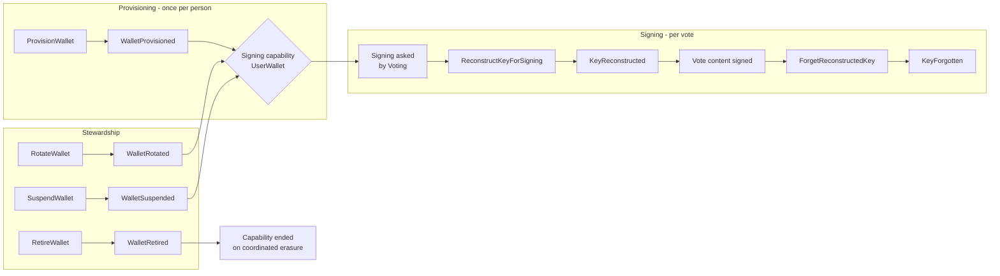
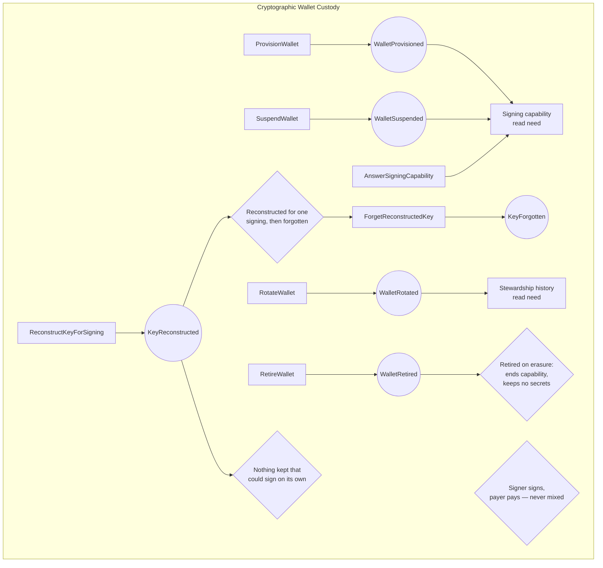

# Cryptographic Wallet Custody — Event Storming

This is the Big Picture + Design Level storming of a Supporting Subdomain. Pure domain language only.
It names no framework, library, storage, transport, or module structure.

Reference input `docs/BrainStorming/VotoChain_DDD_Subdomains.md` §3 (+ §2 voting orchestration,
§15 correlation) was treated as hypothesis, not truth. Deviations are logged as Hotspots.

> This context keeps each person's **signing capability**: what proves "this vote came from this person"
> without the person managing secrets themselves. It signs vote content only — it never pays for sending,
> never decides what a vote means, and never delivers anything anywhere. Paying and sending belong to
> `Blockchain Relay & Transaction Delivery`.

## Big Picture

## Design Level

## Commands

| # | Command | Intent | Actor |
|---|---------|--------|-------|
| 1 | `ProvisionWallet` | Create one person's signing capability, once, at a unique derivation position | Custodian (on person onboarding) |
| 2 | `ReconstructKeyForSigning` | Make signing possible transiently for one specific vote content | Voting (signing need) |
| 3 | `ForgetReconstructedKey` | End the transient use immediately after signing | Signing flow (always follows reconstruction) |
| 4 | `RotateWallet` | Replace the capability at a new derivation position after compromise or loss | Custody steward |
| 5 | `SuspendWallet` | Stop signing from this capability while keeping its history | Custody steward |
| 6 | `RetireWallet` | End the capability and destroy anything signing-related on coordinated erasure | Consent & Compliance coordination |
| 7 | `AnswerSigningCapability` | Answer whether the person may sign now, and with which capability | Voting (signing gate) |

## Domain Events (Facts)

| # | Fact | Meaning |
|---|------|---------|
| 1 | `WalletProvisioned` | One signing capability now exists for the person at one derivation position |
| 2 | `KeyReconstructed` | Signing made transiently possible for one specific vote content; nothing kept that could sign on its own |
| 3 | `KeyForgotten` | The transient signing possibility ended; nothing remains that could sign again |
| 4 | `WalletRotated` | The capability moved to a new derivation position; the old position no longer signs |
| 5 | `WalletSuspended` | Signing from this capability stopped; history stays for scrutiny |
| 6 | `WalletRetired` | The capability ended on coordinated erasure; nothing signing-related kept |

## Policies (Whenever / Then)

| # | Whenever… | Then… |
|---|-----------|-------|
| P1 | A signing capability exists | Nothing is kept anywhere that could sign on its own — signing is possible only transiently, for one asked content |
| P2 | Signing is asked for one vote content | It is reconstructed for that content only, and forgotten immediately after — never reused across contents |
| P3 | A vote is signed vs sent | The person's capability signs the content; a separate payer capability pays for sending — the two are never mixed |
| P4 | Erasure is coordinated (erasure confirmed) | The capability retires from that moment; past signatures stay verifiable history, future signing is refused |

## Read Needs

| Need | Returns |
|------|---------|
| Signing capability | Whether the person may sign now, and with which capability |
| Stewardship history (scrutiny) | Provisioning, rotations, suspensions, and retirement behind a past signature |

## Needs from Other Contexts (business language, not mechanisms)

| Need | From | Why |
|------|------|-----|
| Vote content to sign | Voting | Reconstruction is always for one specific content, never open-ended |
| Person existence | IAM (identity reference) | A capability belongs to exactly one person |
| Erasure coordination | Consent & Compliance | Retirement asked here once an erasure request is confirmed |
| Sending + paying | Blockchain Relay & Transaction Delivery | This context signs only; paying and sending happen elsewhere |
| (Offers) Signed vote content | (offered to) Voting | Voting delivers what this context signed |

## Hotspots & Open Questions

| # | Matter | Standing |
|---|--------|----------|
| H1 | Reference suggests `UserWallet` root with "no persistent private-key field" (§3.3) — how far does the prohibition reach (derived material, cached content, logs)? | Position: nothing kept anywhere that could sign on its own; transient use only. Exact audit boundary open — needs security review |
| H2 | Master secret keeping (§3.1 "hardware-kept secret modules") rephrased as "kept apart, opened only for derivation" | Deliberate rephrase: mechanism removed, domain rule kept. No behavior change intended |
| H3 | Derivation standard (§3.2 "deterministic hierarchy standard", "per-person position index") rephrased as "unique derivation position" | Deliberate rephrase: ordering + uniqueness kept, standard name dropped from the model |
| H4 | Rotation after compromise: does the old position stay verifiable for past votes while refusing new ones? | Open — default: yes, history stays verifiable, new signing refused |
| H5 | Signing while suspended or retired: refused with reason — which reasons must the person be told? | Open — needs product decision |
| H6 | In-flight signing at erasure time: finish the asked signing or refuse immediately? | Open — needs product + legal |

## Related Documentation

| Document | Link |
|----------|------|
| Relay event storming (sibling, pays + sends what this context signs) | `../blockchain-relay-transaction-delivery/event-storming.md` |
| Voting event storming (consumer of signed content) | `../voting-verifiable-ledger/event-storming.md` |
| Subdomain map (input, hypothesis) | `docs/BrainStorming/VotoChain_DDD_Subdomains.md` §2 + §3 + §15 |
| Modeling example (shape reference) | `docs/References/event-storming.md` |
