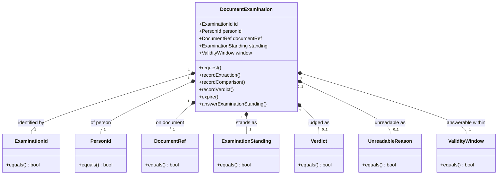
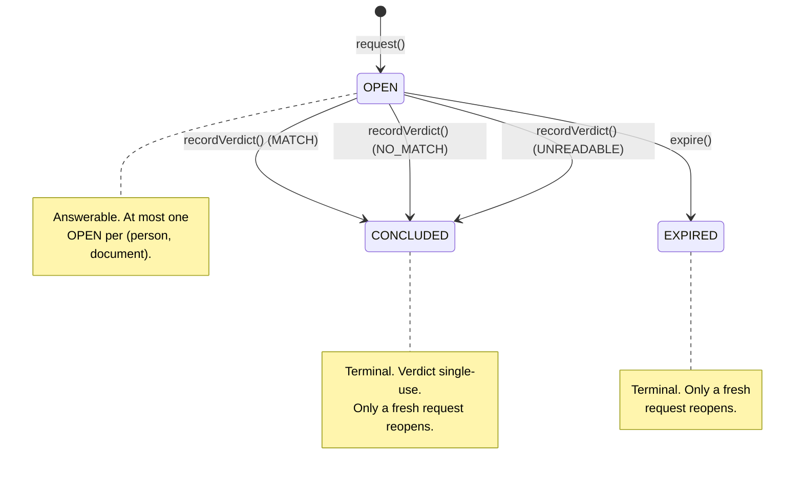
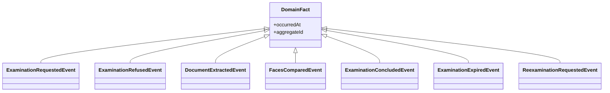

# Document OCR & Face Match Provider — Document Evidence — Domain Model

This is the domain model of a Generic Subdomain. It describes business meaning only:
the aggregate, its operations, value objects, domain facts (events), business rules,
and business rejections. It names no framework, library, storage, transport, or module structure.

Source: `event-storming.md` in this same folder (v0.1.0).
Reference inputs `docs/BrainStorming/VotoChain_DDD_Subdomains.md` §5 + §15 and
`docs/BrainStorming/VotoChain_Flujo_Biometrico_Wallet_ModeloB.md` §2 + §5 were treated as
hypothesis; deviations are logged under Hotspots.

> This context judges **document evidence** once: does this document read, and does this face
> hold against its portrait? It owns examination standing and the verdict — extraction,
> comparison math, and image handling live outside this boundary (executor-first, per the
> storming's locked decision). Membership is the precondition; Biometric enrollment consumes
> a `MATCH` once to seed its lasting reference; opt-in and erasure coordination live in
> `Consent & Compliance`.

## Aggregate Overview

One small aggregate. Each examination is a consistency boundary for exactly one
(person, document) proof. Extraction and comparison belong to the examination they were
recorded against — never separate lifecycles. Splitting them off would break request →
extract → compare → verdict atomicity with no benefit. Persons and documents are referenced
by identity only — never embedded.

---

## Aggregate: DocumentExamination

### Identity & Lifecycle

| Property | Meaning |
|----------|---------|
| `id` | Identity of this examination. Stable for its whole life, never reused |
| `personId` | The person under proof (identity reference only; the person record lives elsewhere) |
| `documentRef` | The document under proof (identity reference only; the document lives outside) |
| `standing` | Where the examination stands (see state machine) |
| `window` | When the examination was requested and how long it stays answerable |

### State Machine: ExaminationStanding

> Reexamination is never a transition: it closes nothing and reopens nothing. A fresh
> `request()` opens a new examination with its own identity, linked to the prior one
> for scrutiny only.

### Invariants (Always True)

| # | Invariant |
|---|-----------|
| 1 | At most one `OPEN` examination exists per (person, document) at any instant. A second request while one is open is refused — never doubled |
| 2 | A concluded examination never answers again. Its verdict is single-use: a `MATCH` is consumed once by Biometric enrollment, never re-asked |
| 3 | An expired examination never answers again. Only a fresh request reopens the proof |
| 4 | Evidence dies with the examination. No image, portrait, or comparison artifact is kept after the verdict — the lasting reference lives solely in Biometric |
| 5 | The verdict set is closed: `MATCH`, `NO_MATCH`, `UNREADABLE`. Unreadable reasons are closed at five |
| 6 | An examination is answerable only within its validity window. Past it, expiry is terminal |
| 7 | Nothing here proves a live person, keeps a reference, decides standing, or judges opt-in. Those are judged where they live |

### Mutating Operations

| Operation | Preconditions | Facts Produced |
|-----------|---------------|----------------|
| `request()` | Person belongs to at least one community (answered outside); processing allowed now (opt-in answered outside); no other `OPEN` examination for this (person, document) | `ExaminationRequestedEvent` — or `ExaminationRefusedEvent` (precondition fails) |
| `recordExtraction()` | Examination is `OPEN` and within its window | `DocumentExtractedEvent` (readable) — or `DocumentExtractedEvent` with unreadable reason |
| `recordComparison()` | Extraction read cleanly; examination still `OPEN` | `FacesComparedEvent` (holds / does not hold) |
| `recordVerdict()` | Extraction + comparison recorded; examination still `OPEN` | `ExaminationConcludedEvent` (carries verdict) |
| `expire()` | The validity window elapsed while `OPEN` | `ExaminationExpiredEvent` |

### Answering Operations (Read, but Owned by the Aggregate)

| Operation | Preconditions | Answers |
|-----------|---------------|---------|
| `answerExaminationStanding()` | Always answerable | Is there a usable (`MATCH`, unconsumed) verdict for person + document now |

### Read Needs (What the Domain Must Be Able to Answer)

| Need | Returns |
|------|---------|
| Examination standing | Usable `MATCH` now? — asked once by Biometric enrollment at reference-seeding time |
| Examination history (scrutiny) | What was requested, extracted, compared, and concluded, in order — requests, evidence judgments, verdicts, refusals |

---

## Value Objects

No identity; defined entirely by attributes; immutable; invalid values are unrepresentable.

### ExaminationId / PersonId / DocumentRef

- The stable identities of examinations, persons, and documents.
- Equality is by value. Distinct kinds are never interchangeable.
- Person and document identities are held as references only; what it means for a person to belong, or for a document to exist, is judged where those facts live.

### ExaminationStanding

- `OPEN`, `CONCLUDED`, `EXPIRED` — where the examination stands (see state machine).

### Verdict

- `MATCH` (reads + holds), `NO_MATCH` (reads but does not hold), `UNREADABLE` (cannot judge).
- Closed set. Recorded once per examination on `ExaminationConcluded`; single-use by construction.

### UnreadableReason

- Why no judgment was possible. Closed set: blurry, glare-covered, cropped, expired, mismatched document type.
- Recorded on the extraction fact for scrutiny; reexamination decisions consult it without rewriting it.

### ValidityWindow

- When the examination was requested and how long it stays answerable.
- Elapsed-or-not is answerable from this object plus the current moment. Past it, the examination expires on its own.

---

## Domain Events (Facts)

Past tense. Immutable. Each carries enough business data that consumers do not need to ask again for the common cases. Each is produced by exactly one aggregate operation. No fact carries images, portraits, comparison artifacts, vendor identifiers, or scores — judgments and closed reasons only.

| Event | Payload (business data) | Produced By | Interested Parties |
|-------|-------------------------|-------------|--------------------|
| `ExaminationRequestedEvent` | ExaminationId, PersonId, DocumentRef | `DocumentExamination.request()` | Examination standing, scrutiny history |
| `ExaminationRefusedEvent` | ExaminationId, PersonId, refusal reason | `DocumentExamination.request()` | Scrutiny history |
| `DocumentExtractedEvent` | ExaminationId, readable / UnreadableReason | `DocumentExamination.recordExtraction()` | Scrutiny history |
| `FacesComparedEvent` | ExaminationId, holds / does not hold | `DocumentExamination.recordComparison()` | Scrutiny history |
| `ExaminationConcludedEvent` | ExaminationId, Verdict | `DocumentExamination.recordVerdict()` | Biometric enrollment (consumes `MATCH` once), scrutiny history |
| `ExaminationExpiredEvent` | ExaminationId, PersonId | `DocumentExamination.expire()` | Scrutiny history |
| `ReexaminationRequestedEvent` | ExaminationId (prior), ExaminationId (new) | `DocumentExamination.request()` (fresh, linked to prior) | Scrutiny history |

---

## Business Rules (Policies)

Stated as domain rules. No mechanism named.

| Rule | Whenever… | Then… |
|------|-----------|-------|
| Unreadable offers reexamination | An examination concludes `UNREADABLE` | A fresh examination may be requested (unbounded; history append-only) |
| No-match closes without reference | An examination concludes `NO_MATCH` | Nothing seeds a reference; only a fresh request reopens |
| Match consumed once | A `MATCH` is asked by Biometric enrollment | The verdict is consumed; the lasting reference lives there, never re-asked here |
| Window elapses | The validity window elapses while `OPEN` | The examination expires; it can no longer answer |
| Executor swap changes nothing | The executing path changes | Standing, evidence record, and verdict vocabulary stay identical |

---

## Business Rejections

What the domain refuses, and why. These are business outcomes, not transport codes.

| Rejection | Meaning |
|-----------|---------|
| `NoEligibleMembership` | Request arrived for a person belonging to no community |
| `ContactNotAllowed` | Request arrived while processing is not allowed now (opt-in answered outside) |
| `ExaminationAlreadyOpen` | Request arrived while one is `OPEN` for the same (person, document) |
| `NoOpenExamination` | Evidence or verdict arrived with no `OPEN` examination |
| `AlreadyConcluded` | Evidence or verdict arrived for a concluded or expired examination |
| `DocumentUnreadable` | Extraction could not judge (carries the closed reason) |

---

## Hotspots & Deviations from the Reference Input

| # | Matter | Position in this model |
|---|--------|------------------------|
| H1 | Map §5 says executor-only, no lifecycle | Overruled per explicit team decision: one examination aggregate; executors interchangeable behind the verdict |
| H2 | Map §5 names executors, contracts, vectors, vendor identifiers, machine zones | Rejected from language — mechanism; execution is an external executor, named here only |
| H3 | Flujo §§1–4 names SDKs, contracts, tokens, derivation paths, queues, key custody | Confined to this hotspot; domain text keeps mechanism-free phrasing consistent with the Wallet/Relay models |
| H4 | One examination or split extraction vs comparison lifecycles? | One aggregate: splitting would break request → extract → compare → verdict atomicity with no benefit |
| H5 | Consumer ordering | Resolved: Membership is the precondition; Biometric enrollment consumes the `MATCH` once |
| H6 | Freshness, retry, retention | Resolved: single-use verdict; unbounded reexamination as new examinations; nothing kept here |

## Open Questions

| # | Question | Standing |
|---|----------|----------|
| — | None remaining | All workshop questions resolved during storming |

## Repository

`ExaminationRepository` (domain port): `findOpenByPersonAndDocument`, `findByIdOrThrow`, `findAllByPersonAndDocument` (history, in order), `findOpen` / `findLatestConcluded` (standing), `save`. At most one `OPEN` per (person, document); the partial unique index is the backstop.

## Factory / creation

Named creation is `DocumentExamination.request({ id, personId, documentRef, window })`, which emits `ExaminationRequestedEvent`. Reexamination is `requestReexamination(newId, window)` on a terminal examination — a new identity linked to the prior, emitting `ReexaminationRequestedEvent`. Reconstitution is only via `DocumentExamination.rehydrate({...})` and emits nothing.

---

## Related Documentation

| Document | Link |
|----------|------|
| Event Storming (this bounded context) | `event-storming.md` |
| Biometric Identity Verification event storming (sibling — consumes `MATCH` once, owns liveness + reference) | `../biometric-identity-verification/event-storming.md` |
| Membership event storming (sibling — precondition: person belongs before examination) | `../membership/event-storming.md` |
| Consent & Compliance event storming (sibling — owns opt-in + erasure coordination) | `../consent-compliance/event-storming.md` |
| Cryptographic Wallet Custody event storming (sibling — wallet derivation follows enrollment) | `../cryptographic-wallet-custody/event-storming.md` |
| Subdomain map (input, hypothesis) | `docs/BrainStorming/VotoChain_DDD_Subdomains.md` §5 + §15 |
| Biometric + wallet flow (input, hypothesis) | `docs/BrainStorming/VotoChain_Flujo_Biometrico_Wallet_ModeloB.md` §2 + §5 |
| Modeling example (shape reference) | `docs/References/domain-model.md` |
