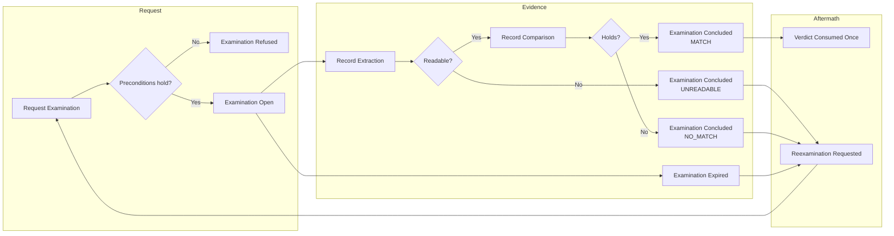

# Event Storming: Document OCR & Face Match Provider — Document Evidence (Generic Subdomain)

## Workshop Overview

| Aspect | Details |
|--------|---------|
| **Date** | 2026-09-07 |
| **Duration** | 1 session × 2 hours (eleventh and final context) |
| **Participants** | Domain Expert (Product), 2 Backend Engineers |
| **Facilitator** | Senior Engineer (DDD practitioner) |
| **Scope** | One document examination → one verdict: document extraction → portrait-vs-face comparison → single judgment (`MATCH` / `NO_MATCH` / `UNREADABLE`). Out of scope: live-person proof, lasting reference keeping, channel possession, person standing, opt-in judgment, actual extraction/comparison mechanics |
| **Tool** | Markdown + Mermaid (mirrors `docs/References/event-storming.md` conventions, in pure domain language) |
| **Input** | `docs/BrainStorming/VotoChain_DDD_Subdomains.md` §5 + §15 and `docs/BrainStorming/VotoChain_Flujo_Biometrico_Wallet_ModeloB.md` §2 (both treated as hypothesis, not truth — see Hotspots) |
| **Execution decision** | Extraction, comparison math, and image handling are **executed outside** (external executors, interchangeable: managed services primary, in-house path as drop-in). This artifact models what the domain **judges and owns**: examination standing, evidence record, verdict. Execution mechanics never appear here |

### Ubiquitous Language in scope (this context owns the meaning)

| Term | Domain definition (inside this BC) |
|---|---|
| **Examination** | One concrete proof for one person and one document. Born on request, dies on verdict or expiry |
| **Evidence** | The document image and presented face as received, held only while the examination is open |
| **Extraction** | What was read from the document (identity data + portrait reference). Judged readable or unreadable |
| **Comparison** | The portrait-vs-face judgment: holds or does not hold |
| **Verdict** | The single judgment on one examination: `MATCH` (reads + holds), `NO_MATCH` (reads but does not hold), `UNREADABLE` (cannot judge) |
| **ExaminationStanding** | Where the examination stands: `OPEN`, `CONCLUDED`, `EXPIRED` |
| **UnreadableReason** | Why no judgment was possible. Closed set: blurry, glare-covered, cropped, expired, mismatched document type |

> Do not confuse with `Biometric Identity Verification` — that context proves a **live person**
> against a lasting reference; this context judges **document evidence** once (does this document
> read, and does this face hold against its portrait?). Membership is the precondition (a person
> belongs to at least one community before examination); Biometric enrollment is the verdict
> consumer (a `MATCH` seeds the lasting reference there). Whether the person may be processed
> at all belongs to `Consent & Compliance`.

## Big Picture (Process Level)

## Commands (Intentions — Imperative, Named by the Business)

| Command | Actor | Preconditions (business) | Facts Produced |
|---------|-------|--------------------------|----------------|
| `RequestExamination` | Person (via onboarding) | Person belongs to at least one community (answered outside); processing allowed now (opt-in answered outside); no other `OPEN` examination for this (person, document) | `ExaminationRequested` — or `ExaminationRefused` (precondition fails) |
| `RecordExtraction` | Examination | Examination is `OPEN` and within its window | `DocumentExtracted` (readable, carries identity data reference) — or `DocumentExtracted` with unreadable reason |
| `RecordComparison` | Examination | Extraction read cleanly; examination still `OPEN` | `FacesCompared` (holds / does not hold) |
| `RecordVerdict` | Examination | Extraction + comparison recorded; examination still `OPEN` | `ExaminationConcluded` (carries verdict) |
| `ExpireExamination` | Examination | Window elapsed while `OPEN` | `ExaminationExpired` |
| `RequestReexamination` | Person (via onboarding) | Prior examination concluded `UNREADABLE` / `NO_MATCH` or expired (retry is unbounded; each retry is a new examination) | `ReexaminationRequested`, then `ExaminationRequested` |
| `AnswerExaminationStanding` | Any consumer | Always answerable | (answering op — no facts) |

## Domain Events (Facts — Past Tense)

| Fact | Payload (business data) | Consumers |
|------|-------------------------|-----------|
| `ExaminationRequested` | examination, person, document reference | Examination standing, scrutiny history |
| `ExaminationRefused` | examination, person, refusal reason | Scrutiny history |
| `DocumentExtracted` | examination, readable / unreadable + reason | Scrutiny history |
| `FacesCompared` | examination, holds / does not hold | Scrutiny history |
| `ExaminationConcluded` | examination, verdict (`MATCH` / `NO_MATCH` / `UNREADABLE`) | Biometric enrollment (consumes `MATCH` once), scrutiny history |
| `ExaminationExpired` | examination, person | Scrutiny history |
| `ReexaminationRequested` | prior examination, new examination | Scrutiny history |

> No fact carries images, vectors, vendor identifiers, or scores — judgments and closed reasons only.
> Portraits die with the examination; the lasting reference lives solely in Biometric.

## Policies (Business Rules — Whenever / Then)

| Policy | Whenever | Then |
|--------|----------|------|
| Unreadable offers reexamination | An examination concludes `UNREADABLE` | A fresh examination may be requested (unbounded; history append-only) |
| No-match closes without reference | An examination concludes `NO_MATCH` | Nothing seeds a reference; only a fresh request reopens |
| Match consumed once | A `MATCH` is asked by Biometric enrollment | The verdict is consumed; the lasting reference lives there, never re-asked here |
| Window elapses | The window elapses while `OPEN` | The examination expires; only a fresh request reopens |
| Executor swap changes nothing | The executing path changes (managed services ↔ in-house) | Standing, evidence record, and verdict vocabulary stay identical |

## Read Models / Needs (What the Domain Must Be Able to Answer)

| Need | Returns |
|------|---------|
| Examination standing | Usable `MATCH` now? — asked once by Biometric enrollment at reference-seeding time |
| Examination history (scrutiny) | What was requested, extracted, compared, and concluded, in order — requests, evidence judgments, verdicts, refusals |

## Hotspots & Deviations from the Reference Input

| # | Matter | Position in this model |
|---|--------|------------------------|
| H1 | Map §5 says executor-only, no lifecycle | Overruled per explicit team decision: full storming with one examination aggregate; executors interchangeable behind the verdict |
| H2 | Map §5 names executors, contracts, vectors, vendor identifiers, machine zones | Rejected from language — mechanism. Appear here only: execution is an external executor (managed services primary, in-house path as drop-in) |
| H3 | Flujo §§1–4 names SDKs, ports, tokens, derivation paths, queues, key custody | Confined to this hotspot. Domain text keeps mechanism-free phrasing consistent with the Wallet/Relay models |
| H4 | Who consumes the verdict first | Resolved: Membership is the precondition (Flujo §2: enrollment after Auth0 + ≥1 Membership); Biometric enrollment consumes the `MATCH` once to seed its lasting reference |
| H5 | Unreadable reasons open vs closed | Resolved: closed set of 5 (blurry, glare-covered, cropped, expired, mismatched document type) |
| H6 | Verdict freshness + retry | Resolved: single-use `MATCH`; unbounded reexamination, each a new examination |
| H7 | Portrait retention vs erasure | Resolved: nothing kept here — raw images never stored (Flujo §2 table + §5); erasure coordination ends the Biometric reference, nothing here |

## Open Questions

| # | Question | Standing |
|---|----------|----------|
| — | None remaining | All five workshop questions resolved during storming (see H4–H7) |

## Related Documentation

| Document | Link |
|----------|------|
| Biometric Identity Verification event storming (sibling — consumes `MATCH` once, owns liveness + reference) | `../biometric-identity-verification/event-storming.md` |
| Membership event storming (sibling — precondition: person belongs before examination) | `../membership/event-storming.md` |
| Consent & Compliance event storming (sibling — owns opt-in + erasure coordination) | `../consent-compliance/event-storming.md` |
| Cryptographic Wallet Custody event storming (sibling — wallet derivation follows enrollment, Flujo §2) | `../cryptographic-wallet-custody/event-storming.md` |
| Subdomain map (input, hypothesis) | `docs/BrainStorming/VotoChain_DDD_Subdomains.md` §5 + §15 |
| Biometric + wallet flow (input, hypothesis) | `docs/BrainStorming/VotoChain_Flujo_Biometrico_Wallet_ModeloB.md` §2 + §5 |
| Modeling example (shape reference) | `docs/References/event-storming.md` |
