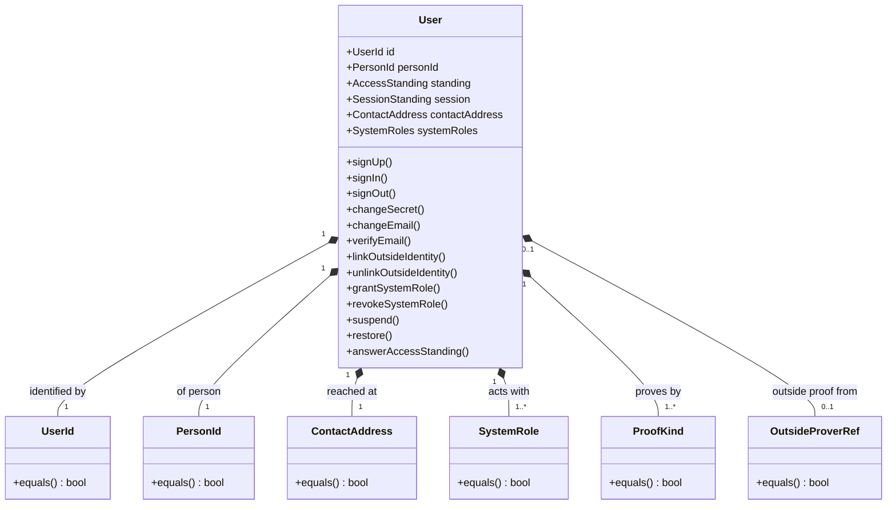
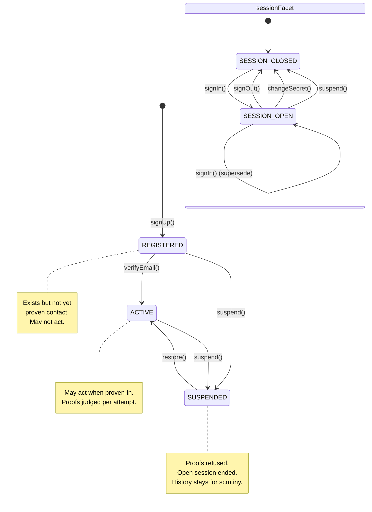
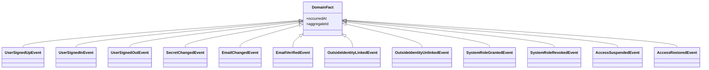

# IAM — Identity & Access Management — Domain Model

This is the domain model of a Supporting Subdomain. It describes business meaning only:
the aggregate, its operations, value objects, domain facts (events), business rules,
and business rejections. It names no framework, library, storage, transport, or module structure.

Source: `event-storming.md` in this same folder (v0.1.0).
Reference input `docs/BrainStorming/VotoChain_DDD_Subdomains.md` §7 + §15 was treated as hypothesis;
deviations are logged under Hotspots.

> This context keeps each person's **technical identity**: who may act, with which standing and which
> roles, and whether they are currently proven-in. It judges standing and owns the history — the
> execution of proofs, session artifacts, and deliveries lives outside this boundary (executor-first,
> per the storming's locked decision).

## Aggregate Overview

One small aggregate. Each user is a consistency boundary for exactly one person's technical
identity. The session is a standing facet of this identity (open or closed, at most one open) —
not a separate lifecycle. The linked outside proof is a facet of this identity — not a second
identity. Splitting either off would break the atomicity of sign-in → open session → supersede
prior, with no benefit. Membership, community, and physical identity are referenced by identity
only — never embedded.

---

## Aggregate: User

### Identity & Lifecycle

| Property | Meaning |
|----------|---------|
| `id` | Identity of this technical identity. Stable for its whole life, never reused |
| `personId` | The person it identifies (identity reference only; the person record lives elsewhere) |
| `standing` | Where the identity stands (see state machine) |
| `session` | Whether the person is currently proven-in: open or closed, at most one open |
| `contactAddress` | The recorded contact address plus whether it stands verified |
| `systemRoles` | The global technical permissions held (at least the plain standing; stewardship never empty) |
| `proofs` | The ways to prove: the local secret, plus at most one linked outside proof |

### State Machine: AccessStanding + SessionStanding

> The session facet moves only while standing allows it: `signIn()` requires `ACTIVE`;
> `suspend()` closes an open session as part of the same transition. Supersede re-enters
> `SESSION_OPEN` while recording the prior session's close (reason `superseded`).

### Invariants (Always True)

| # | Invariant |
|---|-----------|
| 1 | Exactly one technical identity exists per person. A second identity for the same person is unrepresentable |
| 2 | At most one open session exists per identity at any instant. A new sign-in supersedes the prior session — sessions are never doubled |
| 3 | At least one proof always remains: the local secret, the linked outside proof, or both. Unlinking the final way to prove is unrepresentable |
| 4 | At least one steward always remains. Revoking the final steward is unrepresentable — a domain invariant, not an overridable policy |
| 5 | `SUSPENDED` refuses proof and holds no open session. Restoration is the only way back to `ACTIVE` |
| 6 | The recorded contact address is either verified or unverified — never unknown. Changing the address resets verified standing until confirmation is observed |
| 7 | Nothing here carries membership standing, community configuration, or physical identity. Those are judged where they live |

### Mutating Operations

| Operation | Preconditions | Facts Produced |
|-----------|---------------|----------------|
| `signUp()` | Person not yet registered; contact address fresh and well-formed | `UserSignedUpEvent` |
| `signIn()` | Standing is `ACTIVE`; offered proof holds; prior open session (if any) closes as superseded | `UserSignedOutEvent` (superseded, only if a session was open), then `UserSignedInEvent` |
| `signOut()` | A session is open | `UserSignedOutEvent` |
| `changeSecret()` | Standing is `ACTIVE`; current proof holds; ends the open session | `SecretChangedEvent` (+ `UserSignedOutEvent` with reason `proof changed`, only if a session was open) |
| `changeEmail()` | Standing is not `SUSPENDED`; new address fresh and well-formed; resets verified standing | `EmailChangedEvent` |
| `verifyEmail()` | Confirmation observed from the outside delivery for the recorded address | `EmailVerifiedEvent` |
| `linkOutsideIdentity()` | Standing is `ACTIVE`; no outside proof linked yet; the outside proof is genuine | `OutsideIdentityLinkedEvent` |
| `unlinkOutsideIdentity()` | Another proof remains afterwards | `OutsideIdentityUnlinkedEvent` |
| `grantSystemRole()` | Role is a known system role; not already held | `SystemRoleGrantedEvent` |
| `revokeSystemRole()` | Role held; a steward remains afterwards | `SystemRoleRevokedEvent` |
| `suspend()` | Standing is not already `SUSPENDED`; reason recorded; ends the open session | `AccessSuspendedEvent` (+ `UserSignedOutEvent` with reason `suspended`, only if a session was open) |
| `restore()` | Standing is `SUSPENDED`; cause resolved | `AccessRestoredEvent` |

### Answering Operations (Read, but Owned by the Aggregate)

| Operation | Preconditions | Answers |
|-----------|---------------|---------|
| `answerAccessStanding()` | Always answerable | Whether this person may act now, with which system roles, and whether a session is open |

### Read Needs (What the Domain Must Be Able to Answer)

| Need | Returns |
|------|---------|
| Access standing | May act now? With which roles? Session open? — the answer every gated use case consumes |
| Identity history (scrutiny) | What happened to this identity, in order — sign-ups, proofs, sessions, roles, suspensions |
| System roles of a person | Which global permissions are held now |

---

## Value Objects

No identity; defined entirely by attributes; immutable; invalid values are unrepresentable.

### UserId / PersonId

- The stable identities of technical identities and persons.
- Equality is by value. Distinct kinds are never interchangeable.
- Person identity is held as a reference only; what it means for a person to exist is judged where the person record lives.

### ContactAddress

- The recorded contact address (the channel the person is reached at) plus its verified standing.
- Freshness (never held by another identity) and well-formedness are answerable from this object plus history.
- Changing the address yields a new unverified value; verification flips the standing, never the address.

### SystemRole

- One global technical permission: `ADMIN` (keeps the system governable) or `USER` (ordinary person). Further roles are added as values, not as structure.
- The set held always contains at least one steward somewhere in the system (invariant 4 guards the final one).

### ProofKind

- How identity was proven for a given sign-in: `LOCAL` (the person's own secret) or `OUTSIDE` (the linked outside proof).
- Recorded on the sign-in fact for scrutiny; the mechanics of either proof stay outside this boundary.

### OutsideProverRef

- A reference to the one agreed outside prover the linked proof is vouched by. At most one linked at a time.
- Held as a reference only; what makes a proof genuine is judged where execution lives.

### Status Enumerations

- `AccessStanding` — `REGISTERED`, `ACTIVE`, `SUSPENDED`.
- `SessionStanding` — `SESSION_CLOSED`, `SESSION_OPEN`.
- `SignOutReason` — `ASKED`, `SUPERSEDED`, `PROOF_CHANGED`, `SUSPENDED`.

---

## Domain Events (Facts)

Past tense. Immutable. Each carries enough business data that consumers do not need to ask again for the common cases. Each is produced by exactly one aggregate operation.

| Event | Payload (business data) | Produced By | Interested Parties |
|-------|-------------------------|-------------|--------------------|
| `UserSignedUpEvent` | `UserId`, `PersonId`, `ContactAddress` | `User.signUp()` | Identity history, person notice (welcome) |
| `UserSignedInEvent` | `UserId`, `PersonId`, `ProofKind` | `User.signIn()` | Access standing, identity history |
| `UserSignedOutEvent` | `UserId`, `PersonId`, `SignOutReason` | `User.signIn()` (supersede) / `User.signOut()` / `User.changeSecret()` / `User.suspend()` | Access standing, identity history |
| `SecretChangedEvent` | `UserId` | `User.changeSecret()` | Identity history, person notice (security) |
| `EmailChangedEvent` | `UserId`, old `ContactAddress`, new `ContactAddress` | `User.changeEmail()` | Identity history, person notice (both addresses) |
| `EmailVerifiedEvent` | `UserId`, `ContactAddress` | `User.verifyEmail()` | Access standing, identity history |
| `OutsideIdentityLinkedEvent` | `UserId`, `OutsideProverRef` | `User.linkOutsideIdentity()` | Access standing (second proof), identity history |
| `OutsideIdentityUnlinkedEvent` | `UserId`, `OutsideProverRef` | `User.unlinkOutsideIdentity()` | Identity history |
| `SystemRoleGrantedEvent` | `UserId`, `SystemRole` | `User.grantSystemRole()` | Access standing, authorization answers |
| `SystemRoleRevokedEvent` | `UserId`, `SystemRole` | `User.revokeSystemRole()` | Access standing, authorization answers |
| `AccessSuspendedEvent` | `UserId`, reason | `User.suspend()` | Access standing (refuse), person notice (security) |
| `AccessRestoredEvent` | `UserId` | `User.restore()` | Access standing, person notice |

---

## Business Rules (Policies)

Stated as domain rules. No mechanism named.

| Rule | Whenever… | Then… |
|------|-----------|-------|
| Repeated failed proof suspends | A failed-proof signal is observed from outside, past the agreed count | Access suspends with reason; the count resets on a successful proof (default, needs expert confirmation) |
| Secret change ends the session | The secret changes | The open session ends with reason `proof changed`; acting again requires the new proof |
| Suspension ends the session | Access suspends | The open session ends with reason `suspended`; further proofs are refused until restoration |
| Last proof / last steward refusal | An unlink would remove the final way to prove; a revocation would remove the final steward | Refused as invariants — a person always keeps one way to prove, the system always keeps one steward |

---

## Business Rejections

What the domain refuses, and why. These are business outcomes, not transport codes.

| Rejection | Meaning |
|-----------|---------|
| `AlreadyRegistered` | Sign-up asked for a person that already has an identity |
| `ProofNotHeld` | Sign-in (or secret change) offered a proof that does not hold |
| `SuspendedRefused` | Any proof offered while standing is `SUSPENDED` |
| `NoOpenSession` | Sign-out asked while no session is open |
| `LastProofRefused` | Unlink asked while it is the final way to prove |
| `LastStewardRefused` | Revocation asked while it is the final steward |
| `OutsideProofAlreadyLinked` | Link asked while an outside proof is already linked (one prover for now) |
| `AddressAlreadyHeld` | Sign-up or address change asked with an address held by another identity |
| `RoleAlreadyHeld` / `RoleNotHeld` | Grant of a held role, or revocation of an unheld role |

---

## Hotspots & Deviations from the Reference Input

| # | Matter | Position in this model |
|---|--------|------------------------|
| H1 | Reference §7 demands `User` without membership/community fields | Honored: identity, proofs, session standing, contact address, system roles only |
| H2 | One aggregate or a separate session lifecycle? | One aggregate. The session is a standing facet with at most one open; splitting would break sign-in → open → supersede atomicity with no benefit |
| H3 | Executor-first vs local proof mechanics | Executor-first per YAGNI (locked in storming): execution outside, judgment + history inside. IAM stays Supporting/Low-investment |
| H4 | Supersede vs refuse on a second sign-in | Supersede (default, needs expert confirmation): prior session closes with reason `superseded` as part of the same `signIn()` transition |
| H5 | Failed-proof count and reset | Counted where executed, judged here; reset on successful proof (default, needs expert confirmation) |
| H6 | Email standing vs delivery | Standing judged here (`EmailVerified` on observed confirmation); delivery mechanics outside (locked in storming) |

## Open Questions

| # | Question | Standing |
|---|----------|----------|
| 1 | Supersede vs refuse on a second sign-in — confirm supersede? | Open — needs product decision |
| 2 | Failed-proof threshold count and reset rule — confirm reset-on-success? | Open — needs product decision |
| 3 | Which system roles exist beyond steward / plain person, and who may grant them? | Open — needs product decision |
| 4 | Must suspension and address-change reasons be told to the person, and through which notice? | Open — needs product decision |
| 5 | Session presence across devices — one presence total, or one per device under a single standing? | Open — parked |
| 6 | Further provers later — at what point does the one-prover default break? | Open — parked, revisit on a concrete driver |

## Repository

Interface in domain for the single aggregate root. Finders use ubiquitous language; wire `eventName` strings unchanged.

| Repository | Finders |
|------------|---------|
| `UserRepository` (`USER_REPOSITORY`) | `findById(id: UserId)`, `findByPersonId(personId: PersonId)`, `findByEmail(email: string)`, `save(user: User)` |

## Factory / creation

Named create path vs rehydrate split (rehydrate never raises events): `User.signup({ contact })` mints `UserId` + `PersonId` and raises `UserSignedUpEvent`. `User.rehydrate({ id, personId, standing, session, contact, roles, outsideProver })` rebuilds stored state without events.

## Related Documentation

| Document | Link |
|----------|------|
| Event Storming (this bounded context) | `event-storming.md` |
| Membership event storming (sibling — owns eligibility, references this identity) | `../membership/event-storming.md` |
| Community Management event storming (sibling — owns community config and admins) | `../community-management/event-storming.md` |
| Biometric Identity Verification event storming (sibling — owns physical identity proof) | `../biometric-identity-verification/event-storming.md` |
| Subdomain map (input, hypothesis) | `docs/BrainStorming/VotoChain_DDD_Subdomains.md` §7 + §15 |
| Modeling example (shape reference) | `docs/References/domain-model.md` |
