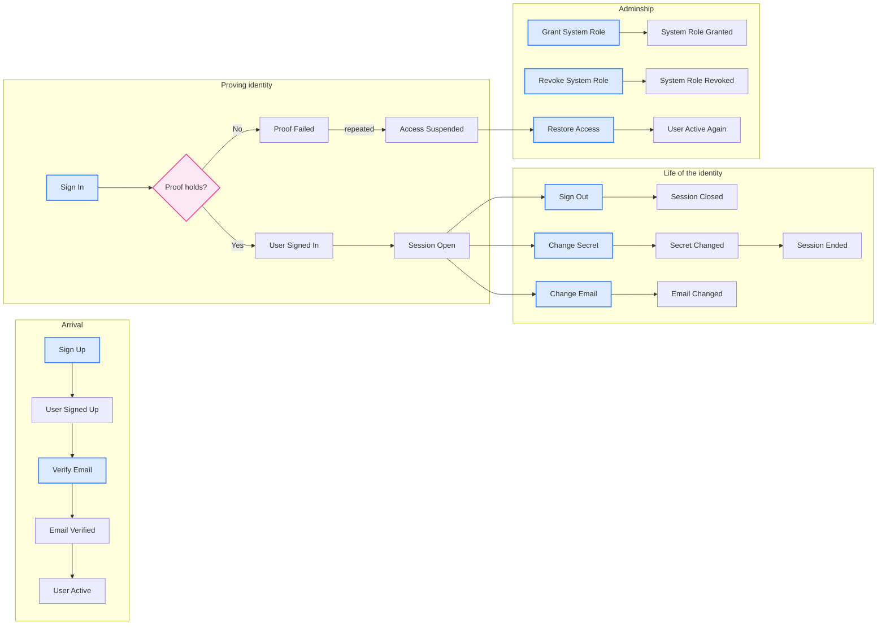

# Event Storming: IAM — Identity & Access Management (Supporting Subdomain)

## Workshop Overview

| Aspect | Details |
|--------|---------|
| **Date** | 2026-09-07 |
| **Duration** | 1 session × 2 hours (eighth context, after Wallet Custody + Relay delivery) |
| **Participants** | Domain Expert (Product), 2 Backend Engineers |
| **Facilitator** | Senior Engineer (DDD practitioner) |
| **Scope** | Technical identity of one person → proof of identity (local secret + one linked outside proof) → single open session → system roles → suspension and restoration. Out of scope: community configuration, membership standing and eligibility, physical identity proof, vote casting and counting, channel delivery itself |
| **Tool** | Markdown + Mermaid (mirrors `docs/References/event-storming.md` conventions, in pure domain language) |
| **Input** | `docs/BrainStorming/VotoChain_DDD_Subdomains.md` §7 + §15 (treated as hypothesis, not truth — see Hotspots) |
| **Execution decision** | Credential proof, session proof, and email delivery are **executed by an external executor** (Auth0-first, no local build — see Hotspots). This artifact models what the domain **judges and owns**; execution mechanics never appear here |

### Ubiquitous Language in scope (this context owns the meaning)

| Term | Domain definition (inside this BC) |
|---|---|
| **User** | The technical identity of one person; exactly 1 per person. Never carries membership standing, community data, or physical identity |
| **Secret** | The local proof material a person offers to prove identity (what the person knows). This context judges proofs; it never exposes the material itself |
| **Outside proof** | Identity proof vouched by the one agreed outside prover and linked to this `User`. A second way to prove, not a second identity |
| **Session** | The standing of being currently proven-in: at most one open session per `User` at any instant |
| **System Role** | A global technical permission (e.g. admin vs user person) — distinct from a member's community role and from administering a community |
| **Access standing** | Where this identity stands: `REGISTERED`, `ACTIVE`, `SUSPENDED` — plus whether a session is open |
| **Email identity** | The contact address recorded for this `User` and whether it stands verified. Standing is judged here; delivery of the verification is executed outside |

> One person is one `User` with N memberships elsewhere. This context never owns community configuration (that lives in `Community Management`), never judges membership standing or eligibility (that lives in `Membership`), and never proves physical identity (that lives in `Biometric Identity Verification`). Other contexts reference the person by identity only.

## Big Picture (Process Level)



### Pivotal points (candidate boundary signals)

1. `User Signed Up` → the technical identity exists from here; nothing else may act for this person yet.
2. `User Signed In` → exactly one open session from here; a new sign-in while one is open supersedes the prior session (default, needs expert confirmation).
3. `Access Suspended` → the open session ends here and further proofs are refused until restoration.
4. `System Role Revoked` → refused when it would remove the final admin (domain invariant, not policy).

## Design Level — User Aggregate

> Design decision: one small aggregate, `User`, referenced by person identity only. The session is a standing of this identity (open/closed, at most one open), not a separate object with its own lifecycle. The outside proof is a linked facet of this identity, not a second identity. Execution of proofs, session artifacts, and deliveries lives outside this boundary; this context judges standing and owns the history.

```mermaid
graph TD
    subgraph "Commands (Intent)"
        C1[SignUpCommand]
        C2[SignInCommand]
        C3[SignOutCommand]
        C4[ChangeSecretCommand]
        C5[ChangeEmailCommand]
        C6[VerifyEmailCommand]
        C7[LinkOutsideIdentityCommand]
        C8[UnlinkOutsideIdentityCommand]
        C9[GrantSystemRoleCommand]
        C10[RevokeSystemRoleCommand]
        C11[SuspendAccessCommand]
        C12[RestoreAccessCommand]
        C13[AnswerAccessStanding]
    end

    subgraph "Aggregate: User"
        U[User<br/>(Aggregate Root)]
        U --- UState[State: AccessStanding<br/>REGISTERED/ACTIVE/<br/>SUSPENDED]
        U --- USess[Session: open/closed<br/>at most one open]
        U --- UProof[Proofs: local secret<br/>+ linked outside proof]
        U --- UEmail[Email identity<br/>address + verified standing]
        U --- URoles[SystemRoles<br/>admin / user]
    end

    subgraph "Events (Facts)"
        E1[UserSignedUp]
        E2[UserSignedIn]
        E3[UserSignedOut]
        E4[SecretChanged]
        E5[EmailChanged]
        E6[EmailVerified]
        E7[OutsideIdentityLinked]
        E8[OutsideIdentityUnlinked]
        E9[SystemRoleGranted]
        E10[SystemRoleRevoked]
        E11[AccessSuspended]
        E12[AccessRestored]
    end

    subgraph "Policies (Reactions)"
        Pol1[Repeated failed proof suspends access]
        Pol2[Secret change ends the open session]
        Pol3[Suspension ends the open session]
        Pol4[Last proof never unlinked; last admin never revoked]
    end

    subgraph "Read Models"
        RM1[Access Standing - may this person act now, with which roles]
        RM2[Identity History - what happened to this identity, for scrutiny]
        RM3[System Roles of a Person]
    end

    subgraph "Needs from other contexts (business language)"
        Ext1[Proof executed outside - credential holds or not, per attempt]
        Ext2[Session proof executed outside - issued, renewed, ended on instruction]
        Ext3[Verification delivery executed outside - the person was asked to confirm]
        Ext4[Person notice - delivered via Notifications, owned there]
        Ext5[Membership + Community - judge their own standing; reference this identity only]
    end

    C1 --> U
    C2 --> U
    C3 --> U
    C4 --> U
    C5 --> U
    C6 --> U
    C7 --> U
    C8 --> U
    C9 --> U
    C10 --> U
    C11 --> U
    C12 --> U
    C13 --> U

    U --> E1
    U --> E2
    U --> E3
    U --> E4
    U --> E5
    U --> E6
    U --> E7
    U --> E8
    U --> E9
    U --> E10
    U --> E11
    U --> E12

    E2 --> Pol2
    E4 --> Pol2
    E11 --> Pol3
    E8 --> Pol4
    E10 --> Pol4

    E1 -.-> RM2
    E2 -.-> RM1
    E3 -.-> RM1
    E9 -.-> RM3
    E10 -.-> RM3
    E11 -.-> RM1
    E12 -.-> RM1
    E11 -.-> RM2

    C2 --> Ext1
    C4 --> Ext1
    E2 -.-> Ext2
    E3 -.-> Ext2
    E4 -.-> Ext2
    E5 -.-> Ext3
    E11 -.-> Ext4
    E12 -.-> Ext4

    classDef cmd fill:#dbeafe,stroke:#3b82f6,stroke-width:2px;
    classDef agg fill:#dcfce7,stroke:#22c55e,stroke-width:3px;
    classDef evt fill:#fef3c7,stroke:#f59e0b,stroke-width:2px;
    classDef pol fill:#fce7f3,stroke:#ec4899,stroke-width:2px;
    classDef rm fill:#e0e7ff,stroke:#6366f1,stroke-width:2px;
    classDef ext fill:#e5e7eb,stroke:#6b7280,stroke-width:2px;

    class C1,C2,C3,C4,C5,C6,C7,C8,C9,C10,C11,C12,C13 cmd;
    class U,UState,USess,UProof,UEmail,URoles agg;
    class E1,E2,E3,E4,E5,E6,E7,E8,E9,E10,E11,E12 evt;
    class Pol1,Pol2,Pol3,Pol4 pol;
    class RM1,RM2,RM3 rm;
    class Ext1,Ext2,Ext3,Ext4,Ext5 ext;
```

## Key Discoveries

### Aggregates Identified

| Aggregate | Root | Invariants |
|-----------|------|------------|
| **User** | `User` | Exactly one technical identity per person; standing follows `REGISTERED → ACTIVE ⇄ SUSPENDED`; at most one open session at any instant; at least one proof always remains (local secret or the linked outside proof); at least one admin always remains; `SUSPENDED` refuses proof and ends the open session |

### Commands (12 + 1 answering)

| Command | Aggregate | Validation |
|---------|-----------|------------|
| `SignUpCommand` | User | Person not yet registered; contact address fresh and well-formed |
| `SignInCommand` | User | Identity `ACTIVE`; offered proof holds; a prior open session is superseded, not doubled |
| `SignOutCommand` | User | A session is open |
| `ChangeSecretCommand` | User | Identity `ACTIVE`; current proof holds; ends the open session |
| `ChangeEmailCommand` | User | Identity not `SUSPENDED`; new address fresh and well-formed; verification standing resets to unverified |
| `VerifyEmailCommand` | User | Confirmation observed from the outside delivery; marks the recorded address verified |
| `LinkOutsideIdentityCommand` | User | Identity `ACTIVE`; no outside proof linked yet (one prover for now); the outside proof is genuine |
| `UnlinkOutsideIdentityCommand` | User | Another proof remains afterwards — never unlinks the last way to prove |
| `GrantSystemRoleCommand` | User | Role is a known system role; not already held |
| `RevokeSystemRoleCommand` | User | Role held; never revokes the final admin |
| `SuspendAccessCommand` | User | Identity not already `SUSPENDED`; reason recorded; ends the open session |
| `RestoreAccessCommand` | User | Identity `SUSPENDED`; cause resolved |
| `AnswerAccessStanding` | User (read) | Always answerable: may this person act now, with which roles, and is a session open |

### Events (12 Published)

| Event | Payload | Downstream Consumers |
|-------|---------|---------------------|
| `UserSignedUp` | person, contact address | Identity history, person notice (welcome) |
| `UserSignedIn` | person, which proof (local / outside) | Access standing, identity history |
| `UserSignedOut` | person, reason (asked / superseded / proof changed / suspended) | Access standing, identity history |
| `SecretChanged` | person | Identity history, person notice (security) |
| `EmailChanged` | person, old address, new address | Identity history, person notice (both addresses) |
| `EmailVerified` | person, address | Access standing (verified contact), identity history |
| `OutsideIdentityLinked` | person, prover reference | Identity history, access standing (second proof) |
| `OutsideIdentityUnlinked` | person, prover reference | Identity history |
| `SystemRoleGranted` | person, role | Access standing, authorization answers |
| `SystemRoleRevoked` | person, role | Access standing, authorization answers |
| `AccessSuspended` | person, reason | Access standing (refuse), person notice (security) |
| `AccessRestored` | person | Access standing, person notice |

### Policies (Business Rules)

| Policy | Trigger | Action |
|--------|---------|--------|
| **Repeated failed proof suspends** | Failed-proof signal observed from the executor, past the agreed count | `SuspendAccessCommand` with reason; the count resets on a successful proof (default, needs expert confirmation) |
| **Secret change ends the session** | `SecretChanged` | The open session ends; proving again requires the new secret |
| **Suspension ends the session** | `AccessSuspended` | The open session ends; further proofs refused until `AccessRestored` |
| **Last proof / last admin refusal** | `UnlinkOutsideIdentityCommand` on the final proof; `RevokeSystemRoleCommand` on the final admin | Refused as domain invariants — a person always keeps one way to prove, the system always keeps one admin |

### Read Models

| Read Model | Source events | Consumers |
|------------|---------------|-----------|
| Access Standing (may act now? which roles? session open?) | `UserSignedIn`, `UserSignedOut`, `SystemRoleGranted`, `SystemRoleRevoked`, `AccessSuspended`, `AccessRestored` | Every gated use case across contexts |
| Identity History (what happened, for scrutiny) | `UserSignedUp`, `UserSignedIn`, `UserSignedOut`, `SecretChanged`, `EmailChanged`, `EmailVerified`, `OutsideIdentityLinked`, `OutsideIdentityUnlinked`, `AccessSuspended`, `AccessRestored` | Scrutiny, audit answers |
| System Roles of a Person | `SystemRoleGranted`, `SystemRoleRevoked` | Authorization answers |

### Needs from other contexts (business language, never direct model access)

| Need | Direction | Meaning |
|------|-----------|---------|
| Proof holds or not | Observed per attempt from the external executor | This context judges standing on the verdict; it never performs the proof mechanics itself |
| Session proof issued / renewed / ended | Instructed to the external executor | `UserSignedIn` / `UserSignedOut` are the domain facts; the artifact mechanics stay outside |
| Person asked to confirm (email verification) | Instructed to the external executor | `VerifyEmailCommand` records the observed confirmation; delivery mechanics stay outside |
| Person notice delivered | Asked of Notifications | Welcome, security, and address-change notices; content reasons travel, business rules do not |
| Membership / Community judge their own standing | Referenced by identity only | Suspension here never rewrites membership or community state; each context judges its own |

## Hotspots (Contentious Decisions)

| # | Hotspot | Decision in this artifact | Rationale |
|---|---------|---------------------------|-----------|
| H1 | **Reference §7 suggests `User` root that must not contain membership/community fields** | Honored: `User` carries identity, proofs, session standing, email identity, and system roles only — nothing of membership, community, or physical identity | Keeps one rate of change per aggregate; membership and community evolve on their own events |
| H2 | **Executor-first (no local build) vs local proof + own session artifacts** | Executor-first, per YAGNI and the map's "rely on Auth0" strategy: execution outside, judgment + history inside | IAM is Supporting/Low-investment; building proprietary proof mechanics would contradict the agreed strategy without a concrete driver |
| H3 | **One outside prover for now vs many** | One linked outside proof at most; adding a second prover later is a new mapping, not a domain change | Keeps the "at least one proof remains" invariant simple; multiplicity is an execution concern |
| H4 | **Single open session: refuse the new sign-in or supersede the old?** | Supersede (default, needs expert confirmation): the prior session closes with reason `superseded` and the new one opens | Matches one-person-one-presence; refusal would strand legitimate re-entry |
| H5 | **Failed-proof count: where does it live?** | Counted where executed, judged here: suspension is a domain fact on the observed signal; the count resets on successful proof (default, needs expert confirmation) | Keeps mechanics outside while the standing decision stays a domain judgment with history |
| H6 | **Last admin: invariant or policy?** | Domain invariant: the final admin can never be revoked (locked decision) | The system must always keep one admin; policies can be overridden, invariants cannot |
| H7 | **Email change + verification: owned here or delegated to OTP + Notifications?** | Standing owned here (locked decision); delivery executed outside | The address is part of this identity, so its verified standing is judged here; only the delivery mechanics are external |

## Open Questions / Parking Lot

| # | Question | Status | Owner |
|---|----------|--------|-------|
| 1 | Supersede vs refuse on a second sign-in — confirm supersede as the standing rule? | Open — needs product decision | Product |
| 2 | Failed-proof threshold count and reset rule — confirm reset-on-success? | Open — needs product decision | Product |
| 3 | Which system roles exist (beyond admin / user), and who may grant them? | Open | Product |
| 4 | Must suspension and address-change reasons be told to the person, and through which notice? | Open | Product |
| 5 | Session presence across devices — one presence total, or one per device under a single standing? | Open — parked | Product |
| 6 | Passwordless or further provers later — at what point does the one-prover default break? | Open — parked, revisit when a concrete driver appears | Product |

## Related Documentation

| Document | Link |
|----------|------|
| Subdomain map (input, hypothesis) | `docs/BrainStorming/VotoChain_DDD_Subdomains.md` §7 + §15 |
| Membership event storming (sibling — owns eligibility, references this identity) | `../membership/event-storming.md` |
| Community Management event storming (sibling — owns community config and admins) | `../community-management/event-storming.md` |
| Biometric Identity Verification event storming (sibling — owns physical identity proof) | `../biometric-identity-verification/event-storming.md` |
| Diagram conventions (example) | `docs/References/event-storming.md` |

(End of file - total lines: see file)
