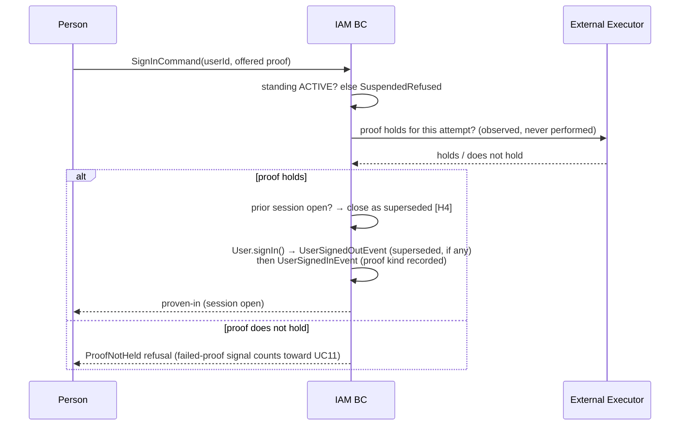

# IAM — Identity & Access Management — Application Layer

This document describes **orchestration**, not business meaning. It answers: in what
order do things happen, who calls whom, and what crosses this bounded context's
boundary to prove one person in. It names no framework, transport, or storage —
same discipline as `domain-model.md`.

Source of business meaning: `domain-model.md` (this same folder). This document adds
nothing new to *what the aggregate can do*; it only sequences calls to the aggregate
and to other bounded contexts, per the rules already frozen in `context-mapping.md`.

A use case here is triggered either by an external request (synchronous) or by a fact
this context reacts to (event-driven). Both are documented the same way.

Naming convention (frozen for all `use-case.md` documents): commands are
`Action+Target+Command` (e.g. `CreateOrderCommand`), events are
`Target+PastAction+Event` (e.g. `OrderCreatedEvent`), queries are
`Action+Target+Criteria+Query` (e.g. `GetOrderByIdQuery`). A query name may grow
whenever the criteria need declaring.

> Executor-first (locked decision): proof execution, session artifacts, and deliveries
> live outside this boundary. This context judges standing and owns the history —
> every external verdict below is consumed as a fact, never performed here.

---

## 1. Use Case Catalog

| # | Use Case | Trigger | Aggregates Touched | External BCs Consulted | Facts Produced |
|---|----------|---------|--------------------|-------------------------|-----------------|
| UC1 | SignUp | Person request with a fresh contact address | `User` | — (address freshness checked against own history) | `UserSignedUpEvent` |
| UC2 | **SignIn** (anchor) | Person request offering a proof | `User` | External executor (proof holds or not, observed per attempt) | `UserSignedOutEvent` (superseded, only if a session was open), then `UserSignedInEvent` |
| UC3 | SignOut | Person request while proven-in | `User` | — | `UserSignedOutEvent` (asked) |
| UC4 | ChangeSecret | Person request proving with the current secret | `User` | External executor (current proof holds) | `SecretChangedEvent` (+ `UserSignedOutEvent` with reason `proof changed`, only if a session was open) |
| UC5 | ChangeEmail | Person request with a fresh address | `User` | — | `EmailChangedEvent` (standing resets to unverified) |
| UC6 | VerifyEmail | Observed confirmation for the recorded address | `User` | Verification OTP (`ChallengeConfirmedEvent`, R9); delivery executed outside | `EmailVerifiedEvent` |
| UC7 | LinkOutsideIdentity | Person request with a genuine outside proof | `User` | Outside prover (genuineness judged where execution lives) | `OutsideIdentityLinkedEvent` |
| UC8 | UnlinkOutsideIdentity | Person request | `User` | — | `OutsideIdentityUnlinkedEvent` |
| UC9 | GrantSystemRole | Admin request | `User` | — | `SystemRoleGrantedEvent` |
| UC10 | RevokeSystemRole | Admin request | `User` | — | `SystemRoleRevokedEvent` |
| UC11 | SuspendAccess | Failed-proof signal past the agreed count, or admin decision | `User` | External executor (failed-proof signal observed) | `AccessSuspendedEvent` (+ `UserSignedOutEvent` with reason `suspended`, only if a session was open) |
| UC12 | RestoreAccess | Admin request once cause resolved | `User` | — | `AccessRestoredEvent` |
| UC13 | AnswerAccessStanding | Any gated use case across contexts | `User` (answering operation only) | — | — (synchronous answer, no fact) |

UC2 is detailed fully below because the judge-proof → open-session → supersede-prior
atomicity is the orchestration most likely to be gotten wrong (doubling sessions, or
judging mechanics this context must never perform). This context holds a single
aggregate, so there is no second multi-aggregate sequence to detail.

---

## 2. Commands & Queries Accepted (Input Contracts)

These are the intentions this bounded context accepts from outside — not to be
confused with the aggregate operations in `domain-model.md`, which are internal.

### Commands

| Command | Carries | Handled By |
|---------|---------|------------|
| `SignUpCommand` | personId, contact address | UC1 |
| `SignInCommand` | userId, offered proof reference | UC2 |
| `SignOutCommand` | userId | UC3 |
| `ChangeSecretCommand` | userId, current proof reference | UC4 |
| `ChangeEmailCommand` | userId, new address | UC5 |
| `VerifyEmailCommand` | userId | UC6 (records the observed confirmation) |
| `LinkOutsideIdentityCommand` | userId, prover reference | UC7 |
| `UnlinkOutsideIdentityCommand` | userId, prover reference | UC8 |
| `GrantSystemRoleCommand` | userId, role | UC9 |
| `RevokeSystemRoleCommand` | userId, role | UC10 |
| `SuspendAccessCommand` | userId, reason | UC11 |
| `RestoreAccessCommand` | userId | UC12 |

UC6 records a confirmation observed from the outside delivery — it never performs the
delivery or the channel proof itself.

### Queries

| Query | Returns | Backing Read Need (domain-model.md) |
|-------|---------|--------------------------------------|
| `GetAccessStandingByPersonQuery` | May act now? With which roles? Session open? | "Access standing" |
| `GetIdentityHistoryByPersonQuery` | What happened to this identity, in order | "Identity history (scrutiny)" |
| `GetSystemRolesByPersonQuery` | Which global permissions are held now | "System roles of a person" |

UC13 is served by the aggregate's answering operation `answerAccessStanding()` — it
judges standing and answers; it mutates nothing and produces no fact.

---

## 3. Use Case Detail — UC2: SignIn (anchor)

### Preconditions

| # | Precondition | Checked Against |
|---|---------------|------------------|
| 1 | Standing is `ACTIVE` (neither unproven `REGISTERED` nor `SUSPENDED`) | `User.standing` |
| 2 | The offered proof holds — verdict observed from the external executor for this attempt | External executor (judged outside, consumed here) |
| 3 | At most one session stays open: a prior open session closes as superseded inside the same transition | `User.session` |

### Sequence

### Steps (Business Language)

| Step | Action | Facts / Failure |
|------|--------|------------------|
| 1 | Confirm standing `ACTIVE` | Otherwise: `SuspendedRefused` (or not yet activatable from `REGISTERED`) |
| 2 | Observe the proof verdict for this attempt from the external executor | This context never performs proof mechanics — it judges the verdict |
| 3 | On a holding proof: close any prior open session with reason `superseded` | `UserSignedOutEvent` (superseded) — sessions are never doubled (invariant 2) |
| 4 | `signIn()` — opens the one session, recording the proof kind (`LOCAL` / `OUTSIDE`) | `UserSignedInEvent` |
| 5 | Return proven-in standing to the person | Session proof artifacts are instructed to the executor; the domain fact is the sign-in |
| 6 | On a failing proof: refuse, counting the failed-proof signal toward the UC11 threshold | `ProofNotHeld`; count resets on a successful proof (default, needs confirmation) |

### What This Use Case Does *Not* Do

- Does not perform proof mechanics (executor's concern — this context judges the verdict and owns the history).
- Does not double sessions (supersede, not refuse-and-keep — H4 default; a second sign-in closes the first inside the same transition).
- Does not touch membership standing, community configuration, or physical identity (each judged where it lives — invariant 7).
- Does not issue session artifacts itself (instructed to the executor on `UserSignedInEvent` / `UserSignedOutEvent`).

### Concurrency & Idempotency

- Two `SignInCommand`s racing each other serialize: each new sign-in supersedes
  whatever session is open at its own moment — the later one wins as the open session,
  the earlier one's session closes with reason `superseded`. No instant ever holds two
  open sessions.
- A `SignOutCommand` racing a superseding sign-in resolves by session identity: it
  closes the session open at its own moment, or fails with `NoOpenSession` if the
  session it meant already closed as superseded — sign-out never reopens, never double-closes.
- Repeating the identical sign-in twice opens, then supersedes: two facts
  (`UserSignedInEvent`, then `UserSignedOutEvent` superseded + `UserSignedInEvent`),
  not one — each sign-in is a proving act with its own moment.

### Open Orchestration Questions

- Supersede vs refuse on a second sign-in — confirm supersede as the standing rule
  (domain-model.md, Open Question #1) — needs product decision.
- Failed-proof threshold count and reset rule — confirm reset-on-success (Open
  Question #2) — needs product decision.
- Session presence across devices — one presence total or one per device under a
  single standing (Open Question #5) — parked.

---

## 4. ACL Published (What This BC Exposes)

| Capability | Consumer (per context-mapping.md) | Notes |
|---|---|---|
| Access standing answer (`answerAccessStanding()`, UC13) | Every gated use case across contexts | May act now? With which roles? Session open? |
| Person identity reference | Membership (UC1 registration), Community (UC5 admin), Biometric (profile/attempt ownership), Wallet (capability ownership) | Each context holds the reference only; what a person is lives here |
| Person notices | Notifications | Welcome, security, suspension, and address-change notices — content reasons travel, business rules do not |

## 5. ACL Consumed (What This BC Depends On)

| Dependency | Pattern (context-mapping.md) | Used In |
|---|---|---|
| External executor → IAM (proof holds / failed-proof signal) | Executor-first (H2) | UC2, UC4 (proof holds per attempt), UC11 (failed-proof signal past the agreed count) |
| Verification OTP → IAM (`ChallengeConfirmedEvent`) | Open Host Service + ACL (R9) | UC6 — the confirmation fact crosses; the code itself never does |
| External executor → IAM (session artifacts, email delivery) | Executor-first | UC2/UC3/UC4 (session proof issued/ended on instruction), UC6 (person asked to confirm) |

Every row here is a consequence of a relationship already frozen in
`context-mapping.md` — this table only says *which use case* is the one that actually
makes the call.

---

## Related Documentation

| Document | Link |
|----------|------|
| Domain model (source of aggregate behavior) | `domain-model.md` |
| Event Storming | `event-storming.md` |
| Context map + relationship catalog (source of R1–R14) | `context-mapping.md` |
| Consolidated ubiquitous language | `ubiquitous-language.md` |
