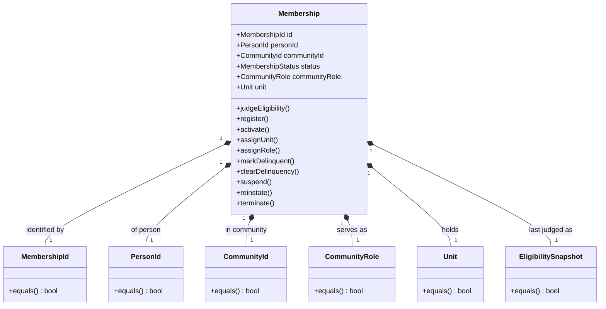
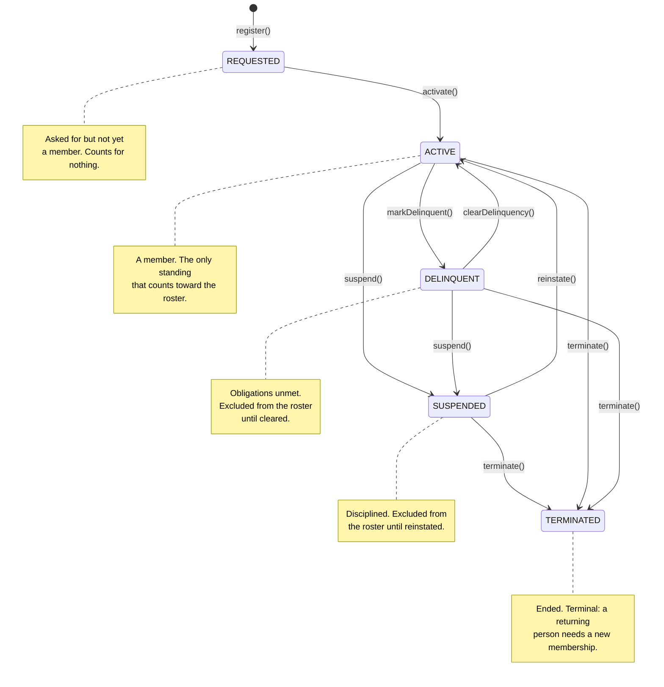
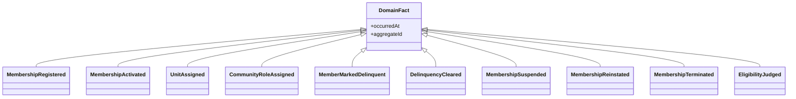

# Membership — Domain Model

This is the domain model of a Supporting Subdomain. It describes business meaning only:
the aggregate, its operations, value objects, domain facts (events), business rules,
and business rejections. It names no framework, library, storage, transport, or module structure.

Source: `event-storming.md` in this same folder (v0.1.0).
Reference input `docs/BrainStorming/VotoChain_DDD_Subdomains.md` §9 + §15 was treated as hypothesis;
deviations are logged under Hotspots.

## Aggregate Overview

One small aggregate. Each membership is a consistency boundary for exactly one
(person, community) pair. The roster is a question this context answers, not an object
it holds. Aggregates reference person and community by identity only — never by embedding.

---

## Aggregate: Membership

### Identity & Lifecycle

| Property | Meaning |
|----------|---------|
| `id` | Identity of this membership. Stable for its whole life, never reused |
| `personId` | The person holding it (identity reference only; the person record lives elsewhere) |
| `communityId` | The community it belongs to (identity reference only; configuration lives elsewhere) |
| `status` | Where the membership stands (see state machine) |
| `communityRole` | The member's part within the association (president, board member, plain owner) |
| `unit` | The apartment or unit the owner holds |
| `lastEligibility` | The most recent frozen eligibility judgment for this pair, with its snapshot reference |

### State Machine: MembershipStatus

### Invariants (Always True)

| # | Invariant |
|---|-----------|
| 1 | Bound to exactly one (person, community) pair. It can never be transferred to another person or community |
| 2 | At most one live (non-`TERMINATED`) membership exists per (person, community) pair |
| 3 | Only `ACTIVE` counts toward the roster. Every other standing is excluded from the roster from the moment it is entered |
| 4 | `TERMINATED` is terminal. No operation leaves it |
| 5 | Unit and community role change without touching standing history. Discipline and attributes evolve independently |
| 6 | Eligibility is judged at the instant asked and frozen as a snapshot. Later standing changes affect only future judgments, never past ones |
| 7 | Membership never contains the community's configuration or the member list. It knows its own pair, nothing more |

### Mutating Operations

| Operation | Preconditions | Facts Produced |
|-----------|---------------|----------------|
| `register()` | Person exists; community exists and accepts members; no live membership for the same pair | `MembershipRegistered` |
| `activate()` | Standing is `REQUESTED`; community standing allows it | `MembershipActivated` |
| `assignUnit()` | Not `TERMINATED`; unit belongs to the community | `UnitAssigned` |
| `assignRole()` | Standing is `ACTIVE`; role is a known community role | `CommunityRoleAssigned` |
| `markDelinquent()` | Standing is `ACTIVE`; the association's books confirm arrears | `MemberMarkedDelinquent` |
| `clearDelinquency()` | Standing is `DELINQUENT`; obligations met again | `DelinquencyCleared` |
| `suspend()` | Standing is `ACTIVE` or `DELINQUENT`; reason recorded | `MembershipSuspended` |
| `reinstate()` | Standing is `SUSPENDED`; cause resolved | `MembershipReinstated` |
| `terminate()` | Not already `TERMINATED`; reason recorded | `MembershipTerminated` |
| `judgeEligibility()` | Always answerable: `ACTIVE` means eligible, anything else means not eligible with reason | `EligibilityJudged` (with snapshot reference) |

### Read Needs (What the Domain Must Be Able to Answer)

| Need | Returns |
|------|---------|
| Membership by identity | The membership or nothing |
| Membership for a (person, community) pair | The live membership or nothing |
| Roster of a community | All `ACTIVE` memberships of that community |
| Eligibility of a person in a community, now | Yes or no, with reason and snapshot reference |
| Memberships of a person | All live memberships across communities |

---

## Value Objects

No identity; defined entirely by attributes; immutable; invalid values are unrepresentable.

### MembershipId / PersonId / CommunityId

- The stable identities of memberships, persons, and communities.
- Equality is by value. Distinct kinds are never interchangeable: a `PersonId` is never a `MembershipId`.
- This context holds person and community identities as references only; what it means for a person or community to exist is judged where those records live.

### Unit

- The apartment or unit the owner holds within the community.
- Belongs to exactly one community. Reassigning the unit changes an attribute, not the membership's identity or standing.
- Follows the person by default (a move changes the unit attribute); whether a sale transfers membership is parked (see Open Questions).

### CommunityRole

- The member's part within the association: president, board member, plain owner (catalog to be confirmed per community).
- Distinct from administering the community (`CommunityAdmin` in Community Management) and from any system-wide grant.
- Assignable only while `ACTIVE`.

### EligibilitySnapshot

- The frozen judgment of eligibility for one (person, community) pair at one instant: the verdict, the standing observed, and the snapshot reference Voting freezes a copy of.
- Explains past authorization grants after standing later changes. The snapshot is history, never edited.

### Status Enumerations

- `MembershipStatus` — `REQUESTED`, `ACTIVE`, `DELINQUENT`, `SUSPENDED`, `TERMINATED`.
- `CommunityRoleKind` — `PRESIDENT`, `BOARD_MEMBER`, `OWNER` (catalog open to per-community extension — see Open Questions).
- `EligibilityVerdict` — `ELIGIBLE`, `NOT_ELIGIBLE`.
- `IneligibilityReason` — `NOT_A_MEMBER`, `DELINQUENT`, `SUSPENDED`, `TERMINATED`, `NEVER_REGISTERED`.

---

## Domain Events (Facts)

Past tense. Immutable. Each carries enough business data that consumers do not need to ask again for the common cases. Each is produced by exactly one aggregate operation.

| Event | Payload (business data) | Produced By | Interested Parties |
|-------|-------------------------|-------------|--------------------|
| `MembershipRegistered` | membership, person, community | `Membership.register()` | Membership listing, scrutiny record |
| `MembershipActivated` | membership, person, community | `Membership.activate()` | Roster (inclusion), scrutiny record |
| `UnitAssigned` | membership, unit | `Membership.assignUnit()` | Membership detail |
| `CommunityRoleAssigned` | membership, role | `Membership.assignRole()` | Membership detail |
| `MemberMarkedDelinquent` | membership, reason | `Membership.markDelinquent()` | Roster (exclusion), member notice |
| `DelinquencyCleared` | membership | `Membership.clearDelinquency()` | Roster (re-inclusion) |
| `MembershipSuspended` | membership, reason | `Membership.suspend()` | Roster (exclusion), member notice |
| `MembershipReinstated` | membership | `Membership.reinstate()` | Roster (re-inclusion) |
| `MembershipTerminated` | membership, reason | `Membership.terminate()` | Membership listing, roster (exclusion) |
| `EligibilityJudged` | person, community, verdict, reason, snapshot reference | `Membership.judgeEligibility()` | Voting (freezes a copy at authorization time), scrutiny record |

---

## Business Rules (Policies)

Stated as domain rules. No mechanism named.

| Rule | Whenever… | Then… |
|------|-----------|-------|
| Only ACTIVE counts | A membership becomes `ACTIVE` (activation, reinstatement, delinquency cleared) | The person is included in the roster from that moment |
| Leaving ACTIVE excludes | A membership leaves `ACTIVE` (marked delinquent, suspended, terminated) | The person is excluded from the roster from that moment |
| Judge at the instant, never rewrite | Eligibility is asked | It is answered for that instant and frozen as a snapshot; later standing changes never alter past judgments |
| Terminated is terminal | A membership is terminated | No further transition is possible; a returning person needs a new membership |
| Delinquency follows the books | The association's books show arrears met or unmet | Marking or clearing delinquency mirrors that truth; this context never invents arrears |

---

## Business Rejections

What the domain refuses, and why. These are business outcomes, not transport codes.

| Rejection | Meaning |
|-----------|---------|
| `MembershipAlreadyExists` | A live membership already covers the same (person, community) pair |
| `CommunityNotAcceptingMembers` | Registration or activation attempted while the community does not accept members |
| `NotEligible` | Eligibility asked of a non-`ACTIVE` membership (with reason: never registered, delinquent, suspended, terminated) |
| `RoleRequiresActive` | Community role assigned to a non-`ACTIVE` membership |
| `IllegalMembershipTransition` | An operation incompatible with current standing (e.g., reinstate while active, clear delinquency while suspended) |
| `TerminationIsTerminal` | Any operation attempted on a `TERMINATED` membership |
| `MembershipNotFound` | A read or judgment refers to a membership that does not exist |

---

## Hotspots & Deviations from the Reference Input

| # | Matter | Position in this model |
|---|--------|------------------------|
| H1 | Reference suggests `Membership` root — does the roster belong inside it? | Roster is a question answered, not an object embedded. `Membership` covers exactly one (person, community) pair; embedding the member list would mix two rates of change |
| H2 | Delinquency immediacy | Excluded from the roster from the moment marked (default). One rule — "only ACTIVE counts" — instead of two competing truths; needs expert confirmation |
| H3 | Past grants vs later standing change | Past judgments never rewritten. A vote authorized while eligible stays authorized; later changes affect only future judgments |
| H4 | Membership follows the person or the unit? | Follows the person; the unit is an attribute (default). Sale/transfer semantics parked |
| H5 | Who may suspend or terminate? | Recorded with reason; entitlement belongs to community administration (see Community Management). Discipline authority kept in one place |

## Open Questions

| # | Question | Standing |
|---|----------|----------|
| 1 | Does delinquency exclude immediately, or only block the next authorization while in-flight votes continue? | Open — needs product decision |
| 2 | On unit sale or transfer, does membership move with the unit or stay with the seller? | Open — needs product + legal |
| 3 | Who may suspend or terminate (community admin, board decision, automatic on arrears)? | Open — needs product decision |
| 4 | Is eligibility judged live at each authorization, or against a periodically confirmed roll? | Open — needs product decision |
| 5 | Which community roles exist — fixed catalog or per-community defined? | Open — needs product decision |
| 6 | Must exclusion reasons be told to the member, and in which form? | Open — needs product decision |

## Related Documentation

| Document | Link |
|----------|------|
| Event Storming (this bounded context) | `event-storming.md` |
| Voting event storming (consumer of eligibility) | `../voting-verifiable-ledger/event-storming.md` |
| Voting domain model (consumer of snapshots) | `../voting-verifiable-ledger/domain-model.md` |
| Community Management event storming (sibling) | `../community-management/event-storming.md` |
| Subdomain map (input, hypothesis) | `docs/BrainStorming/VotoChain_DDD_Subdomains.md` §9 + §15 |
| Modeling example (shape reference) | `docs/References/domain-model.md` |
