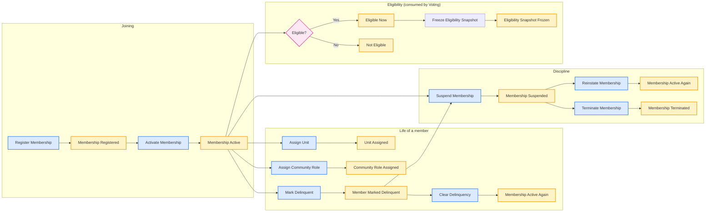

# Event Storming: Membership (Supporting Subdomain)

## Workshop Overview

| Aspect | Details |
|--------|---------|
| **Date** | 2026-09-07 |
| **Duration** | 1 session × 2 hours (second pair, after Core Domain) |
| **Participants** | Domain Expert (Product), 2 Backend Engineers |
| **Facilitator** | Senior Engineer (DDD practitioner) |
| **Scope** | Person–community relationship → membership lifecycle → community role → eligibility and roster. Out of scope: community configuration itself, technical login/session, physical identity proof, vote casting |
| **Tool** | Markdown + Mermaid (mirrors `docs/References/event-storming.md` conventions) |
| **Input** | `docs/BrainStorming/VotoChain_DDD_Subdomains.md` §9 + §15 (treated as hypothesis, not truth — see Hotspots) |

### Ubiquitous Language in scope (this context owns the meaning)

| Term | Domain definition (inside this BC) |
|---|---|
| **Membership** | The relationship between one person and one community; each has its own independent standing |
| **Member / Owner** | A person holding an active `Membership` |
| **Unit** | The apartment or unit the owner holds within the community |
| **MembershipStatus** | Where the membership stands: `REQUESTED`, `ACTIVE`, `DELINQUENT`, `SUSPENDED`, `TERMINATED` |
| **CommunityRole** | The member's part within the association (president, board member, plain owner) — distinct from administering the community and from any system-wide role |
| **Roster** | The set of members currently eligible to vote, as answered by this context |
| **EligibilitySnapshot** | The frozen judgment of eligibility for one person in one community at one instant, handed to Voting at authorization time |
| **Delinquency** | The standing of a member who has not met their community obligations and may lose eligibility |

> One person holds N memberships (one per community). This context never owns community configuration (that lives in `Community Management`) and never owns the technical person record — it only references person and community by identity. Voting consumes eligibility answers and freezes a copy; later changes here never rewrite that frozen copy.

## Big Picture (Process Level)



### Pivotal points (candidate boundary signals)

1. `Membership Active` → the person counts as a member from here; roster inclusion begins.
2. `Member Marked Delinquent` → eligibility under question; the immediacy rule is decided here (see Hotspots).
3. `Membership Suspended / Terminated` → roster exclusion; terminal for `TERMINATED`.
4. `Eligibility Snapshot Frozen` → the judgment leaves this context; Voting freezes a copy and judges the vote against that copy.

## Design Level — Membership Aggregate

> Design decision: one small aggregate, `Membership`, referenced by person and community identity only. The roster is a question this context answers, not an object it embeds. Eligibility history is explained through frozen snapshots, not by rewriting the past.

```mermaid
graph TD
    subgraph "Commands (Intent)"
        C1[RegisterMembershipCommand]
        C2[ActivateMembershipCommand]
        C3[AssignUnitCommand]
        C4[AssignCommunityRoleCommand]
        C5[MarkDelinquentCommand]
        C6[ClearDelinquencyCommand]
        C7[SuspendMembershipCommand]
        C8[ReinstateMembershipCommand]
        C9[TerminateMembershipCommand]
        C10[JudgeEligibilityCommand]
    end

    subgraph "Aggregate: Membership"
        M[Membership<br/>(Aggregate Root)]
        M --- MState[State: MembershipStatus<br/>REQUESTED/ACTIVE/<br/>DELINQUENT/SUSPENDED/<br/>TERMINATED]
        M --- MRole[CommunityRole<br/>president/board/owner]
        M --- MUnit[Unit<br/>apartment or unit held]
        M --- MSnap[EligibilitySnapshot VO<br/>frozen judgment]
    end

    subgraph "Events (Facts)"
        E1[MembershipRegisteredEvent]
        E2[MembershipActivatedEvent]
        E3[UnitAssignedEvent]
        E4[CommunityRoleAssignedEvent]
        E5[MemberMarkedDelinquentEvent]
        E6[DelinquencyClearedEvent]
        E7[MembershipSuspendedEvent]
        E8[MembershipReinstatedEvent]
        E9[MembershipTerminatedEvent]
        E10[EligibilityJudgedEvent]
    end

    subgraph "Policies (Reactions)"
        Pol1[Only ACTIVE counts toward roster]
        Pol2[Leaving ACTIVE excludes from roster from that moment]
        Pol3[Eligibility judged at the instant asked; past grants never rewritten]
        Pol4[Terminated is terminal]
        Pol5[Delinquency standing follows the accounting truth]
    end

    subgraph "Read Models"
        RM1[Membership Detail + Standing]
        RM2[Roster - eligible members of a community]
        RM3[Eligibility Answer - is this person eligible now]
        RM4[Memberships of a Person]
    end

    subgraph "Needs from other contexts (business language)"
        Ext1[Person exists - answered where the person record lives]
        Ext2[Community exists and stands - answered by Community Management]
        Ext3[Obligation standing - what the member owes, per association books]
        Ext4[Voting - asks eligibility, freezes a snapshot copy]
    end

    C1 --> M
    C2 --> M
    C3 --> M
    C4 --> M
    C5 --> M
    C6 --> M
    C7 --> M
    C8 --> M
    C9 --> M
    C10 --> M

    M --> E1
    M --> E2
    M --> E3
    M --> E4
    M --> E5
    M --> E6
    M --> E7
    M --> E8
    M --> E9
    M --> E10

    E2 --> Pol1
    E5 --> Pol2
    E7 --> Pol2
    E10 --> Pol3
    E9 --> Pol4
    E5 --> Pol5
    E6 --> Pol5

    E2 -.-> RM1
    E5 -.-> RM1
    E7 -.-> RM1
    E2 -.-> RM2
    E5 -.-> RM2
    E7 -.-> RM2
    E8 -.-> RM2
    E10 -.-> RM3
    E1 -.-> RM4
    E9 -.-> RM4

    C1 --> Ext1
    C1 --> Ext2
    C5 --> Ext3
    E10 -.-> Ext4

    classDef cmd fill:#dbeafe,stroke:#3b82f6,stroke-width:2px;
    classDef agg fill:#dcfce7,stroke:#22c55e,stroke-width:3px;
    classDef evt fill:#fef3c7,stroke:#f59e0b,stroke-width:2px;
    classDef pol fill:#fce7f3,stroke:#ec4899,stroke-width:2px;
    classDef rm fill:#e0e7ff,stroke:#6366f1,stroke-width:2px;
    classDef ext fill:#e5e7eb,stroke:#6b7280,stroke-width:2px;

    class C1,C2,C3,C4,C5,C6,C7,C8,C9,C10 cmd;
    class M,MState,MRole,MUnit,MSnap agg;
    class E1,E2,E3,E4,E5,E6,E7,E8,E9,E10 evt;
    class Pol1,Pol2,Pol3,Pol4,Pol5 pol;
    class RM1,RM2,RM3,RM4 rm;
    class Ext1,Ext2,Ext3,Ext4 ext;
```

## Key Discoveries

### Aggregates Identified

| Aggregate | Root | Invariants |
|-----------|------|------------|
| **Membership** | `Membership` | Bound to exactly one (person, community) pair; standing follows `REQUESTED → ACTIVE → DELINQUENT → ACTIVE` or `→ SUSPENDED → ACTIVE`, `→ TERMINATED` terminal; only `ACTIVE` counts toward the roster; `TERMINATED` never returns; unit and community role change without touching standing history |

### Commands (10)

| Command | Aggregate | Validation |
|---------|-----------|------------|
| `RegisterMembershipCommand` | Membership | Person exists; community exists and accepts members; no live membership for the same (person, community) pair |
| `ActivateMembershipCommand` | Membership | Standing is `REQUESTED`; community standing allows it |
| `AssignUnitCommand` | Membership | Membership not `TERMINATED`; unit belongs to the community |
| `AssignCommunityRoleCommand` | Membership | Membership `ACTIVE`; role is a known community role |
| `MarkDelinquentCommand` | Membership | Membership `ACTIVE`; obligation standing confirms arrears |
| `ClearDelinquencyCommand` | Membership | Membership `DELINQUENT`; obligations met again |
| `SuspendMembershipCommand` | Membership | Membership `ACTIVE` or `DELINQUENT`; reason recorded |
| `ReinstateMembershipCommand` | Membership | Membership `SUSPENDED`; cause resolved |
| `TerminateMembershipCommand` | Membership | Membership not already `TERMINATED`; reason recorded |
| `JudgeEligibilityCommand` | Membership | Answered at the instant asked: `ACTIVE` standing means eligible; anything else means not eligible, with reason |

### Events (10 Published)

| Event | Payload | Downstream Consumers |
|-------|---------|---------------------|
| `MembershipRegisteredEvent` | membership, person, community | Membership listing, scrutiny record |
| `MembershipActivatedEvent` | membership, person, community | Roster, scrutiny record |
| `UnitAssignedEvent` | membership, unit | Membership detail |
| `CommunityRoleAssignedEvent` | membership, role | Membership detail |
| `MemberMarkedDelinquentEvent` | membership, reason | Roster (exclusion), member notice |
| `DelinquencyClearedEvent` | membership | Roster (re-inclusion) |
| `MembershipSuspendedEvent` | membership, reason | Roster (exclusion), member notice |
| `MembershipReinstatedEvent` | membership | Roster (re-inclusion) |
| `MembershipTerminatedEvent` | membership, reason | Membership listing, roster (exclusion) |
| `EligibilityJudgedEvent` | person, community, verdict, snapshot reference | Voting (freezes a copy at authorization time), scrutiny record |

### Policies (Business Rules)

| Policy | Trigger | Action |
|--------|---------|--------|
| **Only ACTIVE counts** | `MembershipActivatedEvent`, `MembershipReinstatedEvent`, `DelinquencyClearedEvent` | Person included in the roster from that moment |
| **Leaving ACTIVE excludes** | `MemberMarkedDelinquentEvent`, `MembershipSuspendedEvent`, `MembershipTerminatedEvent` | Person excluded from the roster from that moment |
| **Judge at the instant, never rewrite** | `JudgeEligibilityCommand` | Eligibility answered for that instant and frozen as a snapshot; later standing changes never alter past judgments |
| **Terminated is terminal** | `MembershipTerminatedEvent` | No further transition; a returning person needs a new membership |
| **Delinquency follows the books** | Obligation standing changes | Marking or clearing delinquency mirrors the association's books; this context never invents arrears |

### Read Models

| Read Model | Source events | Consumers |
|------------|---------------|-----------|
| Membership Detail + Standing | `MembershipRegistered`, `MembershipActivated`, `UnitAssigned`, `CommunityRoleAssigned`, `MemberMarkedDelinquent`, `MembershipSuspended`, `MembershipTerminated` | Member UI, administration |
| Roster (eligible members of a community) | `MembershipActivated`, `MemberMarkedDelinquent`, `DelinquencyCleared`, `MembershipSuspended`, `MembershipReinstated`, `MembershipTerminated` | Voting (turnout basis, eligibility window) |
| Eligibility Answer | `EligibilityJudged` | Voting (authorization gate) |
| Memberships of a Person | `MembershipRegistered`, `MembershipTerminated` | Person overview across communities |

### Needs from other contexts (business language, never direct model access)

| Need | Direction | Meaning |
|------|-----------|---------|
| Person exists | Asked where the person record lives | Registration and judging require a real person; this context holds only the identity reference |
| Community exists and stands | Asked of Community Management | Registration and activation require a community that accepts members |
| Obligation standing | Observed from the association's books | What the member owes determines delinquency; this context records the judgment, not the ledger |
| Voting asks eligibility | Answered to Voting | `Is this person eligible in this community now, and under which snapshot reference?` — Voting freezes a copy |

## Hotspots (Contentious Decisions)

| # | Hotspot | Decision in this artifact | Rationale |
|---|---------|---------------------------|-----------|
| H1 | **Reference §9 suggests `Membership` root — does the roster belong inside it?** | Roster is a question answered, not an object embedded; `Membership` stays one (person, community) pair | Embedding the whole member list would mix two rates of change and grow the aggregate without bound |
| H2 | **Does delinquency exclude immediately or only at the next authorization?** | Excluded from the roster from the moment marked (default, needs expert confirmation) | Keeps one simple rule — "only ACTIVE counts" — instead of two competing truths |
| H3 | **Past grants vs later standing change** | Past eligibility judgments never rewritten; later changes affect only future judgments | Protects electoral history; a vote authorized while eligible stays authorized |
| H4 | **Membership follows the person or the unit?** | Follows the person; the unit is an attribute that can be reassigned (default, needs expert confirmation) | A sale or move changes the unit attribute, not the person's identity |
| H5 | **Who may suspend or terminate?** | Recorded with reason; entitlement judged where community administration lives (see Community Management) | Keeps discipline authority in one place instead of splitting it across contexts |

## Open Questions / Parking Lot

| # | Question | Status | Owner |
|---|----------|--------|-------|
| 1 | Does delinquency exclude immediately, or only block the next authorization while in-flight votes continue? | Open — needs product decision | Product |
| 2 | On unit sale or transfer, does membership move with the unit to the new owner or stay with the seller? | Open — needs product + legal | Product + Legal |
| 3 | Who may suspend or terminate a membership (community admin, board decision, automatic on arrears)? | Open | Product |
| 4 | How fresh must the roster be — judged live at each authorization, or against a periodically confirmed roll? | Open | Product |
| 5 | Which community roles exist per community, and can a community define its own? | Open | Product |
| 6 | Must exclusion reasons be told to the member, and through which notice? | Open | Product |

## Related Documentation

| Document | Link |
|----------|------|
| Subdomain map (input, hypothesis) | `docs/BrainStorming/VotoChain_DDD_Subdomains.md` §9 + §15 |
| Voting event storming (consumer of eligibility) | `../voting-verifiable-ledger/event-storming.md` |
| Community Management event storming (sibling) | `../community-management/event-storming.md` |
| Diagram conventions (example) | `docs/References/event-storming.md` |
