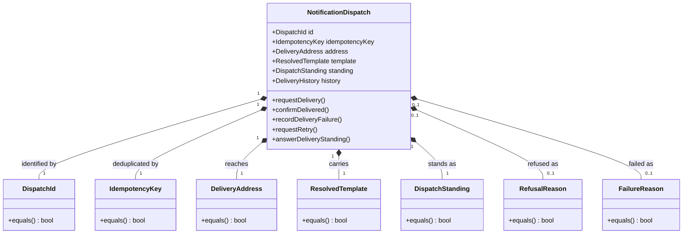
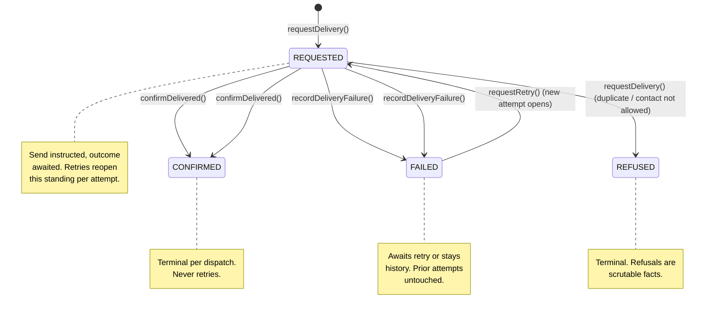
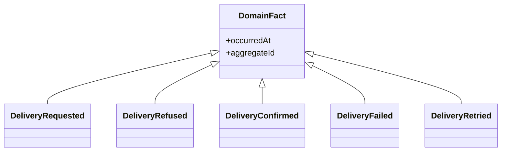

# Notifications — Message Delivery — Domain Model

This is the domain model of a Generic Subdomain. It describes business meaning only:
the aggregate, its operations, value objects, domain facts (events), business rules,
and business rejections. It names no framework, library, storage, transport, or module structure.

Source: `event-storming.md` in this same folder (v0.1.0).
Reference input `docs/BrainStorming/VotoChain_DDD_Subdomains.md` §11 + §15 was treated as hypothesis;
deviations are logged under Hotspots.

> This context is a receiver and actuator: everyone depends on it, it depends on no one.
> It judges delivery standing and owns the outcome history — the when and why stay with the
> requester, opt-in stays with `Consent & Compliance`, and actual sending lives outside this
> boundary (executor-first, per the storming's locked decision). Email only for now.

## Aggregate Overview

One small aggregate. Each dispatch is a consistency boundary for exactly one delivery intent.
The delivery history belongs to the dispatch it records — never a separate lifecycle.
Splitting history off would break intent → outcome atomicity with no benefit.
Templates are referenced content structures resolved at request time. Persons are never
referenced — only the minimal delivery data (address + template) crosses this boundary.

---

## Aggregate: NotificationDispatch

### Identity & Lifecycle

| Property | Meaning |
|----------|---------|
| `id` | Identity of this dispatch. Stable for its whole life, never reused |
| `idempotencyKey` | The requester's promise that this intent is the same one. Seen before → never delivered twice |
| `address` | Where the message goes (minimal delivery data; no person identity travels here) |
| `template` | The resolved content structure with the requester's values filled in |
| `standing` | Where the dispatch stands (see state machine) |
| `history` | The attempts and outcomes in order. Only grows — never rewritten |

### State Machine: DispatchStanding

> Retry never leaves the dispatch: `requestRetry()` records a new attempt and re-enters
> `REQUESTED` on the same dispatch, with all prior attempts preserved exactly as recorded.

### Invariants (Always True)

| # | Invariant |
|---|-----------|
| 1 | One idempotency key delivers at most once ever. The same intent never delivers twice — a domain invariant, not an overridable policy |
| 2 | One dispatch carries exactly one address and one resolved template. A second intent is a second dispatch |
| 3 | History only grows. Confirmed and failed attempts are never rewritten; retry appends, never edits |
| 4 | A confirmed dispatch never retries. A refused dispatch never sends |
| 5 | Refusals are recorded, never silent. Duplicates and disallowed contact still leave history |
| 6 | The channel is email. Further media are parked — not modeled until a concrete driver appears |
| 7 | Nothing here decides when or why to notify, judges opt-in, or proves anything about the recipient. Those are judged where they live |

### Mutating Operations

| Operation | Preconditions | Facts Produced |
|-----------|---------------|----------------|
| `requestDelivery()` | Template known; address well-formed; idempotency key fresh; contact allowed now (opt-in answered outside) | `DeliveryRequested` — or `DeliveryRefused` (duplicate key, or contact not allowed) |
| `confirmDelivered()` | A send was instructed and not yet confirmed for the current attempt | `DeliveryConfirmed` |
| `recordDeliveryFailure()` | A send was instructed and not yet confirmed for the current attempt | `DeliveryFailed` |
| `requestRetry()` | The current attempt failed (confirmed and refused dispatches never retry) | `DeliveryRetried` (new attempt opens on the same dispatch) |

### Answering Operations (Read, but Owned by the Aggregate)

| Operation | Preconditions | Answers |
|-----------|---------------|---------|
| `answerDeliveryStanding()` | Always answerable | Where is this intent: requested, refused, confirmed, or failed — and how many attempts stand recorded |

### Read Needs (What the Domain Must Be Able to Answer)

| Need | Returns |
|------|---------|
| Delivery standing | Where is this intent? — the answer requesting contexts consume (did the person get told?) |
| Delivery history (scrutiny) | What was attempted and concluded, in order — attempts, outcomes, refusals (what was sent, to whom, when) |

---

## Value Objects

No identity; defined entirely by attributes; immutable; invalid values are unrepresentable.

### DispatchId / IdempotencyKey

- The stable identities of dispatches and intents.
- Equality is by value. A repeated key is the *same* intent — answering it twice is unrepresentable.
- The key is supplied by the requester, who owns the when/why; this context only honors uniqueness.

### DeliveryAddress

- Where the message goes: the channel address (email, today) the requester supplied.
- Well-formedness is answerable from this object. Whose address it is — and whether contact is allowed — is judged where those facts live.

### ResolvedTemplate

- The content structure (template key + named placeholders) with the requester's values filled in.
- Resolution happens at request time against the known template catalog; unknown keys are unrepresentable.
- Wording ownership is a content concern, not storming: each requester row becomes one template key when seeded.

### DispatchStanding

- `REQUESTED`, `REFUSED`, `CONFIRMED`, `FAILED` — where the dispatch stands (see state machine).

### RefusalReason / FailureReason

- `RefusalReason` — `DUPLICATE` (key seen before) or `CONTACT_NOT_ALLOWED` (opt-in answered outside).
- `FailureReason` — what the executor observed (carried as business language, e.g. undeliverable address, executor unavailable).
- Both recorded on their facts for scrutiny; retry decisions consult the failure reason without rewriting it.

---

## Domain Events (Facts)

Past tense. Immutable. Each carries enough business data that consumers do not need to ask again for the common cases. Each is produced by exactly one aggregate operation. This context publishes no business-consequence events — only its delivery record.

| Event | Payload (business data) | Produced By | Interested Parties |
|-------|-------------------------|-------------|--------------------|
| `DeliveryRequested` | dispatch, template, address, reason | `NotificationDispatch.requestDelivery()` | Delivery standing, scrutiny history, executor instruction |
| `DeliveryRefused` | dispatch, reason | `NotificationDispatch.requestDelivery()` | Scrutiny history, requester awareness |
| `DeliveryConfirmed` | dispatch, confirmed-at | `NotificationDispatch.confirmDelivered()` | Delivery standing, scrutiny history |
| `DeliveryFailed` | dispatch, reason | `NotificationDispatch.recordDeliveryFailure()` | Delivery standing, retry decisions, scrutiny history |
| `DeliveryRetried` | dispatch, attempt number | `NotificationDispatch.requestRetry()` | Delivery standing, scrutiny history |

---

## Business Rules (Policies)

Stated as domain rules. No mechanism named.

| Rule | Whenever… | Then… |
|------|-----------|-------|
| Never twice | A request arrives with an already-seen idempotency key | Refused as duplicate — the original dispatch stands untouched |
| Refusal is history | Contact is not allowed, or the key is a duplicate | `DeliveryRefused` is still recorded: refusals are scrutable facts, not silent drops |
| Retry appends | A retry is requested after failure | A new attempt opens on the same dispatch; prior attempts stay exactly as recorded |

---

## Business Rejections

What the domain refuses, and why. These are business outcomes, not transport codes.

| Rejection | Meaning |
|-----------|---------|
| `DuplicateIntent` | Request arrived with an already-seen idempotency key |
| `ContactNotAllowed` | Request arrived while contact is not allowed now (opt-in answered outside) |
| `TemplateUnknown` | Request named a template outside the known catalog |
| `AddressMalformed` | Request carried an address that is not well-formed |
| `AlreadyConfirmed` | Retry asked on a confirmed dispatch |
| `NoSendInstructed` | Confirmation or failure recorded with no send instructed for the current attempt |

---

## Hotspots & Deviations from the Reference Input

| # | Matter | Position in this model |
|---|--------|------------------------|
| H1 | Reference §11: no business rule from other contexts may leak in | Honored: only template + address + reason + idempotency key cross the boundary |
| H2 | One aggregate or separate history lifecycle? | One aggregate. History is subordinate to the dispatch; splitting would break intent → outcome atomicity with no benefit |
| H3 | Reference implementation carries device registry + local preference + 4 channels | Parked, not modeled: email-only MVP; no device registry; no local preference (Consent owns opt-in — locked) |
| H4 | Idempotency: invariant or policy? | Domain invariant: the same key never delivers twice |
| H5 | Retry limits and channel fallback | Open: retry appends by shape; limits and fallback media parked without a concrete driver |

## Open Questions

| # | Question | Standing |
|---|----------|----------|
| 1 | Retry limits per intent — how many attempts before abandoning with reason? | Open — needs product decision |
| 2 | Template catalog ownership — who writes and approves wording per requester? | Open — needs product decision |
| 3 | Further channels (SMS/push) — new intent or same dispatch, new attempt? | Open — parked, revisit on a concrete driver |
| 4 | Bounce vs failure vocabulary — is a bounced address a failure, a refusal, or its own outcome? | Open — needs product decision |
| 5 | In-read delivery (in-app inbox) — a channel of this context or a read model elsewhere? | Open — parked |

## Related Documentation

| Document | Link |
|----------|------|
| Event Storming (this bounded context) | `event-storming.md` |
| Verification (OTP) event storming (sibling — instructs delivery, never delivers) | `../verification-otp/event-storming.md` |
| IAM event storming (sibling — a requester: welcome, security, address notices) | `../iam/event-storming.md` |
| Consent & Compliance event storming (sibling — owns opt-in) | `../consent-compliance/event-storming.md` |
| Voting event storming (sibling — a requester: open/close/receipt/tally notices) | `../voting-verifiable-ledger/event-storming.md` |
| Subdomain map (input, hypothesis) | `docs/BrainStorming/VotoChain_DDD_Subdomains.md` §11 + §15 |
| Modeling example (shape reference) | `docs/References/domain-model.md` |
