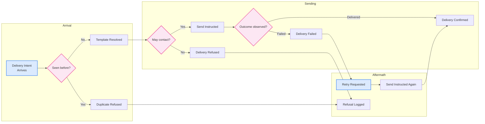

# Event Storming: Notifications — Message Delivery (Generic Subdomain)

## Workshop Overview

| Aspect | Details |
|--------|---------|
| **Date** | 2026-09-07 |
| **Duration** | 1 session × 2 hours (tenth context, paired with Verification OTP) |
| **Participants** | Domain Expert (Product), 2 Backend Engineers |
| **Facilitator** | Senior Engineer (DDD practitioner) |
| **Scope** | One delivery intent → one recorded outcome, over email (MVP): template resolution → send instruction → delivery confirmation or failure. Out of scope: deciding when or why to notify, challenge lifecycle, opt-in judgment, physical delivery mechanics |
| **Tool** | Markdown + Mermaid (mirrors `docs/References/event-storming.md` conventions, in pure domain language) |
| **Input** | `docs/BrainStorming/VotoChain_DDD_Subdomains.md` §11 + §15 (treated as hypothesis, not truth — see Hotspots) |
| **Execution decision** | Actual sending is **executed outside** (external executor). This artifact models what the domain **judges and owns**: the dispatch record, idempotency, template resolution, and the delivery outcome history. Execution mechanics never appear here |

### Ubiquitous Language in scope (this context owns the meaning)

| Term | Domain definition (inside this BC) |
|---|---|
| **Delivery intent** | A request from another context to reach a person: template + address + reason + idempotency key. The when and why stay with the requester |
| **Template** | A reusable content structure with named placeholders (welcome, code delivery, vote receipt, …). Resolved here, filled with the requester's values |
| **Channel** | The delivery medium. Email only for now; further media are parked, not modeled |
| **Dispatch** | One intent's journey to one outcome: requested → confirmed or failed. Retried only as new recorded attempts |
| **Delivery history** | The per-dispatch record of what was attempted, when, and with what outcome. Never rewritten |
| **Idempotency key** | The requester's promise that this intent is the same one: seen before → never delivered twice |

> This context is a receiver and actuator: everyone depends on it, it depends on no one.
> No business rule from Voting, Membership, IAM, or Consent ever leaks in — only their intents arrive.
> Per the map §15, it correlates by minimal delivery data (address + template), never by person identity.

## Big Picture (Process Level)



### Pivotal points (candidate boundary signals)

1. `Duplicate Refused` → idempotency is a domain invariant, not a policy: the same intent never delivers twice.
2. `Delivery Refused` → opt-in refusal is observed from Consent, never judged here; the refusal itself is still logged history.
3. `Delivery Confirmed` → terminal per attempt; a retry is a new attempt record, never a rewritten outcome.

## Design Level — NotificationDispatch Aggregate

> Design decision: one small aggregate, `NotificationDispatch`, per delivery intent.
> The delivery history belongs to the dispatch it records — never a separate lifecycle.
> Templates are referenced content structures resolved at request time, not versioned policy.

```mermaid
graph TD
    subgraph "Commands (Intent)"
        C1[RequestDelivery]
        C2[ConfirmDelivered]
        C3[RecordDeliveryFailure]
        C4[RequestRetry]
        C5[AnswerDeliveryStanding]
    end

    subgraph "Aggregate: NotificationDispatch"
        N[NotificationDispatch<br/>(Aggregate Root)]
        N --- NState[State: DispatchStanding<br/>REQUESTED/REFUSED/<br/>CONFIRMED/FAILED]
        N --- NTmpl[Template + filled<br/>content + address]
        N --- NKey[Idempotency key<br/>unique per intent]
        N --- NHist[Delivery history:<br/>attempts in order]
    end

    subgraph "Events (Facts)"
        E1[DeliveryRequested]
        E2[DeliveryRefused]
        E3[DeliveryConfirmed]
        E4[DeliveryFailed]
        E5[DeliveryRetried]
    end

    subgraph "Policies (Reactions)"
        Pol1[Same idempotency key never delivers twice]
        Pol2[Refused contact still logged as history]
        Pol3[Retry is a new attempt, never a rewrite]
    end

    subgraph "Read Models"
        RM1[Delivery Standing - where is this intent]
        RM2[Delivery History - attempts and outcomes, for scrutiny]
    end

    subgraph "Needs from other contexts (business language)"
        Ext1[Intent arrives - template + address + reason, from any context]
        Ext2[May contact answered - by Consent & Compliance]
        Ext3[Send executed - outside, outcome observed back]
    end

    C1 --> N
    C2 --> N
    C3 --> N
    C4 --> N
    C5 --> N

    N --> E1
    N --> E2
    N --> E3
    N --> E4
    N --> E5

    E1 --> Pol1
    E2 --> Pol2
    E4 --> Pol3

    E1 -.-> RM1
    E2 -.-> RM1
    E3 -.-> RM1
    E4 -.-> RM1
    E5 -.-> RM1
    E1 -.-> RM2
    E3 -.-> RM2
    E4 -.-> RM2
    E5 -.-> RM2

    C1 --> Ext1
    C1 --> Ext2
    E1 --> Ext3

    classDef cmd fill:#dbeafe,stroke:#3b82f6,stroke-width:2px;
    classDef agg fill:#dcfce7,stroke:#22c55e,stroke-width:3px;
    classDef evt fill:#fef3c7,stroke:#f59e0b,stroke-width:2px;
    classDef pol fill:#fce7f3,stroke:#ec4899,stroke-width:2px;
    classDef rm fill:#e0e7ff,stroke:#6366f1,stroke-width:2px;
    classDef ext fill:#e5e7eb,stroke:#6b7280,stroke-width:2px;

    class C1,C2,C3,C4,C5 cmd;
    class N,NState,NTmpl,NKey,NHist agg;
    class E1,E2,E3,E4,E5 evt;
    class Pol1,Pol2,Pol3 pol;
    class RM1,RM2 rm;
    class Ext1,Ext2,Ext3 ext;
```

## Key Discoveries

### Aggregates Identified

| Aggregate | Root | Invariants |
|-----------|------|------------|
| **NotificationDispatch** | `NotificationDispatch` | One idempotency key delivers at most once ever; one dispatch carries exactly one address and one resolved template; history only grows — confirmed and failed attempts are never rewritten |

### Commands (4 + 1 answering)

| Command | Aggregate | Validation |
|---------|-----------|------------|
| `RequestDelivery` | NotificationDispatch | Template known; address well-formed; idempotency key fresh (seen before → refused as duplicate); contact allowed now (opt-in answered outside) |
| `ConfirmDelivered` | NotificationDispatch | A send was instructed and not yet confirmed; records the observed confirmation |
| `RecordDeliveryFailure` | NotificationDispatch | A send was instructed and not yet confirmed; reason recorded |
| `RequestRetry` | NotificationDispatch | Prior attempt failed (confirmed dispatches never retry); opens a new attempt on the same dispatch |
| `AnswerDeliveryStanding` | NotificationDispatch (read) | Always answerable: where is this intent (requested / refused / confirmed / failed) |

### Events (5 Published)

| Event | Payload | Downstream Consumers |
|-------|---------|---------------------|
| `DeliveryRequested` | dispatch, template, address, reason | Delivery standing, scrutiny history, executor instruction |
| `DeliveryRefused` | dispatch, reason (duplicate / contact not allowed) | Scrutiny history, requester awareness |
| `DeliveryConfirmed` | dispatch, confirmed-at | Delivery standing, scrutiny history |
| `DeliveryFailed` | dispatch, reason | Delivery standing, retry decisions, scrutiny history |
| `DeliveryRetried` | dispatch, attempt number | Delivery standing, scrutiny history |

> This context publishes no domain events of its own beyond its delivery record: it is a receiver/actuator.
> Business consequences (verified email, informed voter) are judged by the requesting contexts on their own facts.

### Policies (Business Rules)

| Policy | Trigger | Action |
|--------|---------|--------|
| **Never twice** | `RequestDelivery` with an already-seen idempotency key | Refused as duplicate — a domain invariant; the original dispatch stands untouched |
| **Refusal is history** | Contact not allowed, or duplicate | `DeliveryRefused` still recorded: refusals are scrutable facts, not silent drops |
| **Retry appends** | `RequestRetry` after failure | `DeliveryRetried` opens a new attempt; prior attempts stay exactly as recorded |

### Read Models

| Read Model | Source events | Consumers |
|------------|---------------|-----------|
| Delivery Standing (where is this intent?) | `DeliveryRequested`, `DeliveryRefused`, `DeliveryConfirmed`, `DeliveryFailed`, `DeliveryRetried` | Requesting contexts (did the person get told?) |
| Delivery History (attempts and outcomes, for scrutiny) | All five facts | Scrutiny, erasure answers (what was sent, to whom, when) |

### Needs from other contexts (business language, never direct model access)

| Need | Direction | Meaning |
|------|-----------|---------|
| Delivery intent | Arrives from any context (IAM, Verification, Voting, Membership) | Template + address + reason + idempotency key; the when/why stay with the requester |
| May contact now? | Answered by Consent & Compliance | Opt-in judged where consent lives; refusal here only enforces + logs |
| Send executed | Instructed outside, outcome observed back | `ConfirmDelivered` / `RecordDeliveryFailure` record observed outcomes; mechanics stay outside |

### Known Requesters (VotoChain — replaces Glottia's consumer list)

| Requester | Intent examples |
|-----------|-----------------|
| IAM | Welcome, security notice (secret changed), address-change notice (both addresses), suspension/restoration notice |
| Verification (OTP) | Code delivery for `login`, `email-verification`, `password-reset` |
| Voting | Proposal opened, proposal closed, vote receipt, tally published |
| Membership | Standing changes affecting the member (suspension, reinstatement) |
| Consent & Compliance | Erasure coordination notices owned by the requesting context (content travels, rules do not) |

> The template catalog itself (keys, wording) is a later content concern, not storming. Each row above becomes one template key when seeded.

## Hotspots (Contentious Decisions)

| # | Hotspot | Decision in this artifact | Rationale |
|---|---------|---------------------------|-----------|
| H1 | **Reference §11: no business rule from other contexts may leak in** | Honored: only template + address + reason + idempotency key cross the boundary | Keeps this the most generic context on the map; every rule stays with its owner |
| H2 | **Glottia reference carries PUSH/SMS/IN_APP + DeviceToken + local Preference** | Parked, not modeled: email-only MVP; no device registry; no local preference (Consent owns opt-in — locked) | YAGNI: VotoChain has no app-push or SMS driver today; a local preference would duplicate Consent |
| H3 | **Glottia delivers OTP synchronously via facade; here delivery is instructed out** | Instruction observed back: Verification instructs, this context records the outcome | Keeps the pair boundary strict per map §10.1; temporal coupling is an execution concern, not a domain fact |
| H4 | **Idempotency: invariant or policy?** | Domain invariant: the same key never delivers twice (locked) | Duplicates erode trust in receipts and codes; invariants cannot be overridden |
| H5 | **Retry limits and channel fallback** | Open: retry is a new attempt record by shape; limits and fallback media are parked | No concrete driver; deciding now would invent policy without evidence |

## Open Questions / Parking Lot

| # | Question | Status | Owner |
|---|----------|--------|-------|
| 1 | Retry limits per intent — how many attempts before abandoning with reason? | Open | Product |
| 2 | Template catalog ownership — who writes and approves wording per requester? | Open | Product |
| 3 | Further channels (SMS/push) — new intent or same dispatch, new attempt? | Open — parked, revisit on a concrete driver | Product |
| 4 | Bounce vs failure vocabulary — is a bounced address a failure, a refusal, or its own outcome? | Open | Product |
| 5 | In-read delivery (in-app inbox) — a channel of this context or a read model elsewhere? | Open — parked | Product |

## Related Documentation

| Document | Link |
|----------|------|
| Subdomain map (input, hypothesis) | `docs/BrainStorming/VotoChain_DDD_Subdomains.md` §11 + §15 |
| Verification (OTP) event storming (sibling — instructs delivery, never delivers) | `../verification-otp/event-storming.md` |
| IAM event storming (sibling — a requester: welcome, security, address notices) | `../iam/event-storming.md` |
| Consent & Compliance event storming (sibling — owns opt-in, answers may-contact-now) | `../consent-compliance/event-storming.md` |
| Voting event storming (sibling — a requester: open/close/receipt/tally notices) | `../voting-verifiable-ledger/event-storming.md` |
| Diagram conventions (example) | `docs/References/event-storming.md` |
