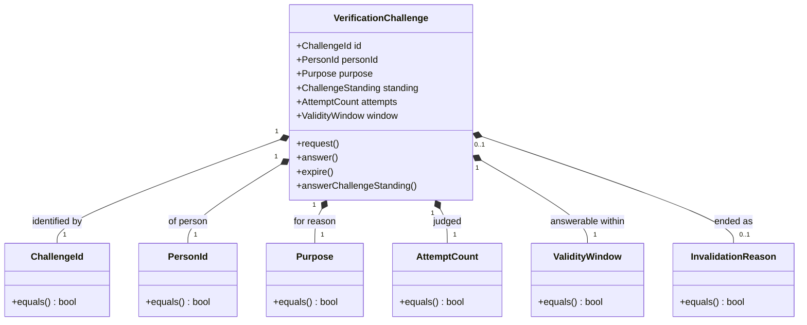
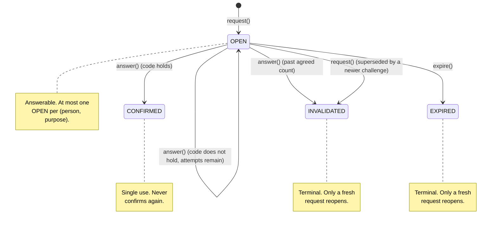
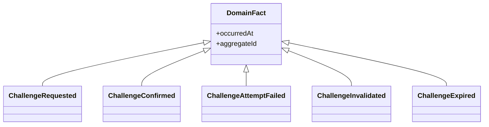

# Verification (OTP) — Channel Possession Proof — Domain Model

This is the domain model of a Generic Subdomain. It describes business meaning only:
the aggregate, its operations, value objects, domain facts (events), business rules,
and business rejections. It names no framework, library, storage, transport, or module structure.

Source: `event-storming.md` in this same folder (v0.1.0).
Reference input `docs/BrainStorming/VotoChain_DDD_Subdomains.md` §10 + §15 was treated as hypothesis;
deviations are logged under Hotspots.

> This context proves **possession of a channel**: that the person can read what was sent there.
> It judges challenge standing and owns the attempt history — code generation, code comparison,
> and delivery live outside this boundary (executor-first, per the storming's locked decision).
> Physical identity belongs to `Biometric Identity Verification`; the when/why of contacting
> belongs to the requester; opt-in belongs to `Consent & Compliance`.

## Aggregate Overview

One small aggregate. Each challenge is a consistency boundary for exactly one
(person, purpose) proof. Attempts belong to the challenge they were presented against —
never a separate lifecycle. Splitting attempts off would break request → judge →
exhaust/consume atomicity with no benefit. Persons are referenced by identity only —
never embedded.

---

## Aggregate: VerificationChallenge

### Identity & Lifecycle

| Property | Meaning |
|----------|---------|
| `id` | Identity of this challenge. Stable for its whole life, never reused |
| `personId` | The person asked to prove (identity reference only; the person record lives elsewhere) |
| `purpose` | The reason for the proof: `login`, `email-verification`, or `password-reset` — closed set |
| `standing` | Where the challenge stands (see state machine) |
| `attempts` | How many presented codes have been judged, against the agreed maximum |
| `window` | When the challenge was requested and how long it stays answerable |

### State Machine: ChallengeStanding

> Supersede closes the prior challenge (`INVALIDATED` with reason `superseded`) and opens the new
> one as part of the same `request()` transition — mirroring the IAM session default, still pending
> expert confirmation.

### Invariants (Always True)

| # | Invariant |
|---|-----------|
| 1 | At most one `OPEN` challenge exists per (person, purpose) at any instant. A second request supersedes the prior one — challenges are never doubled |
| 2 | A `CONFIRMED` challenge never confirms again. Consumption is single-use by construction |
| 3 | An `INVALIDATED` or `EXPIRED` challenge never answers again. Only a fresh request reopens the proof |
| 4 | The presented code is judged per attempt and never kept in readable form. History records judgments, never secrets |
| 5 | The purpose set is closed: `login`, `email-verification`, `password-reset`. Vote authorization lives in Voting, never here |
| 6 | A challenge is answerable only within its validity window. Past it, expiry is terminal |
| 7 | Nothing here carries physical identity, delivery mechanics, or opt-in judgment. Those are judged where they live |

### Mutating Operations

| Operation | Preconditions | Facts Produced |
|-----------|---------------|----------------|
| `request()` | Person known; purpose in the closed set; contact allowed now (opt-in answered outside); prior open challenge (if any) closes as superseded | `ChallengeInvalidated` (superseded, only if one was open), then `ChallengeRequested` |
| `answer()` | A challenge is `OPEN` and within its window; the presented code is judged; the attempt is counted | `ChallengeConfirmed` (code holds) — or `ChallengeAttemptFailed` (code does not hold, attempts remain) — or `ChallengeAttemptFailed` + `ChallengeInvalidated` (past agreed count) |
| `expire()` | The validity window elapsed while `OPEN` | `ChallengeExpired` |

### Answering Operations (Read, but Owned by the Aggregate)

| Operation | Preconditions | Answers |
|-----------|---------------|---------|
| `answerChallengeStanding()` | Always answerable | Is there a usable (`OPEN`, within window) challenge for person + purpose, and how many attempts remain |

### Read Needs (What the Domain Must Be Able to Answer)

| Need | Returns |
|------|---------|
| Challenge standing | Usable challenge now? With how many attempts left? — the answer IAM flows and request throttling consume |
| Challenge history (scrutiny) | What was requested, presented, and concluded, in order — requests, attempts, and outcomes |

---

## Value Objects

No identity; defined entirely by attributes; immutable; invalid values are unrepresentable.

### ChallengeId / PersonId

- The stable identities of challenges and persons.
- Equality is by value. Distinct kinds are never interchangeable.
- Person identity is held as a reference only; what it means for a person to exist is judged where the person record lives.

### Purpose

- The reason for the proof: `LOGIN` (prove during sign-in), `EMAIL_VERIFICATION` (prove the address is held), `PASSWORD_RESET` (prove before a secret reset is allowed).
- Closed set. A new purpose later is a new mapping, not a domain change.

### AttemptCount

- How many presented codes have been judged against this challenge, and the agreed maximum.
- Starting proposal (pending product confirmation): maximum 5. Past it, the challenge invalidates.
- Remaining attempts are answerable from this object at any instant.

### ValidityWindow

- When the challenge was requested and how long it stays answerable.
- Starting proposal (pending product confirmation): 5 minutes from request. Past it, the challenge expires on its own.
- Elapsed-or-not is answerable from this object plus the current moment.

### InvalidationReason

- Why a challenge ended without confirmation: `ATTEMPTS_EXHAUSTED` or `SUPERSEDED`.
- Recorded on the invalidation fact for scrutiny; the superseding challenge carries its own identity.

---

## Domain Events (Facts)

Past tense. Immutable. Each carries enough business data that consumers do not need to ask again for the common cases. Each is produced by exactly one aggregate operation. No event carries the code itself.

| Event | Payload (business data) | Produced By | Interested Parties |
|-------|-------------------------|-------------|--------------------|
| `ChallengeRequested` | challenge, person, purpose, window | `VerificationChallenge.request()` | Challenge standing, scrutiny history, delivery instruction |
| `ChallengeConfirmed` | challenge, person, purpose | `VerificationChallenge.answer()` | IAM standing, scrutiny history |
| `ChallengeAttemptFailed` | challenge, person, purpose, remaining attempts | `VerificationChallenge.answer()` | Scrutiny history |
| `ChallengeInvalidated` | challenge, person, purpose, reason | `VerificationChallenge.request()` (supersede) / `VerificationChallenge.answer()` (exhausted) | Challenge standing, scrutiny history |
| `ChallengeExpired` | challenge, person, purpose | `VerificationChallenge.expire()` | Challenge standing, scrutiny history |

---

## Business Rules (Policies)

Stated as domain rules. No mechanism named.

| Rule | Whenever… | Then… |
|------|-----------|-------|
| Second request supersedes | A request arrives while one is `OPEN` for the same (person, purpose) | The prior challenge invalidates with reason `superseded` and the new one opens (default, needs expert confirmation) |
| Attempts exhaust | A failed attempt passes the agreed count | The challenge invalidates with reason `attempts exhausted`; only a fresh request reopens |
| Window elapses | The validity window elapses while `OPEN` | The challenge expires; it can no longer answer |

---

## Business Rejections

What the domain refuses, and why. These are business outcomes, not transport codes.

| Rejection | Meaning |
|-----------|---------|
| `PurposeUnknown` | Request asked for a reason outside the closed set |
| `ContactNotAllowed` | Request asked while contact is not allowed now (opt-in answered outside) |
| `NoUsableChallenge` | An answer arrived with no `OPEN` challenge for the pair |
| `AlreadyAnswered` | An answer arrived for a confirmed, invalidated, or expired challenge |
| `AttemptNotHeld` | The presented code does not hold (recorded as a failed attempt while attempts remain) |

---

## Hotspots & Deviations from the Reference Input

| # | Matter | Position in this model |
|---|--------|------------------------|
| H1 | Reference §10 demands its own lifecycle, only using Notifications as channel | Honored: challenge lifecycle here; delivery instructed out; opt-in judged out |
| H2 | One aggregate or separate attempt lifecycle? | One aggregate. Attempts are a counted facet of the challenge; splitting would break request → judge → exhaust/consume atomicity with no benefit |
| H3 | Second request while one open: refuse or supersede? | Supersede (default, needs expert confirmation), mirroring the IAM session default |
| H4 | Attempt count, window, code length as domain defaults | Starting proposal: short numeric code, 5-minute window, 5 attempts — pending product confirmation; numbers change without touching the model shape |
| H5 | Code secrecy: events vs instruction-only | Instruction-only: no fact carries the code; history records judgments, never secrets |
| H6 | Purpose set closed vs extensible | Closed at three; vote authorization lives in Voting, never here |

## Open Questions

| # | Question | Standing |
|---|----------|----------|
| 1 | Supersede vs refuse on a second request — confirm supersede? | Open — needs product decision |
| 2 | Window length, attempt count, code length — confirm the starting proposal? | Open — needs product decision |
| 3 | Must throttling (how often may a person request) be a domain rule or an execution guard? | Open — parked |
| 4 | Further channels later — new purpose values or same challenge, new delivery? | Open — parked, revisit on a concrete driver |
| 5 | Which IAM flows consume `ChallengeConfirmed` first? | Open — needs product decision |

## Related Documentation

| Document | Link |
|----------|------|
| Event Storming (this bounded context) | `event-storming.md` |
| Notifications event storming (sibling — owns delivery, instructed from here) | `../notifications/event-storming.md` |
| IAM event storming (sibling — consumes confirmations by reference) | `../iam/event-storming.md` |
| Consent & Compliance event storming (sibling — owns opt-in) | `../consent-compliance/event-storming.md` |
| Biometric Identity Verification event storming (sibling — owns physical identity, distinct) | `../biometric-identity-verification/event-storming.md` |
| Subdomain map (input, hypothesis) | `docs/BrainStorming/VotoChain_DDD_Subdomains.md` §10 + §15 |
| Modeling example (shape reference) | `docs/References/domain-model.md` |
