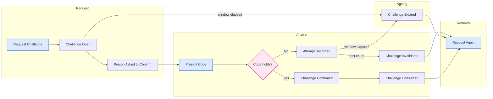

# Event Storming: Verification (OTP) — Channel Possession Proof (Generic Subdomain)

## Workshop Overview

| Aspect | Details |
|--------|---------|
| **Date** | 2026-09-07 |
| **Duration** | 1 session × 2 hours (ninth context, paired with Notifications) |
| **Participants** | Domain Expert (Product), 2 Backend Engineers |
| **Facilitator** | Senior Engineer (DDD practitioner) |
| **Scope** | One-off proof that a person holds a channel (email): challenge request → presented-code judgment with attempt discipline → expiry/consumption. Out of scope: physical identity proof, vote authorization, message delivery itself, communication opt-in |
| **Tool** | Markdown + Mermaid (mirrors `docs/References/event-storming.md` conventions, in pure domain language) |
| **Input** | `docs/BrainStorming/VotoChain_DDD_Subdomains.md` §10 + §15 (treated as hypothesis, not truth — see Hotspots) |
| **Execution decision** | Code generation, code comparison, and channel delivery are **executed outside** (external executors). This artifact models what the domain **judges and owns**: challenge standing, attempt history, expiry, consumption. Execution mechanics never appear here |

### Ubiquitous Language in scope (this context owns the meaning)

| Term | Domain definition (inside this BC) |
|---|---|
| **Challenge** | One concrete instance of a proof requested for a person and a purpose. Born on request, dies on confirmation, invalidation, or expiry |
| **Purpose** | The reason for the challenge. Closed set: `login`, `email-verification`, `password-reset` — nothing else (vote authorization lives in Voting) |
| **Presented code** | What the person offers back. Judged per attempt (holds / does not hold); never kept in readable form |
| **Attempt** | One judgment of a presented code against an open challenge. Counted; past the agreed count the challenge is invalidated |
| **Validity window** | How long a challenge stays answerable after request. Past it, the challenge expires on its own |
| **Consumption** | The single use of a challenge: a confirmed challenge can never confirm again |

> Do not confuse with `Biometric Identity Verification` — that context proves **physical identity**
> (a live person matching a reference face); this context proves **possession of a channel**
> (the person can read what was sent there). Channel delivery itself belongs to `Notifications`;
> whether the person may be contacted at all belongs to `Consent & Compliance`.

## Big Picture (Process Level)



### Pivotal points (candidate boundary signals)

1. `Challenge Open` → one usable challenge per (person, purpose) from here; a second request supersedes the prior one (default, needs expert confirmation).
2. `Challenge Confirmed` → the only fact consumers (IAM, and only IAM for now) may act on; single-use, never reusable.
3. `Challenge Invalidated` / `Challenge Expired` → terminal; the only way forward is a fresh request.

## Design Level — VerificationChallenge Aggregate

> Design decision: one small aggregate, `VerificationChallenge`, referenced by person and purpose.
> The attempt history belongs to the challenge it was presented against — never a separate lifecycle.
> Delivery of the code is instructed to `Notifications`; confirmation of delivery is observed, never assumed.

```mermaid
graph TD
    subgraph "Commands (Intent)"
        C1[RequestChallenge]
        C2[AnswerChallenge]
        C3[ExpireChallenge]
        C4[AnswerChallengeStanding]
    end

    subgraph "Aggregate: VerificationChallenge"
        V[VerificationChallenge<br/>(Aggregate Root)]
        V --- VState[State: ChallengeStanding<br/>OPEN/CONFIRMED/<br/>INVALIDATED/EXPIRED]
        V --- VPurp[Purpose: login /<br/>email-verification /<br/>password-reset]
        V --- VAtt[Attempts: count +<br/>agreed maximum]
        V --- VWin[Validity window:<br/>requested-at + span]
    end

    subgraph "Events (Facts)"
        E1[ChallengeRequested]
        E2[ChallengeConfirmed]
        E3[ChallengeAttemptFailed]
        E4[ChallengeInvalidated]
        E5[ChallengeExpired]
    end

    subgraph "Policies (Reactions)"
        Pol1[Second request supersedes the open challenge]
        Pol2[Past-count attempts invalidate the challenge]
        Pol3[Elapsed window expires the challenge]
    end

    subgraph "Read Models"
        RM1[Challenge Standing - is there a usable challenge for person + purpose]
        RM2[Challenge History - requests, attempts, and outcomes, for scrutiny]
    end

    subgraph "Needs from other contexts (business language)"
        Ext1[Delivery instructed - person asked to confirm, via Notifications]
        Ext2[Opt-in answered - may contact now, via Consent & Compliance]
        Ext3[Verdict consumed - IAM judges standing on confirmation, by reference only]
    end

    C1 --> V
    C2 --> V
    C3 --> V
    C4 --> V

    V --> E1
    V --> E2
    V --> E3
    V --> E4
    V --> E5

    E1 --> Pol1
    E3 --> Pol2
    E1 --> Pol3

    E1 -.-> RM1
    E2 -.-> RM1
    E4 -.-> RM1
    E5 -.-> RM1
    E1 -.-> RM2
    E2 -.-> RM2
    E3 -.-> RM2

    C1 --> Ext1
    C1 --> Ext2
    E2 -.-> Ext3

    classDef cmd fill:#dbeafe,stroke:#3b82f6,stroke-width:2px;
    classDef agg fill:#dcfce7,stroke:#22c55e,stroke-width:3px;
    classDef evt fill:#fef3c7,stroke:#f59e0b,stroke-width:2px;
    classDef pol fill:#fce7f3,stroke:#ec4899,stroke-width:2px;
    classDef rm fill:#e0e7ff,stroke:#6366f1,stroke-width:2px;
    classDef ext fill:#e5e7eb,stroke:#6b7280,stroke-width:2px;

    class C1,C2,C3,C4 cmd;
    class V,VState,VPurp,VAtt,VWin agg;
    class E1,E2,E3,E4,E5 evt;
    class Pol1,Pol2,Pol3 pol;
    class RM1,RM2 rm;
    class Ext1,Ext2,Ext3 ext;
```

## Key Discoveries

### Aggregates Identified

| Aggregate | Root | Invariants |
|-----------|------|------------|
| **VerificationChallenge** | `VerificationChallenge` | At most one usable (`OPEN`) challenge per (person, purpose) at any instant; a confirmed challenge never confirms again; an invalidated or expired challenge never answers again; the presented code is judged per attempt and never kept readable |

### Commands (3 + 1 answering)

| Command | Aggregate | Validation |
|---------|-----------|------------|
| `RequestChallenge` | VerificationChallenge | Person known; purpose in the closed set; contact allowed now (opt-in answered outside); a prior open challenge for the same pair is superseded, not doubled |
| `AnswerChallenge` | VerificationChallenge | A challenge is `OPEN` and within its window; the presented code is judged; attempts counted |
| `ExpireChallenge` | VerificationChallenge | The validity window elapsed while `OPEN` |
| `AnswerChallengeStanding` | VerificationChallenge (read) | Always answerable: is there a usable challenge for person + purpose |

### Events (5 Published)

| Event | Payload | Downstream Consumers |
|-------|---------|---------------------|
| `ChallengeRequested` | person, purpose, window | Challenge standing, scrutiny history, delivery instruction |
| `ChallengeConfirmed` | person, purpose | IAM standing (email verified / sign-in second proof / secret reset allowed), scrutiny history |
| `ChallengeAttemptFailed` | person, purpose, remaining attempts | Scrutiny history |
| `ChallengeInvalidated` | person, purpose, reason (attempts exhausted / superseded) | Challenge standing, scrutiny history |
| `ChallengeExpired` | person, purpose | Challenge standing, scrutiny history |

> No event carries the code itself. Consumers act on the confirmation fact, never on the secret.

### Policies (Business Rules)

| Policy | Trigger | Action |
|--------|---------|--------|
| **Second request supersedes** | `RequestChallenge` while one is `OPEN` for the same (person, purpose) | Prior challenge invalidated with reason `superseded`; the new one opens (default, needs expert confirmation) |
| **Attempts exhaust** | Failed attempt past the agreed count | `ChallengeInvalidated` with reason `attempts exhausted`; only a fresh request reopens |
| **Window elapses** | Validity window elapsed while `OPEN` | `ChallengeExpired`; the challenge can no longer answer |

### Read Models

| Read Model | Source events | Consumers |
|------------|---------------|-----------|
| Challenge Standing (usable challenge now?) | `ChallengeRequested`, `ChallengeConfirmed`, `ChallengeInvalidated`, `ChallengeExpired` | IAM flows, request throttling answers |
| Challenge History (what was asked and answered, for scrutiny) | All five facts | Scrutiny, abuse review |

### Needs from other contexts (business language, never direct model access)

| Need | Direction | Meaning |
|------|-----------|---------|
| Person asked to confirm | Instructed to Notifications | Delivery of the code is a delivery instruction; this context never delivers itself |
| May contact now? | Answered by Consent & Compliance | Opt-in is judged where consent lives; a refused answer blocks the request with reason |
| Verdict consumed | Offered to IAM | `ChallengeConfirmed` is the only fact IAM acts on; IAM judges standing, never re-judges the code |

## Hotspots (Contentious Decisions)

| # | Hotspot | Decision in this artifact | Rationale |
|---|---------|---------------------------|-----------|
| H1 | **Reference §10 suggests its own lifecycle, only using Notifications as channel** | Honored: challenge lifecycle here, delivery instructed out, opt-in judged out | Keeps one rate of change per aggregate; delivery and consent evolve on their own events |
| H2 | **Second request while one open: refuse or supersede?** | Supersede (default, needs expert confirmation): prior invalidated with reason `superseded` | Mirrors the IAM session default; refusal would strand a person whose code never arrived |
| H3 | **Plain code in events vs instruction-only** | Instruction-only: no event carries the code; delivery travels as an instruction to Notifications | The confirmation fact is what consumers need; the secret itself is judged once and never recorded readable |
| H4 | **Attempt count and window as domain defaults** | Starting proposal: short numeric code, 5-minute window, 5 attempts — all pending product confirmation | Generic sensible defaults; product owns the final numbers without changing the model shape |
| H5 | **Purpose set closed vs extensible** | Closed at three (`login`, `email-verification`, `password-reset`); a new purpose later is a new mapping, not a domain change | Map §10.3 + §15 sanction exactly these; vote authorization lives in Voting, never here |

## Open Questions / Parking Lot

| # | Question | Status | Owner |
|---|----------|--------|-------|
| 1 | Supersede vs refuse on a second request — confirm supersede? | Open — needs product decision | Product |
| 2 | Window length, attempt count, code length — confirm the starting proposal? | Open — needs product decision | Product |
| 3 | Must throttling (how often may a person request) be a domain rule or an execution guard? | Open — parked | Product |
| 4 | Further channels later (beyond email) — new purpose values or same challenge, new delivery? | Open — parked, revisit on a concrete driver | Product |
| 5 | Which IAM flows consume `ChallengeConfirmed` first (email verification during sign-up vs sign-in second proof)? | Open | Product |

## Related Documentation

| Document | Link |
|----------|------|
| Subdomain map (input, hypothesis) | `docs/BrainStorming/VotoChain_DDD_Subdomains.md` §10 + §15 |
| Notifications event storming (sibling — owns delivery, instructed from here) | `../notifications/event-storming.md` |
| IAM event storming (sibling — consumes confirmations by reference) | `../iam/event-storming.md` |
| Consent & Compliance event storming (sibling — owns opt-in, answers may-contact-now) | `../consent-compliance/event-storming.md` |
| Biometric Identity Verification event storming (sibling — owns physical identity, distinct from channel proof) | `../biometric-identity-verification/event-storming.md` |
| Diagram conventions (example) | `docs/References/event-storming.md` |
