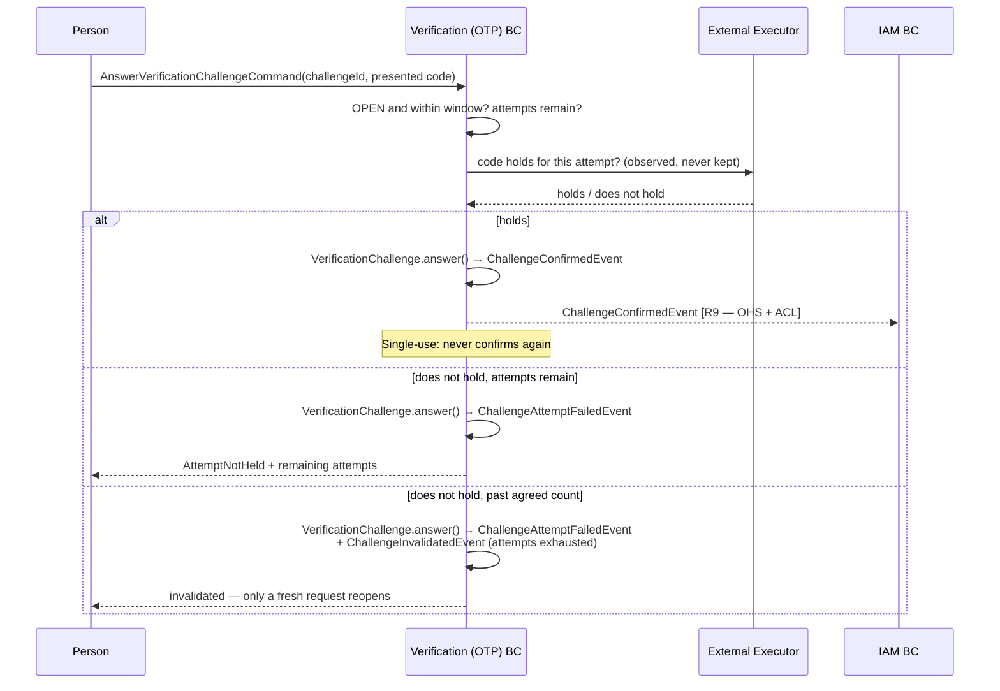

# Verification (OTP) — Application Layer

This document describes **orchestration**, not business meaning. It answers: in what
order do things happen, who calls whom, and what crosses this bounded context's
boundary to prove one channel held. It names no framework, transport, or storage —
same discipline as `domain-model.md`.

Source of business meaning: `domain-model.md` (this same folder). This document adds
nothing new to *what the aggregate can do*; it only sequences calls to the aggregate
and to other bounded contexts, per the rules already frozen in `context-mapping.md`.

A use case here is triggered either by an external request (synchronous) or by a fact
this context reacts to (event-driven). Both are documented the same way.

Naming convention (frozen for all `use-case.md` documents): commands are
`Action+Target+Command` (e.g. `CreateOrderCommand`), events are
`Target+PastAction+Event` (e.g. `OrderCreatedEvent`), queries are
`Action+Target+Criteria+Query` (e.g. `GetOrderByIdQuery`). A query name may grow
whenever the criteria need declaring.

> This context proves **possession of a channel** (the person can read what was sent
> there). Physical identity belongs to Biometric Identity Verification — the two are
> never confused here. Code generation, code comparison, and delivery are executed
> outside (executor-first, locked decision): this context judges standing and owns the
> attempt history.

---

## 1. Use Case Catalog

| # | Use Case | Trigger | Aggregates Touched | External BCs Consulted | Facts Produced |
|---|----------|---------|--------------------|-------------------------|-----------------|
| UC1 | RequestChallenge | Person request for a purpose in the closed set | `VerificationChallenge` | Consent & Compliance (may-contact-now?), Notifications (delivery instruction) | `ChallengeInvalidatedEvent` (superseded, only if one was open), then `ChallengeRequestedEvent` |
| UC2 | **AnswerChallenge** (anchor) | Person presents a code against the open challenge | `VerificationChallenge` | External executor (code holds or not, observed per attempt) | `ChallengeConfirmedEvent` — or `ChallengeAttemptFailedEvent` — or `ChallengeAttemptFailedEvent` + `ChallengeInvalidatedEvent` (past agreed count) |
| UC3 | ExpireChallenge | Time sweep (validity window elapsed) | `VerificationChallenge` | — | `ChallengeExpiredEvent` |
| UC4 | AnswerChallengeStanding | IAM flows / request throttling check | `VerificationChallenge` (answering operation only) | — | — (synchronous answer, no fact) |

UC2 is detailed fully below because the judge → confirm-or-count → single-use-consumption
ordering is the orchestration most likely to be gotten wrong (re-confirming, keeping
the secret, or re-judging in the consumer). This context holds a single aggregate, so
there is no second multi-aggregate sequence to detail.

---

## 2. Commands & Queries Accepted (Input Contracts)

These are the intentions this bounded context accepts from outside — not to be
confused with the aggregate operations in `domain-model.md`, which are internal.

### Commands

| Command | Carries | Handled By |
|---------|---------|------------|
| `RequestVerificationChallengeCommand` | personId, purpose (`login`, `email-verification`, `password-reset`) | UC1 |
| `AnswerVerificationChallengeCommand` | challengeId, presented code | UC2 |
| `ExpireVerificationChallengeCommand` | challengeId | UC3 (time-triggered sweep) |

UC1 refuses before opening when the purpose is outside the closed set
(`PurposeUnknown`) or contact is not allowed now (`ContactNotAllowed`) — both checked
before any fact is produced.

### Queries

| Query | Returns | Backing Read Need (domain-model.md) |
|-------|---------|--------------------------------------|
| `GetChallengeStandingByPersonAndPurposeQuery` | Usable challenge now? With how many attempts left? | "Challenge standing" |
| `GetChallengeHistoryByPersonAndPurposeQuery` | What was requested, presented, and concluded, in order | "Challenge history (scrutiny)" |

UC4 is served by the aggregate's answering operation `answerChallengeStanding()` — it
judges standing and answers; it mutates nothing and produces no fact.

---

## 3. Use Case Detail — UC2: AnswerChallenge (anchor)

### Preconditions

| # | Precondition | Checked Against |
|---|---------------|------------------|
| 1 | A challenge is `OPEN` for this (person, purpose) and within its validity window | `VerificationChallenge` |
| 2 | Attempts remain (count below the agreed maximum) | `VerificationChallenge.attempts` |
| 3 | The presented code is judged per attempt by the external executor — holds or does not hold | External executor (judged outside, consumed here) |

### Sequence

### Steps (Business Language)

| Step | Action | Facts / Failure |
|------|--------|------------------|
| 1 | Confirm an `OPEN` challenge exists for the pair and the window has not elapsed | Otherwise: `NoUsableChallenge` (none open) or `AlreadyAnswered` (confirmed/invalidated/expired) |
| 2 | Confirm attempts remain against the agreed maximum | Past the count, the challenge invalidates instead of answering |
| 3 | Observe the code verdict for this attempt from the external executor | The code is judged once and never kept in readable form (invariant 4) |
| 4a | On a holding code: `answer()` confirms — single use | `ChallengeConfirmedEvent`; IAM acts on this fact, never on the secret (R9) |
| 4b | On a failing code with attempts left: `answer()` counts the attempt | `ChallengeAttemptFailedEvent` with remaining attempts |
| 4c | On a failing code past the count: `answer()` counts and invalidates | `ChallengeAttemptFailedEvent` + `ChallengeInvalidatedEvent` (`ATTEMPTS_EXHAUSTED`) |

### What This Use Case Does *Not* Do

- Does not generate, compare, or deliver codes (executed outside — this context judges the verdict and owns the history).
- Does not carry the code in any fact (instruction-only — history records judgments, never secrets).
- Does not judge opt-in (Consent & Compliance owns `may-contact-now?` — checked at UC1, not re-checked here).
- Does not prove physical identity or authorize votes (Biometric and Voting concerns — the purpose set stays closed at three).

### Concurrency & Idempotency

- Two answers racing each other serialize per attempt: each is judged and counted in
  turn — the one that confirms first consumes the challenge (`CONFIRMED`); the later
  one finds no usable challenge (`AlreadyAnswered`), even if its code would have held.
- A re-request (UC1) racing an in-flight answer resolves by the supersede rule: the
  request invalidates the open challenge (`SUPERSEDED`) and the late answer finds it
  already answered — answers are never applied to the new challenge.
- Repeating the same presented code after failure counts a new attempt each time —
  attempts are counted per presentation, not per distinct code.

### Open Orchestration Questions

- Window length, attempt count, code length — confirm the starting proposal (short
  numeric code, 5-minute window, 5 attempts; domain-model.md, Open Question #2) —
  needs product decision.
- Supersede vs refuse on a second request — confirm supersede (Open Question #1) —
  needs product decision.
- Whether throttling (how often a person may request) is a domain rule or an
  execution guard (Open Question #3) — parked.

---

## 4. ACL Published (What This BC Exposes)

| Capability | Consumer (per context-mapping.md) | Notes |
|---|---|---|
| `ChallengeConfirmedEvent` | IAM (R9) | The confirmation fact crosses; the code itself never does — IAM judges standing, never re-judges the code |
| Delivery instruction | Notifications | Person asked to confirm — delivery of the code is a delivery intent, owned there |
| Challenge standing answer (`answerChallengeStanding()`, UC4) | IAM flows, request throttling | Usable challenge now? With how many attempts left? |

## 5. ACL Consumed (What This BC Depends On)

| Dependency | Pattern (context-mapping.md) | Used In |
|---|---|---|
| Consent & Compliance → Verification (may-contact-now?) | Partnership / coordination | UC1 — opt-in judged where consent lives; a refused answer blocks the request |
| External executor → Verification (code holds or not) | Executor-first (H1) | UC2 — judged outside per attempt, consumed here, never kept readable |
| IAM → Verification (person existence) | Identity reference | UC1 — a challenge belongs to exactly one known person |

Every row here is a consequence of a relationship already frozen in
`context-mapping.md` — this table only says *which use case* is the one that actually
makes the call.

---

## Related Documentation

| Document | Link |
|----------|------|
| Domain model (source of aggregate behavior) | `domain-model.md` |
| Event Storming | `event-storming.md` |
| Context map + relationship catalog (source of R1–R14) | `context-mapping.md` |
| Consolidated ubiquitous language | `ubiquitous-language.md` |
