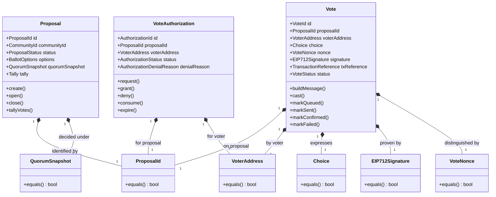
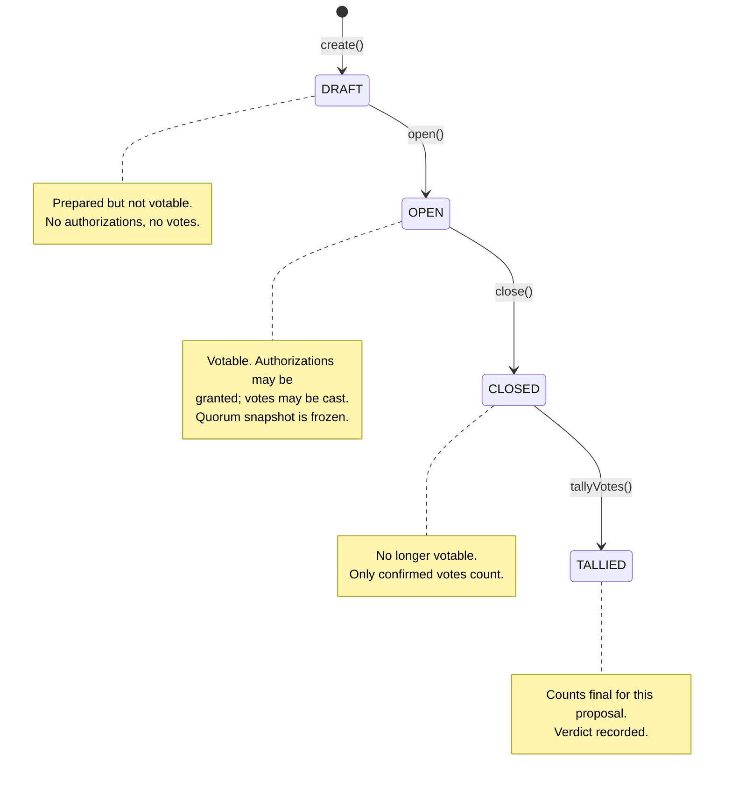
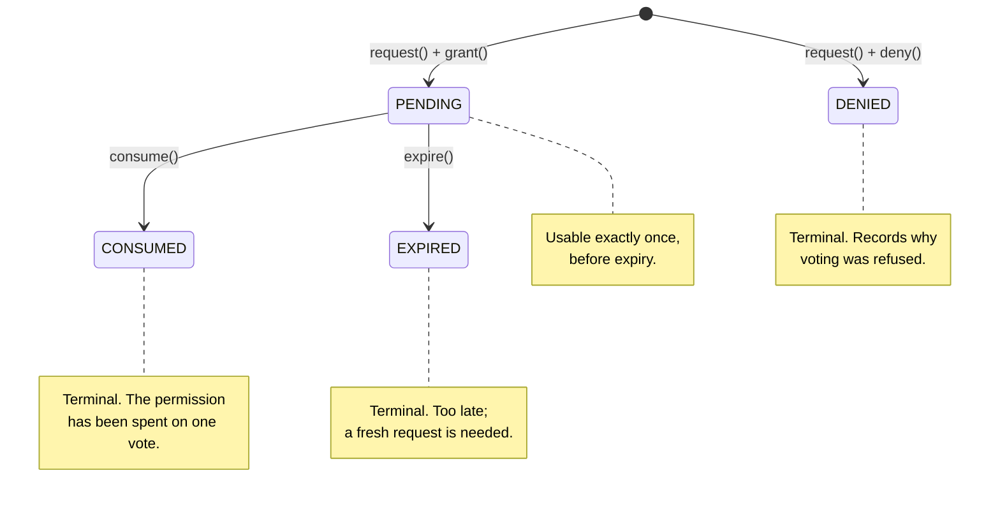
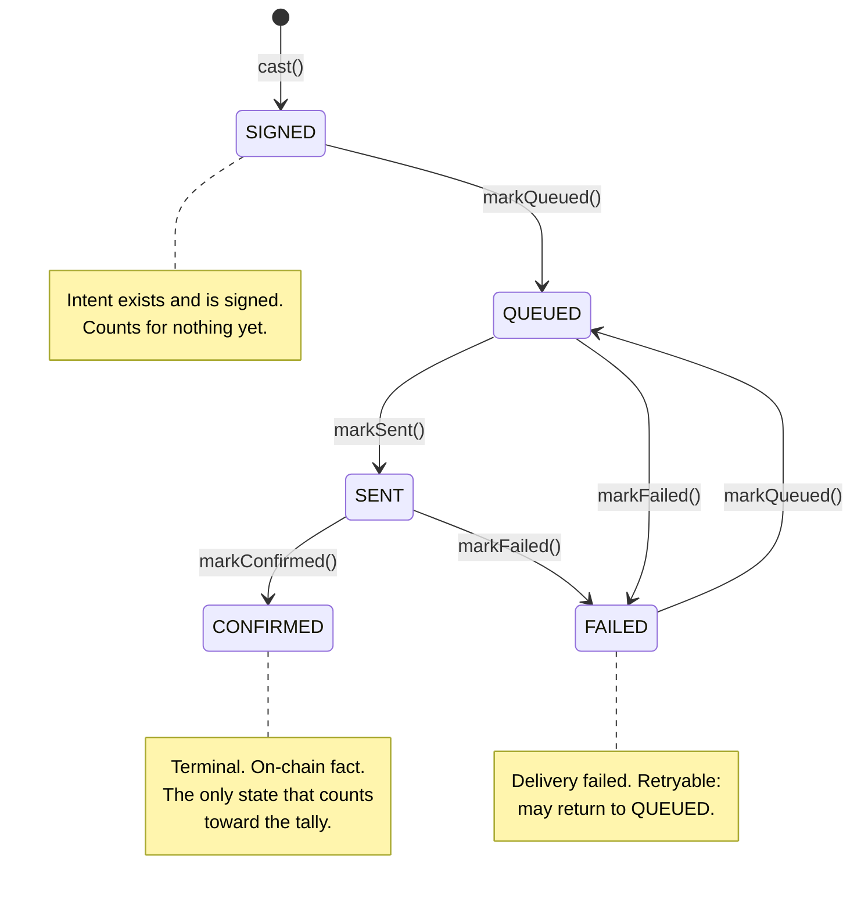

# Voting & Verifiable Ledger — Domain Model

This is the domain model of the Core Domain. It describes business meaning only:
aggregates, their operations, value objects, domain facts (events), business rules,
and business rejections. It names no framework, library, storage, transport, or module structure.

Source: `event-storming.md` in this same folder (v0.1.0).
Reference input `docs/BrainStorming/VotoChain_DDD_Subdomains.md` §2 was treated as hypothesis;
deviations are logged under Hotspots.

## Aggregate Overview

Three small aggregates. Each is a consistency boundary. Aggregates reference each other
by identity only — never by embedding.

---

## Aggregate: Proposal

### Identity & Lifecycle

| Property | Meaning |
|----------|---------|
| `id` | Identity of this proposal. Stable for its whole life, never reused |
| `communityId` | The community this proposal belongs to (identity reference only; community state lives elsewhere) |
| `status` | Where the proposal is in its life (see state machine) |
| `options` | The set of eligible choices (the ballot) |
| `quorumSnapshot` | The participation rule frozen at opening; the vote is judged against this copy, not against any later rule change |
| `tally` | Per-option counts plus turnout and the quorum verdict; meaningful only after tallying |

### State Machine: ProposalStatus

### Invariants (Always True)

| # | Invariant |
|---|-----------|
| 1 | Status moves only forward: `DRAFT → OPEN → CLOSED → TALLIED`. No reopening, no skipping |
| 2 | The quorum snapshot is written exactly once, at opening, and never changes afterwards |
| 3 | Authorizations and votes exist only while the proposal is `OPEN`. Anything arriving later is rejected as late |
| 4 | The tally counts only confirmed votes; intent alone (signed, queued, sent) never counts |
| 5 | The proposal never contains votes. It knows counts, not vote objects |

### Mutating Operations

| Operation | Preconditions | Facts Produced |
|-----------|---------------|----------------|
| `create()` | Community exists; ballot has at least two distinct options | `ProposalDraftedEvent` |
| `open()` | Status is `DRAFT`; participation rule is available to freeze into the snapshot | `ProposalOpenedEvent` |
| `close()` | Status is `OPEN`; closer is entitled (community administrator or scheduled close — entitlement judged outside this context) | `ProposalClosedEvent` |
| `tallyVotes()` | Status is `CLOSED` | `ProposalTalliedEvent`, plus `QuorumReachedEvent` or `QuorumNotReachedEvent` |

### Read Needs (What the Domain Must Be Able to Answer)

| Need | Returns |
|------|---------|
| Proposal by identity | The proposal or nothing |
| Proposals of a community by status | The matching proposals |
| Tally of a proposal | Per-option counts, turnout, quorum verdict (only meaningful once tallied) |

---

## Aggregate: VoteAuthorization

A short-lived, single-use permission for one voter to sign one vote on one proposal.
Single-use is a property of the authorization. The source material states nothing about
re-voting; the vote-mutability rule for `Vote` below is therefore a modeling default,
not a quoted requirement.

### Identity & Lifecycle

| Property | Meaning |
|----------|---------|
| `id` | Identity of this permission |
| `proposalId` | The proposal it permits voting on |
| `voterAddress` | The voter it is issued to (the on-chain identity whose signature will be verified) |
| `status` | `PENDING`, `CONSUMED`, `EXPIRED`, or `DENIED` |
| `denialReason` | Why it was denied, when denied: `INELIGIBLE`, `IDENTITY_NOT_VERIFIED`, `PROPOSAL_NOT_OPEN` |
| `expiresAt` | The moment after which a pending permission can no longer be used |

### State Machine: AuthorizationStatus

### Invariants (Always True)

| # | Invariant |
|---|-----------|
| 1 | Bound to exactly one `(proposal, voter)` pair. It can never be transferred or reused for another proposal or voter |
| 2 | Usable at most once: `CONSUMED`, `EXPIRED`, and `DENIED` are all terminal |
| 3 | Granting requires three truths at the same moment: the proposal is `OPEN`, the voter is eligible, the voter's physical identity has been verified |
| 4 | At most one pending permission exists per `(proposal, voter)` pair |
| 5 | Consuming the permission and casting the vote are one indivisible business step — two concurrent casts can never share one permission |

### Mutating Operations

| Operation | Preconditions | Facts Produced |
|-----------|---------------|----------------|
| `request()` | Proposal is `OPEN` | `VoteAuthorizationRequestedEvent` |
| `grant()` | Eligible voter, verified identity, no live pending permission for the pair | `VoteAuthorizationGrantedEvent` |
| `deny()` | Any grant precondition fails | `VoteAuthorizationDeniedEvent` (with reason) |
| `consume()` | Status `PENDING`, not expired; happens together with casting the vote | `VoteAuthorizationConsumedEvent` |
| `expire()` | Status `PENDING`, validity window elapsed | `VoteAuthorizationExpiredEvent` |

### Read Needs

| Need | Returns |
|------|---------|
| Authorization by identity | The authorization or nothing |
| Pending authorization for a (proposal, voter) pair | The pending permission or nothing |

---

## Aggregate: Vote

A voter's decision on a proposal, from signed intent to confirmed on-chain fact.
Intent (signed, queued, sent) and fact (confirmed) are different states with different
business weight: only the fact counts.

### Identity & Lifecycle

| Property | Meaning |
|----------|---------|
| `id` | Identity of this vote |
| `proposalId` | The proposal being decided |
| `voterAddress` | Whose decision this is (must equal the address recovered from the signature) |
| `choice` | The selected option; must belong to the proposal's ballot |
| `nonce` | Distinguishes this vote from any other attempt by the same voter on the same proposal |
| `signature` | The structured typed signature over (proposal, voter, choice, nonce) |
| `txReference` | The chain's reference to the submitted transaction, once submitted |
| `status` | `SIGNED`, `QUEUED`, `SENT`, `CONFIRMED`, or `FAILED` |

### State Machine: VoteStatus

### Invariants (Always True)

| # | Invariant |
|---|-----------|
| 1 | The signature binds all four of (proposal, voter, choice, nonce). A signature for one combination proves nothing about any other |
| 2 | The recovered signer and the declared voter are the same address. A mismatch is never confirmable |
| 3 | The choice belongs to the proposal's ballot at casting time |
| 4 | Casting requires a live (`PENDING`, unexpired) authorization for the same (proposal, voter) pair, consumed in the same step |
| 5 | Casting requires the proposal to be `OPEN`. Anything later is a late vote, not a vote |
| 6 | One confirmed vote per (proposal, voter). A second confirmed vote for the same pair is a replay, not a vote (default rule; re-vote would need an explicit supersede concept — parked, see Open Questions) |
| 7 | Nothing changes after `CONFIRMED` |
| 8 | Machine retries (re-queueing, re-sending the same vote) are delivery, not new votes, and never violate invariant 6 |

### Mutating Operations

| Operation | Preconditions | Facts Produced |
|-----------|---------------|----------------|
| `buildMessage()` | Live authorization; choice in ballot | `VoteMessageBuiltEvent` |
| `cast()` | Proposal `OPEN`; authorization consumed atomically; signature well-formed and verifiable off-chain | `VoteCastEvent`, plus the authorization's `VoteAuthorizationConsumedEvent` |
| `markQueued()` | Status `SIGNED` (or retry from `FAILED`) | `SignedVoteQueuedEvent` |
| `markSent()` | Status `QUEUED`; chain reference observed | `TransactionSentEvent` |
| `markConfirmed()` | Status `SENT`; chain confirms inclusion; recovered signer equals declared voter | `VoteConfirmedOnChainEvent` |
| `markFailed()` | Delivery reported failed; reason records whether retry is meaningful | `TransactionFailedEvent` |

### Read Needs

| Need | Returns |
|------|---------|
| Vote by identity | The vote or nothing |
| Confirmed vote for a (proposal, voter) pair | The confirmed vote or nothing (the replay guard reads this) |
| Verifiable proof of a vote | Choice, signature, chain reference, and recovered address — everything a third party needs to verify authorship without trusting Morocoders |
| Voter receipt | This voter's vote journey: cast → queued → sent → confirmed (or failed) |

---

## Value Objects

No identity; defined entirely by attributes; immutable; invalid values are unrepresentable.

### ProposalId / AuthorizationId / VoteId / CommunityId

- The stable identities of proposals, permissions, votes, and communities.
- Equality is by value. Distinct kinds are never interchangeable: a `VoteId` is never a `ProposalId`.

### VoterAddress

- The voter's on-chain identity — the address the signature must recover to.
- Valid means well-formed as a chain address. Belonging to an eligible voter is judged at authorization time, not by the address itself.

### Choice

- One selected ballot option.
- Valid means belonging to the proposal's `BallotOptions`. The proposal owns the ballot; the vote carries the selection.

### BallotOptions

- The set of options offered by a proposal.
- At least two distinct options. Fixed once the proposal is opened.

### EIP712Signature

- The structured, typed signature over (proposal, voter, choice, nonce).
- Carries everything needed for independent recovery of the signer (`ecrecover()` semantics belong to the chain; this context records the signature and the recovered address as facts).

### VoteNonce

- Distinguishes one voting attempt from another by the same voter on the same proposal.
- Fresh per authorization. Reusing a consumed authorization's nonce is part of what makes a replay detectable.

### QuorumSnapshot

- The frozen copy of the participation rule (threshold and basis) taken when the proposal opens.
- The vote is judged against this copy. Later changes to community rules do not rewrite history.

### EligibilitySnapshot

- The frozen record of what made a voter eligible at authorization time (roster standing as observed then).
- Explains past grants after the roster later changes.

### TransactionReference

- The chain's handle for a submitted vote (transaction hash, block position once confirmed).
- Observed from the chain, never invented by this context.

### Status Enumerations

- `ProposalStatus` — `DRAFT`, `OPEN`, `CLOSED`, `TALLIED`.
- `AuthorizationStatus` — `PENDING`, `CONSUMED`, `EXPIRED`, `DENIED`.
- `AuthorizationDenialReason` — `INELIGIBLE`, `IDENTITY_NOT_VERIFIED`, `PROPOSAL_NOT_OPEN`.
- `VoteStatus` — `SIGNED`, `QUEUED`, `SENT`, `CONFIRMED`, `FAILED`.

---

## Domain Events (Facts)

Past tense. Immutable. Each carries enough business data that reactors do not need to ask again for the common cases. Each is produced by exactly one aggregate operation.

```mermaid
classDiagram
    class DomainFact {
        +occurredAt
        +aggregateId
    }
    DomainFact <|-- ProposalDraftedEvent
    DomainFact <|-- ProposalOpenedEvent
    DomainFact <|-- ProposalClosedEvent
    DomainFact <|-- ProposalTalliedEvent
    DomainFact <|-- QuorumReachedEvent
    DomainFact <|-- QuorumNotReachedEvent
    DomainFact <|-- VoteAuthorizationRequestedEvent
    DomainFact <|-- VoteAuthorizationGrantedEvent
    DomainFact <|-- VoteAuthorizationDeniedEvent
    DomainFact <|-- VoteAuthorizationConsumedEvent
    DomainFact <|-- VoteAuthorizationExpiredEvent
    DomainFact <|-- VoteMessageBuiltEvent
    DomainFact <|-- VoteCastEvent
    DomainFact <|-- SignedVoteQueuedEvent
    DomainFact <|-- TransactionSentEvent
    DomainFact <|-- VoteConfirmedOnChainEvent
    DomainFact <|-- TransactionFailedEvent
    DomainFact <|-- ReplayRejectedEvent
    DomainFact <|-- LateVoteRejectedEvent
```

| Event | Payload (business data) | Produced By | Interested Parties |
|-------|-------------------------|-------------|--------------------|
| `ProposalDraftedEvent` | `ProposalId`, `CommunityId` | `Proposal.create()` | Proposal listing |
| `ProposalOpenedEvent` | `ProposalId`, `QuorumSnapshot` (frozen) | `Proposal.open()` | Voters (vote is open), eligibility window |
| `ProposalClosedEvent` | `ProposalId`, moment of closing | `Proposal.close()` | Tally policy, voters (late votes now rejected) |
| `ProposalTalliedEvent` | `ProposalId`, `Tally` (per-option counts, turnout, quorum verdict) | `Proposal.tallyVotes()` | Result announcement, tally view |
| `QuorumReachedEvent` | `ProposalId`, turnout | `Proposal.tallyVotes()` | Tally view, announcement |
| `QuorumNotReachedEvent` | `ProposalId`, turnout | `Proposal.tallyVotes()` | Tally view, announcement |
| `VoteAuthorizationRequestedEvent` | `AuthorizationId`, `ProposalId`, `VoterAddress` | `VoteAuthorization.request()` | Scrutiny record |
| `VoteAuthorizationGrantedEvent` | `AuthorizationId`, `ProposalId`, `VoterAddress`, expiry, `EligibilitySnapshot` | `VoteAuthorization.grant()` | Signing readiness |
| `VoteAuthorizationDeniedEvent` | `AuthorizationId`, `AuthorizationDenialReason` | `VoteAuthorization.deny()` | Voter explanation |
| `VoteAuthorizationConsumedEvent` | `AuthorizationId`, `VoteId` it was spent on | `VoteAuthorization.consume()` (with `Vote.cast()`) | Replay guard |
| `VoteAuthorizationExpiredEvent` | `AuthorizationId` | `VoteAuthorization.expire()` | Scrutiny record |
| `VoteMessageBuiltEvent` | `VoteId`, `ProposalId`, `Choice`, `VoteNonce` | `Vote.buildMessage()` | Scrutiny record |
| `VoteCastEvent` | `VoteId`, `ProposalId`, `VoterAddress`, `EIP712Signature` | `Vote.cast()` | Delivery, voter receipt |
| `SignedVoteQueuedEvent` | `VoteId`, queue position reference | `Vote.markQueued()` | Delivery, voter receipt |
| `TransactionSentEvent` | `VoteId`, `TransactionReference` | `Vote.markSent()` | Voter receipt, scrutiny |
| `VoteConfirmedOnChainEvent` | `VoteId`, `TransactionReference`, block position, recovered `VoterAddress` | `Vote.markConfirmed()` | Verifiable proof, tally view, voter receipt |
| `TransactionFailedEvent` | `VoteId`, reason, whether retry is meaningful | `Vote.markFailed()` | Retry policy |
| `ReplayRejectedEvent` | `ProposalId`, `VoterAddress`, reason | Guard on attempted second confirmation | Security record |
| `LateVoteRejectedEvent` | `ProposalId`, `VoterAddress` | Guard on post-close attempt | Scrutiny record |

---

## Business Rules (Policies)

Stated as domain rules. No mechanism named.

| Rule | Whenever… | Then… |
|------|-----------|-------|
| Authorization expiry | Validity window elapses on a `PENDING` permission | It becomes `EXPIRED` and can never be used |
| Replay guard | A cast arrives with a consumed, expired, or unknown permission — or a confirmation is attempted for an already-confirmed (proposal, voter) pair | The attempt is rejected and recorded as `ReplayRejected` |
| Late-vote guard | Any vote step is attempted after the proposal closed | The attempt is rejected and recorded as `LateVoteRejected` |
| Delivery retry | Delivery fails with a retryable reason | The same vote (same identity, same signature) may be queued again; this is not a new vote |
| Quorum evaluation | A closed proposal is tallied | Confirmed votes are compared against the frozen quorum snapshot; exactly one of `QuorumReached` / `QuorumNotReached` follows |
| Verifiable proof | A vote is confirmed on-chain | Choice, signature, chain reference, and recovered address become jointly available so any third party can verify authorship independently |

---

## Business Rejections

What the domain refuses, and why. These are business outcomes, not transport codes.

| Rejection | Meaning |
|-----------|---------|
| `ProposalNotOpen` | Authorization or vote attempted outside `OPEN` |
| `VoterIneligible` | Voter fails the roster standing required at authorization time |
| `IdentityNotVerified` | Voter's physical identity has not been verified for this vote |
| `AuthorizationExpired` | A pending permission used after its window |
| `AuthorizationAlreadyConsumed` | A permission used twice |
| `ReplayRejected` | A second confirmed vote attempted for the same (proposal, voter) |
| `LateVote` | Any vote step attempted after closing |
| `InvalidChoice` | Selection outside the proposal's ballot |
| `SignerMismatch` | Recovered signer differs from the declared voter |
| `IllegalProposalTransition` | An operation incompatible with current proposal status (e.g., tally before close) |
| `IllegalVoteTransition` | An operation incompatible with current vote status (e.g., change after confirmed) |
| `VoteNotFound` | A read or guard refers to a vote that does not exist |

---

## Hotspots & Deviations from the Reference Input

| # | Matter | Position in this model |
|---|--------|------------------------|
| H1 | Reference suggested `Proposal` owning `Vote` internally | Rejected. Three small aggregates by identity reference. A single proposal aggregate would grow without bound and serialize every vote through one consistency boundary |
| H2 | Live community rules vs frozen snapshot | The proposal freezes the participation rule at opening. Community rules evolve independently without rewriting electoral history |
| H3 | Replay vs delivery retry | Two different things: the domain rejects second confirmed votes per voter; delivery may retry the same vote identity. Never conflated |
| H4 | Intent vs fact | Signed/queued/sent is intent; confirmed on-chain is fact. Only fact counts |
| H5 | Permission consumption | Consuming the permission and casting the vote are one indivisible step, closing the double-cast window |
| H6 | Choice visibility | Proofs expose choice plus signature plus chain reference (transparent, verifiable voting). Secret ballot would be a different voting concept, not modeled here |

## Open Questions

| # | Question | Standing |
|---|----------|----------|
| 1 | May a voter change their vote (re-vote / overwrite)? | Parked. Source material is silent. Model defaults to one confirmed vote per voter; enabling re-vote needs an explicit supersede concept |
| 2 | How long is an authorization valid? | Open — needs product + security decision |
| 3 | Who may close a proposal (administrator, schedule, early close on quorum)? | Open — needs product decision |
| 4 | After how much chain confirmation is a vote "confirmed"? | Open — needs blockchain engineering decision (reorganization tolerance) |
| 5 | Is transparent choice acceptable, or is ballot secrecy required? | Open — product + legal; secrecy would reshape the proof concept |
| 6 | Is the rich tally here (per-option counts, turnout, verdict) sufficient, or does reporting deserve its own bounded context? | Watching. Full Results & Reporting was excluded by team decision; if reporting grows (trends, exports), split it out |

## Repository

Interfaces in domain, one per aggregate root. Finders use ubiquitous language; wire `eventName` strings unchanged.

| Repository | Finders |
|------------|---------|
| `ProposalRepository` (`PROPOSAL_REPOSITORY`) | `findById(id: ProposalId)`, `save(proposal: Proposal)` |
| `VoteAuthorizationRepository` (`AUTHORIZATION_REPOSITORY`) | `findById(id: AuthorizationId)`, `save(authorization: VoteAuthorization)` |
| `VoteRepository` (`VOTE_REPOSITORY`) | `findById(id: VoteId)`, `save(vote: Vote)` |

Broader reads (`listProposalsByCommunityAndStatus`, `getTallyByProposal`, `getVoterReceiptByProposalAndVoter`, `getVerifiableProofByVote`) are query-service operations over these repositories.

## Factory / creation

Named create path vs rehydrate split (rehydrate never raises events): `Proposal.create(id, communityId, options)` raises `ProposalDraftedEvent`; `VoteAuthorization.request(id, proposalId, voter, ttlMin)` raises `VoteAuthorizationRequestedEvent`; `Vote.cast(id, proposalId, voter, choice, nonce, sig, recovered)` raises `VoteMessageBuiltEvent` + `VoteCastEvent` (`Vote.buildMessage(...)` is pure, event-free). `Proposal.rehydrate(...)` / equivalent reload paths rebuild stored state without events.

## Related Documentation

| Document | Link |
|----------|------|
| Event Storming (this bounded context) | `event-storming.md` |
| Subdomain map (input, hypothesis) | `docs/BrainStorming/VotoChain_DDD_Subdomains.md` §2 |
| Modeling example (shape reference) | `docs/References/domain-model.md` |
