# Event Storming: Voting & Verifiable Ledger (Core Domain)

## Workshop Overview

| Aspect | Details |
|--------|---------|
| **Date** | 2026-09-07 |
| **Duration** | 1 session × 2 hours (Core Domain first, per plan) |
| **Participants** | Domain Expert (Product), 2 Backend Engineers, 1 Blockchain Engineer |
| **Facilitator** | Senior Engineer (DDD practitioner) |
| **Scope** | Proposal lifecycle → eligibility check → VoteAuthorization → vote-message build → sign → hand to delivery → ledger confirmation → verifiable read. Out of scope: wallet derivation internals, biometric orchestration, delivery mechanics, roster management |
| **Tool** | Markdown + Mermaid (mirrors `docs/References/event-storming.md` conventions) |
| **Input** | `docs/BrainStorming/VotoChain_DDD_Subdomains.md` §2 (treated as hypothesis, not truth — see Hotspots) |

### Ubiquitous Language in scope (this context owns the meaning)

| Term | Domain definition (inside this BC) |
|---|---|
| **Proposal** | Item submitted for vote within a community; has its own lifecycle (`DRAFT → OPEN → CLOSED → TALLIED`) |
| **Vote** | A user's decision on a `Proposal`, expressed as a `choice` |
| **VoteAuthorization** | Short-lived, single-use permission to sign a vote for a specific `proposalId` + `voterAddress` |
| **Signed Vote Content** | Structured, signed representation of the vote; signing is executed outside, judged here |
| **Signer Recovery** | Operation reconstructing the signer address from a signature, executed on the ledger side |
| **Verifiable Vote** | Vote whose authorship can be publicly proven without trusting Morocoders |
| **Replay** | Reusing an already-consumed authorization or vote signature |
| **Ledger Confirmation** | Answer consumed from the ledger (sent / confirmed / failed); never modeled here, only consumed |
| **QuorumSnapshot** | Copy of `VotingPolicy/QuorumConfig` taken at proposal opening; the vote counts against this, not against live community config |
| **EligibilitySnapshot** | Copy of roster/eligibility evaluated at authorization time |

> `Quorum` default value is defined in `Community Management`; `Roster`/eligibility is defined in `Membership`. This context only consumes snapshots via ACL + queries. It never owns community or membership state.

## Big Picture (Process Level)

```mermaid
graph LR
    subgraph "Setup"
        CreateProp[Create Proposal]
        CreateProp --> PropDrafted[Proposal Drafted]
        PropDrafted --> OpenProp[Open Proposal]
        OpenProp --> PropOpened[Proposal Opened]
    end

    subgraph "Authorization (off-chain gate)"
        RequestAuth[Request Vote Authorization]
        PropOpened --> RequestAuth
        RequestAuth --> CheckElig{Eligible +<br/>Identity Verified?}
        CheckElig -->|No| AuthDenied[Vote Authorization Denied]
        CheckElig -->|Yes| AuthGranted[Vote Authorization Granted]
    end

    subgraph "Signing (off-chain)"
        AuthGranted --> BuildMsg[Build Vote Message]
        BuildMsg --> MsgBuilt[Vote Message Built]
        MsgBuilt --> SignVote[Sign Vote]
        SignVote --> VoteSigned[Vote Signed]
    end

    subgraph "Delivery + On-chain"
        VoteSigned --> HandoverVote[Hand Signed Vote to Delivery]
        HandoverVote --> VoteHandedOver[Signed Vote Handed to Delivery]
        VoteHandedOver --> RelayTx[Relay Transaction]
        RelayTx --> TxSent[Transaction Sent]
        TxSent --> TxConfirmed{On-chain<br/>Confirmed?}
        TxConfirmed -->|Yes| VoteConfirmed[Vote Confirmed On-Chain]
        TxConfirmed -->|No / Retry| TxFailed[Transaction Failed]
        TxFailed --> RelayTx
    end

    subgraph "Closing + Verifiability"
        VoteConfirmed --> CastCounted[Vote Counted]
        PropOpened --> CloseProp[Close Proposal]
        CloseProp --> PropClosed[Proposal Closed]
        PropClosed --> TallyVotes[Tally Votes]
        TallyVotes --> QuorumMet{Quorum Met?}
        QuorumMet -->|Yes| QuorumReached[Quorum Reached]
        QuorumMet -->|No| QuorumFailed[Quorum Not Reached]
        QuorumReached --> PropTallied[Proposal Tallied]
        QuorumFailed --> PropTallied
    end

    subgraph "Exceptional paths"
        AuthGranted --> AuthExpired[Vote Authorization Expired]
        VoteSigned --> ReplayAttempt[Replay Attempt Detected]
        ReplayAttempt --> ReplayRejected[Replay Rejected]
        SignVote --> DoubleSign[Second Sign Attempt]
        DoubleSign --> ReplayRejected
        CloseProp --> LateVote[Late Vote Attempt]
        LateVote --> LateRejected[Late Vote Rejected]
    end

    classDef event fill:#fef3c7,stroke:#f59e0b,stroke-width:2px;
    classDef command fill:#dbeafe,stroke:#3b82f6,stroke-width:2px;
    classDef policy fill:#fce7f3,stroke:#ec4899,stroke-width:2px;
    classDef aggregate fill:#dcfce7,stroke:#22c55e,stroke-width:2px;
    classDef external fill:#e5e7eb,stroke:#6b7280,stroke-width:2px;

    class CreateProp,OpenProp,RequestAuth,BuildMsg,SignVote,HandoverVote,RelayTx,CloseProp,TallyVotes command;
    class PropDrafted,PropOpened,AuthDenied,AuthGranted,MsgBuilt,VoteSigned,VoteHandedOver,TxSent,VoteConfirmed,CastCounted,PropClosed,QuorumReached,QuorumFailed,PropTallied,AuthExpired,ReplayAttempt,ReplayRejected,LateVote,LateRejected,TxFailed event;
    class CheckElig,TxConfirmed,QuorumMet policy;
```



### Pivotal points (candidate boundary signals)

1. `Proposal Opened` → voting phase begins (setup vs. voting).
2. `Vote Authorization Granted` → off-chain gate passes, signing may begin.
3. `Vote Signed` → custody/cryptography done, delivery begins.
4. `Vote Confirmed On-Chain` → source of truth shifts from off-chain intent to on-chain fact.
5. `Proposal Closed` → no more votes accepted, tally phase begins.

## Design Level — Proposal / VoteAuthorization / Vote Aggregates

> Design decision (deviation from reference §2.4, see Hotspot H1): `Proposal` is NOT the single root owning all votes. Three small aggregates, referenced by ID only:
> - `Proposal` — lifecycle + `QuorumSnapshot` + tally view.
> - `VoteAuthorization` — single-use, expiring permission.
> - `Vote` — off-chain signed intent + on-chain confirmation state.

```mermaid
graph TD
    subgraph "Commands (Intent)"
        C1[CreateProposalCommand]
        C2[OpenProposalCommand]
        C3[CloseProposalCommand]
        C4[TallyProposalCommand]
        C5[RequestVoteAuthorizationCommand]
        C6[BuildVoteMessageCommand]
        C7[CastVoteCommand]
        C8[QueueSignedVoteCommand]
        C9[ConfirmOnChainVoteCommand]
        C10[FailRelayCommand]
    end

    subgraph "Aggregates"
        P[Proposal<br/>(Aggregate Root)]
        P --- PState[State: ProposalStatus<br/>DRAFT/OPEN/CLOSED/TALLIED]
        P --- PQSnap[QuorumSnapshot VO]
        P --- PTally[Tally: counts +<br/>quorum evaluation]

        A[VoteAuthorization<br/>(Aggregate Root)]
        A --- AState[State: PENDING/CONSUMED/<br/>EXPIRED/DENIED]

        V[Vote<br/>(Aggregate Root)]
        V --- VState[State: SIGNED/<br/>QUEUED/SENT/<br/>CONFIRMED/FAILED]
        V --- VSig[SignedContent VO]
    end

    subgraph "Events (Facts)"
        E1[ProposalDraftedEvent]
        E2[ProposalOpenedEvent]
        E3[ProposalClosedEvent]
        E4[ProposalTalliedEvent]
        E5[VoteAuthorizationRequestedEvent]
        E6[VoteAuthorizationGrantedEvent]
        E7[VoteAuthorizationDeniedEvent]
        E8[VoteAuthorizationConsumedEvent]
        E9[VoteAuthorizationExpiredEvent]
        E10[VoteMessageBuiltEvent]
        E11[VoteCastEvent]
        E12[SignedVoteQueuedEvent]
        E13[TransactionSentEvent]
        E14[VoteConfirmedOnChainEvent]
        E15[TransactionFailedEvent]
        E16[ReplayRejectedEvent]
        E17[LateVoteRejectedEvent]
        E18[QuorumReachedEvent]
        E19[QuorumNotReachedEvent]
    end

    subgraph "Policies (Reactions)"
        Pol1[Expire unused authorizations]
        Pol2[Reject replay / double-sign]
        Pol3[Reject vote after close]
        Pol4[Retry failed relay with backoff]
        Pol5[Evaluate quorum on close/tally]
        Pol6[Publish verifiable proof on confirmation]
    end

    subgraph "Read Models"
        RM1[Proposal Detail + Status]
        RM2[Verifiable Vote Proof<br/>choice + signature + txHash + recovered signer address]
        RM3[Tally / Quorum View]
        RM4[Voter Receipt - my vote status]
    end

    subgraph "External Systems / Other BCs"
        Ext1[Membership - Roster query]
        Ext2[Community Management - VotingPolicy query]
        Ext3[Biometric Identity Verification - verification result]
        Ext4[Wallet Custody - sign via port]
        Ext5[Relay & Delivery]
        Ext6[Ledger confirmation]
    end

    C1 --> P
    C2 --> P
    C3 --> P
    C4 --> P
    C5 --> A
    C6 --> V
    C7 --> V
    C8 --> V
    C9 --> V
    C10 --> V

    P --> E1
    P --> E2
    P --> E3
    P --> E4
    P --> E18
    P --> E19
    A --> E5
    A --> E6
    A --> E7
    A --> E8
    A --> E9
    V --> E10
    V --> E11
    V --> E12
    V --> E13
    V --> E14
    V --> E15
    V --> E16
    V --> E17

    E6 --> Pol2
    E11 --> Pol2
    E3 --> Pol3
    E15 --> Pol4
    E4 --> Pol5
    E14 --> Pol6
    E5 --> Pol1

    E2 -.-> Ext1
    E2 -.-> Ext2
    E6 -.-> Ext3
    E6 -.-> Ext4
    E12 -.-> Ext5
    E13 -.-> Ext6
    E14 -.-> Ext6
    C5 --> Ext1
    C5 --> Ext3
    C2 --> Ext2
    C7 --> Ext4

    E2 -.-> RM1
    E3 -.-> RM1
    E4 -.-> RM1
    E14 -.-> RM2
    E11 -.-> RM4
    E12 -.-> RM4
    E14 -.-> RM4
    E18 -.-> RM3
    E19 -.-> RM3

    classDef cmd fill:#dbeafe,stroke:#3b82f6,stroke-width:2px;
    classDef agg fill:#dcfce7,stroke:#22c55e,stroke-width:3px;
    classDef evt fill:#fef3c7,stroke:#f59e0b,stroke-width:2px;
    classDef pol fill:#fce7f3,stroke:#ec4899,stroke-width:2px;
    classDef rm fill:#e0e7ff,stroke:#6366f1,stroke-width:2px;
    classDef ext fill:#e5e7eb,stroke:#6b7280,stroke-width:2px;

    class C1,C2,C3,C4,C5,C6,C7,C8,C9,C10 cmd;
    class P,PState,PQSnap,PTally,A,AState,V,VState,VSig agg;
    class E1,E2,E3,E4,E5,E6,E7,E8,E9,E10,E11,E12,E13,E14,E15,E16,E17,E18,E19 evt;
    class Pol1,Pol2,Pol3,Pol4,Pol5,Pol6 pol;
    class RM1,RM2,RM3,RM4 rm;
    class Ext1,Ext2,Ext3,Ext4,Ext5,Ext6 ext;
```

## Key Discoveries

### Aggregates Identified

| Aggregate | Root | Invariants |
|-----------|------|------------|
| **Proposal** | `Proposal` | Status follows `DRAFT → OPEN → CLOSED → TALLIED`; `QuorumSnapshot` frozen at open and never mutated; tally only after `CLOSED`; references votes by `voteId` only, never embeds them |
| **VoteAuthorization** | `VoteAuthorization` | Bound to exactly one `(proposalId, voterAddress)`; single-use (`CONSUMED` terminal); expires via TTL; `DENIED` carries reason; cannot authorize when proposal not `OPEN` |
| **Vote** | `Vote` | Signature binds `(proposalId, voterAddress, choice)` with a single-use marker; one confirmed vote per `(proposalId, voterAddress)` — enforced by consumed authorization + on-chain idempotency key; no transition after `CONFIRMED`; no cast when proposal not `OPEN` |

### Commands (10)

| Command | Aggregate | Validation |
|---------|-----------|------------|
| `CreateProposalCommand` | Proposal | `communityId` + `VotingPolicy` snapshot source exists; title/options valid |
| `OpenProposalCommand` | Proposal | Status `DRAFT`; freezes `QuorumSnapshot` from Community ACL |
| `CloseProposalCommand` | Proposal | Status `OPEN`; only authorized closer (community admin / schedule) |
| `TallyProposalCommand` | Proposal | Status `CLOSED`; counts only `CONFIRMED` votes |
| `RequestVoteAuthorizationCommand` | VoteAuthorization | Proposal `OPEN`; voter eligible (Membership roster) + identity verified (Biometric result); no live `PENDING` auth for same voter+proposal |
| `BuildVoteMessageCommand` | Vote | Authorization `PENDING` and unexpired; `choice` in proposal options |
| `CastVoteCommand` | Vote | Message well-formed; authorization consumed atomically with cast (same unit of work) |
| `QueueSignedVoteCommand` | Vote | State `SIGNED`; signature verifies off-chain before handover to delivery |
| `ConfirmOnChainVoteCommand` | Vote | `txHash` + confirmation from the ledger; recovered signer address == `voterAddress` |
| `FailRelayCommand` | Vote | Retry count / terminal failure from Relay callback |

### Events (19 Published)

| Event | Payload | Downstream Consumers |
|-------|---------|---------------------|
| `ProposalDraftedEvent` | `proposalId`, `communityId` | Audit, Proposal Detail RM |
| `ProposalOpenedEvent` | `proposalId`, `quorumSnapshot` | Notification (vote open), Membership (eligibility window) |
| `ProposalClosedEvent` | `proposalId`, `closedAt` | Notification, Tally policy |
| `ProposalTalliedEvent` | `proposalId`, `counts`, `quorumResult` | Notification (results), Tally RM, Audit |
| `VoteAuthorizationRequestedEvent` | `authorizationId`, `proposalId`, `voterId` | Audit |
| `VoteAuthorizationGrantedEvent` | `authorizationId`, `proposalId`, `voterAddress`, `expiresAt` | Audit, Wallet Custody (sign readiness) |
| `VoteAuthorizationDeniedEvent` | `authorizationId`, `reason` (`INELIGIBLE`, `IDENTITY_NOT_VERIFIED`, `PROPOSAL_NOT_OPEN`) | Audit, Notification |
| `VoteAuthorizationConsumedEvent` | `authorizationId`, `voteId` | Audit, Replay guard |
| `VoteAuthorizationExpiredEvent` | `authorizationId` | Audit |
| `VoteMessageBuiltEvent` | `voteId`, `proposalId`, `choice`, `nonce` | Audit |
| `VoteCastEvent` | `voteId`, `proposalId`, `voterAddress`, `signature` | Relay & Delivery, Voter Receipt RM |
| `SignedVoteQueuedEvent` | `voteId`, `deliveryId` | Relay & Delivery, Voter Receipt RM |
| `TransactionSentEvent` | `voteId`, `txHash` | Voter Receipt RM, Audit |
| `VoteConfirmedOnChainEvent` | `voteId`, `txHash`, `blockNumber`, `recoveredAddress` | Verifiable Proof RM, Tally RM, Notification (receipt) |
| `TransactionFailedEvent` | `voteId`, `reason`, `retryable` | Relay retry policy, Audit |
| `ReplayRejectedEvent` | `proposalId`, `voterAddress`, `reason` | Audit, Security log |
| `LateVoteRejectedEvent` | `proposalId`, `voterAddress` | Audit |
| `QuorumReachedEvent` | `proposalId`, `participation` | Tally RM, Notification |
| `QuorumNotReachedEvent` | `proposalId`, `participation` | Tally RM, Notification |

### Policies (Business Rules)

| Policy | Trigger | Action |
|--------|---------|--------|
| **Expire unused authorizations** | TTL elapsed, state `PENDING` | `VoteAuthorizationExpiredEvent`, authorization unusable |
| **Replay / double-sign guard** | `VoteCastCommand` with consumed/unknown auth, or duplicate `(proposalId, voterAddress)` confirmed vote | `ReplayRejectedEvent`, reject command |
| **Late-vote guard** | Any vote command after `ProposalClosedEvent` | `LateVoteRejectedEvent`, reject command |
| **Relay retry** | `TransactionFailedEvent(retryable=true)` | Request re-delivery with backoff; safe retry via the Relay's sending order |
| **Quorum evaluation** | `TallyProposalCommand` / `ProposalClosedEvent` | Compare `CONFIRMED` count vs `QuorumSnapshot`; emit `QuorumReached` / `QuorumNotReached` |
| **Verifiable proof publication** | `VoteConfirmedOnChainEvent` | Update Verifiable Proof RM (`choice`, `signature`, `txHash`, recovered signer address) — no trust in Morocoders needed |

### Read Models

| Read Model | Source events | Consumers |
|------------|---------------|-----------|
| Proposal Detail + Status | `ProposalDrafted/Open/Closed/Tallied` | Voting UI, Admin |
| Verifiable Vote Proof | `VoteConfirmedOnChain` (+ `VoteCast` for pending state) | Public verifier, voter, auditor — recompute the signer recovery independently |
| Tally / Quorum View | `VoteConfirmedOnChain`, `QuorumReached/NotReached`, `ProposalTallied` | Results UI (note: full Results & Reporting BC excluded — this is minimal tally only) |
| Voter Receipt | `VoteCast`, `SignedVoteQueued`, `TransactionSent`, `VoteConfirmedOnChain`, `TransactionFailed` | Voter tracking "my vote" without exposing others' choices |

### External Systems / Cross-context dependencies (via ACL, never direct model access)

| Dependency | Direction | Integration |
|------------|-----------|-------------|
| Membership (Roster) | Inbound query | `IsEligible(voterId, communityId)` → boolean + `EligibilitySnapshot`; Customer/Supplier |
| Community Management (VotingPolicy) | Inbound query at open | `GetVotingPolicy(communityId)` → snapshot into `QuorumSnapshot`; Conformist (small, stable) |
| Biometric Identity Verification | Inbound signal | `IdentityVerified(voterId)` result consumed at authorization; Open Host Service |
| Wallet Custody | Outbound | `Sign this content` — signing executed outside, judged here; this context never holds signing secrets |
| Blockchain Relay & Transaction Delivery | Outbound | Hand over signed-only content; delivery order and sending cost are relay concerns, not voting rules |
| Ledger | Outbound | `send`, `getConfirmation`, signer-recovery check; consumed as answers, never modeled here |

## Hotspots (Contentious Decisions)

| # | Hotspot | Decision in this artifact | Rationale |
|---|---------|---------------------------|-----------|
| H1 | **Reference §2.4 says `Proposal` root with `Vote` internal** | Rejected. Three small aggregates (`Proposal`, `VoteAuthorization`, `Vote`) by ID reference | Single `Proposal` aggregate would grow unboundedly (N votes) and serialize all writes — transaction contention on popular votes; violates "aggregate is small, one per transaction" rule |
| H2 | **Quorum live-read vs snapshot** | Snapshot `VotingPolicy` into `Proposal.QuorumSnapshot` at `Open` | Prevents retroactive rule change mid-vote; `Community` can evolve config independently |
| H3 | **Replay vs relay-retry idempotency** | Two layers: (a) domain — consumed auth + unique `(proposalId, voterAddress)` confirmed vote; (b) delivery — single handling of `(voteId)` through the Relay's sending order | Domain rejects human double-vote; delivery makes machine retries safe (sending-order conflicts, re-sends) without conflating the two |
| H4 | **Off-chain vs on-chain source of truth** | Off-chain `VoteCast` = intent; on-chain `VoteConfirmedOnChain` = fact; only `CONFIRMED` counts toward tally | Handles chain reorgs / dropped txs; UI must show pending vs confirmed distinctly |
| H5 | **Who consumes authorization atomically** | `CastVoteCommand` consumes auth + creates `Vote.SIGNED` in one unit of work | Closes TOCTOU window where two concurrent casts share one auth |
| H6 | **`choice` privacy on public proof** | Proof RM exposes `choice + signature + txHash` (transparent vote, per VotoChain verifiability goal) | If ballot secrecy is later required, needs new BC (e.g., shielded voting) — parked, not assumed |

## Open Questions / Parking Lot

| # | Question | Status | Owner |
|---|----------|--------|-------|
| 1 | Re-vote allowed (overwrite) or single immutable vote? Current model assumes single; overwrite needs `VoteSupersededEvent` design | Parked — needs product decision | Product |
| 2 | Authorization TTL value (e.g., 5 min?) + max pending auths per voter | Open | Product + Security |
| 3 | Who may close a proposal (admin role vs schedule vs quorum-early-close)? | Open | Product |
| 4 | Chain reorg handling: how many confirmations before `CONFIRMED`? | Open | Blockchain Eng |
| 5 | Ballot secrecy vs transparent verifiable choice (H6) — confirm VotoChain guarantees | Open | Product + Legal |
| 6 | Results & Reporting BC excluded per team decision — confirm minimal tally in Voting is sufficient for MVP | Parked | Product |
| 7 | Fraud & Risk Detection excluded — confirm replay/security logging here is enough for MVP | Parked | Product |

## Related Documentation

| Document | Link |
|----------|------|
| Subdomain map (input, hypothesis) | `docs/BrainStorming/VotoChain_DDD_Subdomains.md` §2 |
| Diagram conventions (example) | `docs/References/event-storming.md` |
| Domain model example | `docs/References/domain-model.md` |
| Next artifact (not started) | `docs/Bounded Contexts/voting-verifiable-ledger/domain-model.md` |
| Next context candidates | Wallet Custody, Membership, or Relay — pick max 1–2 after this review |
