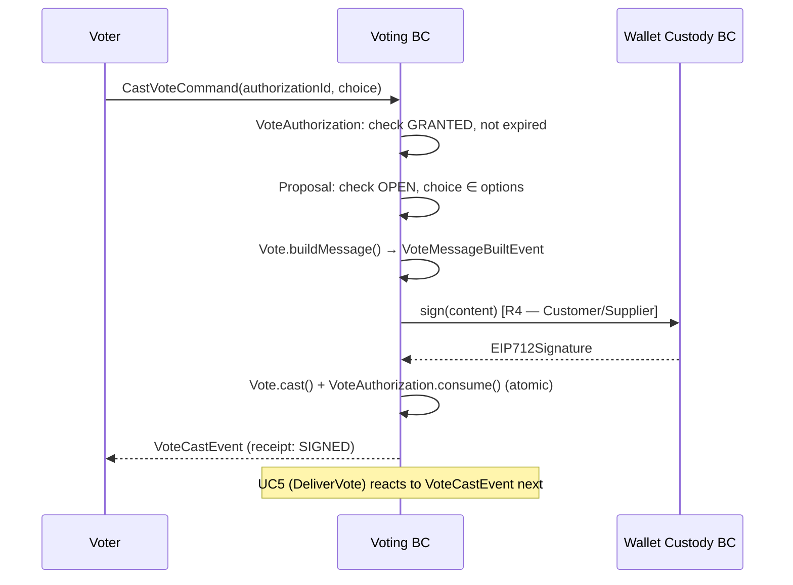
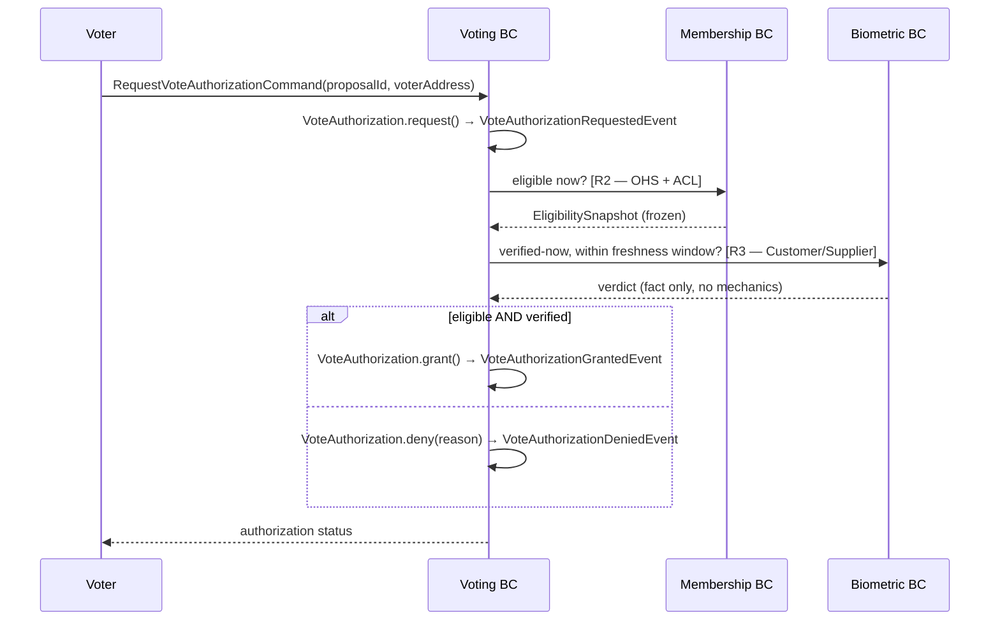

# Voting & Verifiable Ledger — Application Layer

This document describes **orchestration**, not business meaning. It answers: in what
order do things happen, who calls whom, and what crosses this bounded context's
boundary to make one intention real. It names no framework, transport, or storage —
same discipline as `domain-model.md`.

Source of business meaning: `domain-model.md` (this same folder). This document adds
nothing new to *what an aggregate can do*; it only sequences calls to aggregates and
to other bounded contexts, per the rules already frozen in `context-mapping.md`.

A use case here is triggered either by an external request (synchronous) or by a fact
this context reacts to (event-driven). Both are documented the same way.

Naming convention (frozen for all `use-case.md` documents): commands are
`Action+Target+Command` (e.g. `CreateOrderCommand`), events are
`Target+PastAction+Event` (e.g. `OrderCreatedEvent`), queries are
`Action+Target+Criteria+Query` (e.g. `GetOrderByIdQuery`). A query name may grow
whenever the criteria need declaring — e.g. `GetVoterReceiptByProposalAndVoterQuery`.

---

## 1. Use Case Catalog

| # | Use Case | Trigger | Aggregates Touched | External BCs Consulted | Facts Produced |
|---|----------|---------|--------------------|-------------------------|-----------------|
| UC1 | DraftProposal | Community admin request | `Proposal` | — | `ProposalDraftedEvent` |
| UC2 | OpenProposal | Scheduled or admin request | `Proposal` | Community (policy snapshot) | `ProposalOpenedEvent` |
| UC3 | RequestVoteAuthorization | Voter request | `VoteAuthorization` | Membership (eligibility), Biometric (verified-now) | `VoteAuthorizationRequestedEvent`, then `VoteAuthorizationGrantedEvent` or `VoteAuthorizationDeniedEvent` |
| UC4 | **CastVote** (anchor) | Voter request, with a granted authorization | `VoteAuthorization`, `Vote` | Wallet (sign this content) | `VoteMessageBuiltEvent`, `VoteAuthorizationConsumedEvent`, `VoteCastEvent` |
| UC5 | DeliverVote | Reacts to `VoteCastEvent` | `Vote` | Relay (deliver signed-only) | `SignedVoteQueuedEvent`, `TransactionSentEvent` |
| UC6 | HandleDeliveryOutcome | Reacts to Relay's `DeliveryConfirmedEvent` / `DeliveryFailedEvent` | `Vote` | — | `VoteConfirmedOnChainEvent` or `TransactionFailedEvent` |
| UC7 | CloseProposal | Scheduled or admin request | `Proposal` | — | `ProposalClosedEvent` |
| UC8 | TallyProposal | Reacts to `ProposalClosedEvent` (or scheduled) | `Proposal` | — | `ProposalTalliedEvent`, `QuorumReachedEvent`/`QuorumNotReachedEvent` |
| UC9 | ExpireAuthorization | Scheduled sweep | `VoteAuthorization` | — | `VoteAuthorizationExpiredEvent` |

UC4 is detailed fully below because it is the only use case that touches two aggregates
of this context *and* a foreign context synchronously in the same business transaction
— the orchestration decisions there (ordering, failure handling) are the ones most
likely to be gotten wrong.

---

## 2. Commands & Queries Accepted (Input Contracts)

These are the intentions this bounded context accepts from outside — not to be
confused with the aggregate operations in `domain-model.md`, which are internal.

### Commands

| Command | Carries | Handled By |
|---------|---------|------------|
| `DraftProposalCommand` | communityId, ballot options | UC1 |
| `OpenProposalCommand` | proposalId | UC2 |
| `RequestVoteAuthorizationCommand` | proposalId, voterAddress, personId | UC3 |
| `CastVoteCommand` | authorizationId, choice | UC4 |
| `CloseProposalCommand` | proposalId, closedBy | UC7 |

UC5, UC6, UC8, UC9 accept no external command: they are triggered by a domain fact
(`VoteCastEvent`, Relay's `DeliveryConfirmedEvent`/`DeliveryFailedEvent`,
`ProposalClosedEvent`) or by a schedule (UC9 sweep, UC2/UC7 timers).

### Queries

| Query | Returns | Backing Read Need (domain-model.md) |
|-------|---------|--------------------------------------|
| `GetProposalByIdQuery` | Proposal state or nothing | "Proposal by identity" |
| `ListProposalsByCommunityAndStatusQuery` | Matching proposals | "Proposals of a community by status" |
| `GetTallyByProposalQuery` | Per-option counts, turnout, quorum verdict | "Tally of a proposal" |
| `GetVoterReceiptByProposalAndVoterQuery` | This voter's vote journey: cast → queued → sent → confirmed/failed | "Voter receipt" |

---

## 3. Use Case Detail — UC4: CastVote (anchor)

### Preconditions

| # | Precondition | Checked Against |
|---|---------------|------------------|
| 1 | Authorization exists, status `PENDING` (granted), not expired | `VoteAuthorization` |
| 2 | Proposal is `OPEN` | `Proposal` |
| 3 | Choice belongs to the proposal's `BallotOptions` | `Proposal.options` |

Eligibility and identity verification are **not** re-checked here — they were already
answered and frozen into the authorization at UC3 (`EligibilitySnapshot`, verified-now
verdict). CastVote trusts a granted authorization; it does not re-ask Membership or
Biometric. Re-verifying here would silently duplicate a decision this context already
made, and would let the two checks drift out of sync over time.

### Sequence

### Steps (Business Language)

| Step | Action | Facts / Failure |
|------|--------|------------------|
| 1 | Load the authorization; confirm `GRANTED`, unexpired, unconsumed | Otherwise: `AuthorizationExpired`, `AuthorizationAlreadyConsumed`, or not found |
| 2 | Confirm the proposal is still `OPEN` | Otherwise: `LateVote` (`LateVoteRejectedEvent`) |
| 3 | Confirm the choice belongs to the ballot | Otherwise: `InvalidChoice` |
| 4 | `Vote.buildMessage()` — assembles proposal, voter, choice, nonce into the signable content | `VoteMessageBuiltEvent` |
| 5 | Ask Wallet Custody to sign this one content (R4: reconstruction is transient, forgotten right after) | Wallet may refuse if `WalletStanding` is not `PROVISIONED`/available — surfaced as a rejection to the voter, no partial state left behind |
| 6 | Recover the signer from the returned signature; confirm it matches the declared voter | Otherwise: `SignerMismatch` |
| 7 | `Vote.cast()` and `VoteAuthorization.consume()` execute as one atomic step (domain-model.md, H5) — this closes the double-cast window | `VoteCastEvent`, `VoteAuthorizationConsumedEvent` |
| 8 | Return the receipt (`VoteStatus: SIGNED`) to the voter | UC5 picks up from `VoteCastEvent` |

### What This Use Case Does *Not* Do

- Does not deliver to the chain (UC5's job — kept separate so a delivery failure never
  rolls back a valid, signed vote).
- Does not re-ask eligibility or liveness (trusts the frozen authorization).
- Does not wait for on-chain confirmation before returning (intent vs. fact, H4).

### Concurrency & Idempotency

- Steps 1–3 and step 7 must observe the same authorization state; a second `CastVoteCommand`
  arriving for an already-consumed authorization fails at step 1, recorded as
  `ReplayRejectedEvent` — it never reaches Wallet a second time.
- If step 5 (signing) succeeds but step 7 (persisting `VoteCastEvent`) fails, the signature
  is discarded and never retried automatically: a fresh `CastVoteCommand` must be resubmitted
  against the same still-`GRANTED` authorization (it was never consumed). No orphaned
  signed content persists outside this flow.

### Open Orchestration Question

Whether step 5 (ask Wallet) and step 7 (persist) must be wrapped in a single
distributed transaction or accepted as two separately-committing steps with the
compensation described above is not yet decided — carried alongside domain-model.md's
Open Question #2 (authorization validity window), since both bound how long a
`GRANTED` authorization must stay usable.

---

## 4. Use Case Detail — UC3: RequestVoteAuthorization

### Sequence

Both external answers (R2, R3) are consulted in the same use case and frozen into the
authorization at grant time — neither is re-asked later, including inside UC4. This is
the one place in this bounded context where the `EligibilitySnapshot` and the
verified-now verdict actually enter the model.

---

## 5. ACL Published (What This BC Exposes)

| Capability | Consumer (per context-mapping.md) | Notes |
|---|---|---|
| — | *none, currently* | No modeled bounded context pulls from Voting synchronously today. Voting is a net *downstream* consumer of Membership/Community/Biometric and a net *upstream* producer toward Wallet/Relay/Notifications, but nothing reads its state via ACL yet |

Voting's read needs (`GetTallyByProposalQuery`, `GetProposalByIdQuery`, …) are consumed by the UI/API
directly, not by another bounded context — so they are not modeled as an ACL here.
If a Results & Reporting context is ever split out (domain-model.md, Hotspot #6), this
section gets its first real entry.

## 6. ACL Consumed (What This BC Depends On)

| Dependency | Pattern (context-mapping.md) | Used In |
|---|---|---|
| Community → Voting (policy + standing) | Open Host Service + ACL (R1) | UC2 (OpenProposal) |
| Membership → Voting (eligibility) | Open Host Service + ACL (R2) | UC3 |
| Biometric → Voting (verified-now) | Customer/Supplier (R3) | UC3 |
| Voting → Wallet (sign this content) | Customer/Supplier (R4) | UC4 |
| Voting → Relay (deliver signed-only) | Customer/Supplier (Voting customer) + OHS (R5) | UC5 |
| Voting → Notifications (vote notices) | Open Host Service (R11) | UC4, UC5, UC6 (delivery intents on cast/queue/confirm/fail) |

Every row here is a consequence of a relationship already frozen in
`context-mapping.md` — this table only says *which use case* is the one that actually
makes the call.

---

## Related Documentation

| Document | Link |
|----------|------|
| Domain model (source of aggregate behavior) | `domain-model.md` |
| Event Storming | `event-storming.md` |
| Context map + relationship catalog (source of R1–R14) | `context-mapping.md` |
| Consolidated ubiquitous language | `ubiquitous-language.md` |
