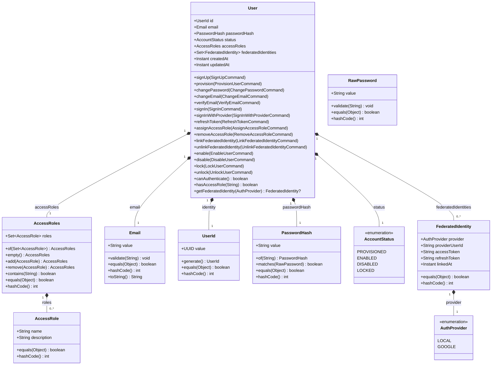
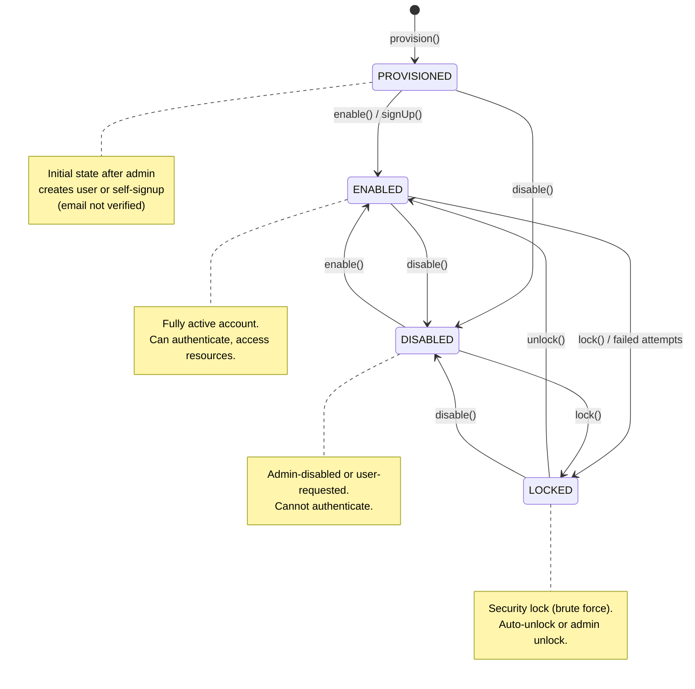
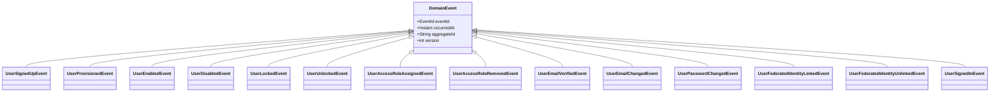

# IAM Service - Domain Model

## Aggregate Overview



---

## Aggregate: User

### Identity & Lifecycle
| Property | Type | Description |
|----------|------|-------------|
| `id` | `UserId` | UUID, generated on creation |
| `email` | `Email` | Unique, validated format |
| `passwordHash` | `PasswordHash` | BCrypt hash, never plain text |
| `status` | `AccountStatus` | State machine (see below) |
| `accessRoles` | `AccessRoles` | Collection of assigned roles |
| `federatedIdentities` | `Set<FederatedIdentity>` | Linked external identities |
| `createdAt` | `Instant` | Audit timestamp |
| `updatedAt` | `Instant` | Audit timestamp |

### State Machine: AccountStatus



### Invariants (Always True)

| # | Invariant | Enforced By |
|---|-----------|-------------|
| 1 | Email is unique across all users | `UserRepository` (unique constraint) |
| 2 | Password hash never exposed externally | `PasswordHash` VO, no getter for raw |
| 3 | Status transitions follow state machine | `User` aggregate methods |
| 4 | Cannot disable last admin user | `UserCommandService` (domain service) |
| 5 | Cannot unlink last authentication method | `User.unlinkFederatedIdentity()` throws `CannotUnlinkLastAuthMethodException` |
| 6 | Federated identity provider unique per user | `User.linkFederatedIdentity()` checks existing |
| 7 | Access role must exist in system | `UserCommandService` validates via `AccessRoleRepository` |
| 8 | Refresh token rotation on use | `TokenService.rotateRefreshToken()` |

### Commands (Mutating Operations)

| Command | Method | Preconditions | Events Published |
|---------|--------|---------------|------------------|
| `SignUpCommand` | `signUp()` | Email not exists | `UserSignedUpEvent` |
| `ProvisionUserCommand` | `provision()` | Email not exists | `UserProvisionedEvent` |
| `ChangePasswordCommand` | `changePassword()` | Valid current password | `UserPasswordChangedEvent` |
| `ChangeEmailCommand` | `changeEmail()` | New email not exists | `UserEmailChangedEvent` |
| `VerifyEmailCommand` | `verifyEmail()` | Email unverified | `UserEmailVerifiedEvent` |
| `SignInCommand` | `signIn()` | Valid credentials, enabled | — |
| `SignInWithProviderCommand` | `signInWithProvider()` | Valid provider token | — |
| `RefreshTokenCommand` | `refreshToken()` | Valid refresh token | — |
| `AssignAccessRoleCommand` | `assignAccessRole()` | Role exists, not assigned | `UserAccessRoleAssignedEvent` |
| `RemoveAccessRoleCommand` | `removeAccessRole()` | Role assigned, not last admin | `UserAccessRoleRemovedEvent` |
| `LinkFederatedIdentityCommand` | `linkFederatedIdentity()` | Provider not linked | `UserFederatedIdentityLinkedEvent` |
| `UnlinkFederatedIdentityCommand` | `unlinkFederatedIdentity()` | Not last auth method | `UserFederatedIdentityUnlinkedEvent` |
| `EnableUserCommand` | `enable()` | Status != ENABLED | `UserEnabledEvent` |
| `DisableUserCommand` | `disable()` | Status != DISABLED | `UserDisabledEvent` |
| `LockUserCommand` | `lock()` | Status != LOCKED | `UserLockedEvent` |
| `UnlockUserCommand` | `unlock()` | Status == LOCKED | `UserUnlockedEvent` |
| `SeedRolesCommand` | (static) | Roles don't exist | — |

### Queries (Read Operations)

| Query | Method | Returns |
|-------|--------|---------|
| `GetUserByIdQuery` | `UserQueryService.getById()` | `User` or empty |
| `GetUserByEmailQuery` | `UserQueryService.getByEmail()` | `User` or empty |
| `GetAllUsersQuery` | `UserQueryService.getAll()` | `Paged<User>` |

---

## Entity: FederatedIdentity

Represents a linked external identity provider (Google, etc.).

| Property | Type | Description |
|----------|------|-------------|
| `provider` | `AuthProvider` | GOOGLE (extensible) |
| `providerUserId` | `String` | Subject ID from provider |
| `accessToken` | `String` | OAuth2 access token (encrypted) |
| `refreshToken` | `String` | OAuth2 refresh token (encrypted) |
| `linkedAt` | `Instant` | When linkage was created |

**Identity**: Composite of `(provider, providerUserId)` — unique per user.

---

## Value Objects

### Email
- **Validation**: RFC 5322 compliant regex
- **Normalization**: Lowercase, trimmed
- **Immutability**: Yes

### UserId
- **Generation**: UUID v4 (random)
- **Immutability**: Yes

### PasswordHash
- **Algorithm**: BCrypt (cost factor 12)
- **Verification**: Constant-time comparison
- **Immutability**: Yes

### RawPassword
- **Validation**: Min 8 chars, max 128, complexity optional
- **Immutability**: Yes

### AccountStatus (Enum)
- `PROVISIONED` — Created, email not verified
- `ENABLED` — Active, can authenticate
- `DISABLED` — Disabled by admin/user
- `LOCKED` — Security lock

### AuthProvider (Enum)
- `LOCAL` — Email/password
- `GOOGLE` — Google OAuth2

### AccessRoles
- **Wrapper** around `Set<AccessRole>`
- **Factory methods**: `of()`, `empty()`
- **Operations**: `add()`, `remove()`, `contains()`
- **Immutability**: Returns new instance

---

## Domain Events

All events extend `DomainEvent` (from `shared.domain.model.events`).



| Event | Payload | Published By | Consumers |
|-------|---------|--------------|-----------|
| `UserSignedUpEvent` | `userId`, `email` | `User.signUp()` | Audit, Notification (welcome) |
| `UserProvisionedEvent` | `userId`, `email`, `roles` | `User.provision()` | Audit, Authorization (sync roles) |
| `UserEnabledEvent` | `userId` | `User.enable()` | Audit, Authorization |
| `UserDisabledEvent` | `userId`, `reason` | `User.disable()` | Audit, Authorization (revoke) |
| `UserLockedEvent` | `userId`, `reason` | `User.lock()` | Audit, Notification (alert) |
| `UserUnlockedEvent` | `userId` | `User.unlock()` | Audit |
| `UserAccessRoleAssignedEvent` | `userId`, `roleName` | `User.assignAccessRole()` | Audit, Authorization |
| `UserAccessRoleRemovedEvent` | `userId`, `roleName` | `User.removeAccessRole()` | Audit, Authorization |
| `UserEmailVerifiedEvent` | `userId`, `email` | `User.verifyEmail()` | Audit |
| `UserEmailChangedEvent` | `userId`, `oldEmail`, `newEmail` | `User.changeEmail()` | Audit, Notification |
| `UserPasswordChangedEvent` | `userId` | `User.changePassword()` | Audit, Notification (security) |
| `UserFederatedIdentityLinkedEvent` | `userId`, `provider` | `User.linkFederatedIdentity()` | Audit |
| `UserFederatedIdentityUnlinkedEvent` | `userId`, `provider` | `User.unlinkFederatedIdentity()` | Audit |
| `UserSignedInEvent` | `userId`, `provider` | `User.signIn()` | Audit, Analytics |

---

## Domain Services (Ports)

### UserCommandService (Interface)
```java
UserId signUp(SignUpCommand command);
UserId provision(ProvisionUserCommand command);
void changePassword(ChangePasswordCommand command);
void changeEmail(ChangeEmailCommand command);
void verifyEmail(VerifyEmailCommand command);
TokenPair signIn(SignInCommand command);
TokenPair signInWithProvider(SignInWithProviderCommand command);
TokenPair refreshToken(RefreshTokenCommand command);
void assignAccessRole(AssignAccessRoleCommand command);
void removeAccessRole(RemoveAccessRoleCommand command);
void linkFederatedIdentity(LinkFederatedIdentityCommand command);
void unlinkFederatedIdentity(UnlinkFederatedIdentityCommand command);
void enable(EnableUserCommand command);
void disable(DisableUserCommand command);
void lock(LockUserCommand command);
void unlock(UnlockUserCommand command);
void seedRoles(SeedRolesCommand command);
```

### UserQueryService (Interface)
```java
Optional<User> getById(GetUserByIdQuery query);
Optional<User> getByEmail(GetUserByEmailQuery query);
Paged<User> getAll(GetAllUsersQuery query);
```

### RoleCommandService (Interface)
```java
void createRole(String name, String description);
void deleteRole(String name);
```

### Repository Ports
```java
interface UserRepository {
    void save(User user);
    Optional<User> findById(UserId id);
    Optional<User> findByEmail(Email email);
    Paged<User> findAll(Pageable pageable);
    boolean existsByEmail(Email email);
}

interface AccessRoleRepository {
    void save(AccessRole role);
    Optional<AccessRole> findByName(String name);
    void deleteByName(String name);
    Set<AccessRole> findAll();
}
```

### Service Ports
```java
interface HashingService {
    PasswordHash hash(RawPassword raw);
    boolean matches(RawPassword raw, PasswordHash hash);
}

interface TokenService {
    TokenPair generate(UserId userId, AccessRoles roles);
    TokenPair refresh(String refreshToken);
    void revoke(String refreshToken);
    UserId validateAccessToken(String token);
}

interface ExternalIdentityVerifier {
    VerifiedExternalIdentity verify(String idToken);
}
```

---

## Exceptions (Domain)

| Exception | Trigger | HTTP Status |
|-----------|---------|-------------|
| `AccountDisabledException` | Auth attempt on disabled account | 403 |
| `AccountLockedException` | Auth attempt on locked account | 403 |
| `AccountNotVerifiedException` | Auth before email verification | 403 |
| `CannotUnlinkLastAuthMethodException` | Unlink last login method | 400 |
| `EmailAlreadyExistsException` | Duplicate email on sign up/provision | 409 |
| `FederatedIdentityAlreadyLinkedException` | Link duplicate provider | 409 |
| `IllegalAccountStateTransitionException` | Invalid status transition | 400 |
| `InvalidCredentialsException` | Bad password/token | 401 |
| `InvalidRefreshTokenException` | Expired/revoked/invalid refresh token | 401 |
| `ProviderNotConfiguredException` | OAuth provider not configured | 503 |
| `RoleNotFoundException` | Role doesn't exist | 404 |
| `UserNotFoundException` | User not found | 404 |

---

## Implementation References

| Domain Concept | File |
|----------------|------|
| User Aggregate | `iam/domain/model/aggregates/User.java` |
| AccessRole Entity | `iam/domain/model/entities/AccessRole.java` |
| FederatedIdentity Entity | `iam/domain/model/entities/FederatedIdentity.java` |
| Email VO | `iam/domain/model/valueobjects/Email.java` |
| UserId VO | `iam/domain/model/valueobjects/UserId.java` |
| PasswordHash VO | `iam/domain/model/valueobjects/PasswordHash.java` |
| AccountStatus Enum | `iam/domain/model/valueobjects/AccountStatus.java` |
| Domain Events | `iam/domain/model/events/*.java` |
| Commands | `iam/domain/model/commands/*.java` |
| Queries | `iam/domain/model/queries/*.java` |
| Domain Services | `iam/domain/services/*.java` |
| Repository Ports | `iam/infrastructure/persistence/repositories/*.java` |
| Service Ports | `iam/application/internal/outboundservices/**/*.java` |