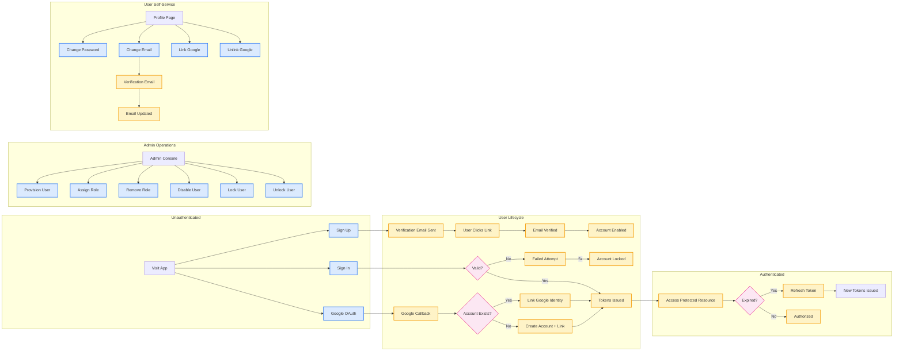

# Event Storming: IAM Service

## Workshop Overview

| Aspect | Details |
|--------|---------|
| **Date** | 2026-08-20 |
| **Duration** | 2 sessions × 2 hours |
| **Participants** | Domain Expert (Product), 2 Backend Engineers, 1 QA, 1 UX |
| **Facilitator** | Senior Engineer (DDD practitioner) |
| **Scope** | User identity, authentication, authorization, federated login |
| **Tool** | Miro (remote), sticky notes → exported to Mermaid |

## Big Picture (Process Level)



## Design Level — User Aggregate

```mermaid
graph TD
    subgraph "Commands (Intent)"
        C1[SignUpCommand]
        C2[ProvisionUserCommand]
        C3[SignInCommand]
        C4[SignInWithProviderCommand]
        C5[RefreshTokenCommand]
        C6[ChangePasswordCommand]
        C7[ChangeEmailCommand]
        C8[VerifyEmailCommand]
        C9[AssignAccessRoleCommand]
        C10[RemoveAccessRoleCommand]
        C11[LinkFederatedIdentityCommand]
        C12[UnlinkFederatedIdentityCommand]
        C13[EnableUserCommand]
        C14[DisableUserCommand]
        C15[LockUserCommand]
        C16[UnlockUserCommand]
        C17[SeedRolesCommand]
    end
    
    subgraph "Aggregate: User"
        U[User\n(Aggregate Root)]
        U --- S[State: AccountStatus\nPROVISIONED/ENABLED/DISABLED/LOCKED]
        U --- R[Roles: AccessRoles]
        U --- F[FederatedIdentities]
        U --- E[Email]
        U --- P[PasswordHash]
    end
    
    subgraph "Events (Facts)"
        E1[UserSignedUpEvent]
        E2[UserProvisionedEvent]
        E3[UserSignedInEvent]
        E4[UserPasswordChangedEvent]
        E5[UserEmailChangedEvent]
        E6[UserEmailVerifiedEvent]
        E7[UserAccessRoleAssignedEvent]
        E8[UserAccessRoleRemovedEvent]
        E9[UserFederatedIdentityLinkedEvent]
        E10[UserFederatedIdentityUnlinkedEvent]
        E11[UserEnabledEvent]
        E12[UserDisabledEvent]
        E13[UserLockedEvent]
        E14[UserUnlockedEvent]
    end
    
    subgraph "Policies (Reactions)"
        Pol1[Auto-lock after 5 failed attempts]
        Pol2[Revoke tokens on password change]
        Pol3[Revoke tokens on disable/lock]
        Pol4[Sync roles to Authorization Service]
        Pol5[Send welcome email on sign up]
        Pol6[Send security alert on lock]
        Pol7[Notify old/new email on change]
    end
    
    subgraph "Read Models"
        RM1[User List (paginated)]
        RM2[Current User Profile]
        RM3[User Roles for AuthZ]
    end
    
    subgraph "External Systems"
        Ext1[Google OAuth2]
        Ext2[Email Service]
        Ext3[Authorization Service]
        Ext4[Audit Service]
        Ext5[Notification Service]
    end
    
    C1 --> U
    C2 --> U
    C3 --> U
    C4 --> U
    C5 --> U
    C6 --> U
    C7 --> U
    C8 --> U
    C9 --> U
    C10 --> U
    C11 --> U
    C12 --> U
    C13 --> U
    C14 --> U
    C15 --> U
    C16 --> U
    C17 --> U
    
    U --> E1
    U --> E2
    U --> E3
    U --> E4
    U --> E5
    U --> E6
    U --> E7
    U --> E8
    U --> E9
    U --> E10
    U --> E11
    U --> E12
    U --> E13
    U --> E14
    
    E1 --> Pol5
    E3 --> Pol4
    E4 --> Pol2
    E7 --> Pol4
    E8 --> Pol4
    E11 --> Pol4
    E12 --> Pol3
    E13 --> Pol3
    E13 --> Pol6
    E5 --> Pol7
    E6 --> Pol5
    
    E1 -.-> Ext4
    E2 -.-> Ext4
    E3 -.-> Ext4
    E4 -.-> Ext4
    E5 -.-> Ext4
    E6 -.-> Ext4
    E7 -.-> Ext4
    E8 -.-> Ext4
    E9 -.-> Ext4
    E10 -.-> Ext4
    E11 -.-> Ext4
    E12 -.-> Ext4
    E13 -.-> Ext4
    E14 -.-> Ext4
    
    E1 -.-> Ext5
    E5 -.-> Ext5
    E6 -.-> Ext5
    E13 -.-> Ext5
    
    E7 -.-> Ext3
    E8 -.-> Ext3
    E11 -.-> Ext3
    E12 -.-> Ext3
    
    C4 --> Ext1
    C11 --> Ext1
    
    Pol5 -.-> Ext2
    Pol6 -.-> Ext2
    Pol7 -.-> Ext2
    
    E1 -.-> RM1
    E2 -.-> RM1
    E3 -.-> RM1
    E7 -.-> RM1
    E8 -.-> RM1
    E11 -.-> RM1
    E12 -.-> RM1
    
    E3 -.-> RM2
    E4 -.-> RM2
    E5 -.-> RM2
    E6 -.-> RM2
    
    E3 -.-> RM3
    E7 -.-> RM3
    E8 -.-> RM3
    E11 -.-> RM3
    E12 -.-> RM3
    
    classDef cmd fill:#dbeafe,stroke:#3b82f6,stroke-width:2px;
    classDef agg fill:#dcfce7,stroke:#22c55e,stroke-width:3px;
    classDef evt fill:#fef3c7,stroke:#f59e0b,stroke-width:2px;
    classDef pol fill:#fce7f3,stroke:#ec4899,stroke-width:2px;
    classDef rm fill:#e0e7ff,stroke:#6366f1,stroke-width:2px;
    classDef ext fill:#e5e7eb,stroke:#6b7280,stroke-width:2px;
    
    class C1,C2,C3,C4,C5,C6,C7,C8,C9,C10,C11,C12,C13,C14,C15,C16,C17 cmd;
    class U,S,R,F,E,P agg;
    class E1,E2,E3,E4,E5,E6,E7,E8,E9,E10,E11,E12,E13,E14 evt;
    class Pol1,Pol2,Pol3,Pol4,Pol5,Pol6,Pol7 pol;
    class RM1,RM2,RM3 rm;
    class Ext1,Ext2,Ext3,Ext4,Ext5 ext;
```

## Key Discoveries

### Aggregates Identified

| Aggregate | Root | Invariants |
|-----------|------|------------|
| **User** | `User` | Email uniqueness, password never exposed, status transitions valid, cannot unlink last auth method, cannot remove last admin |
| **AccessRole** | `AccessRole` (reference) | Name uniqueness, system roles seeded |

### Commands (17)

| Command | Aggregate | Validation |
|---------|-----------|------------|
| `SignUpCommand` | User | Email unique, password strength |
| `ProvisionUserCommand` | User | Email unique, roles exist |
| `SignInCommand` | User | Credentials valid, account enabled |
| `SignInWithProviderCommand` | User | Google token valid, email verified |
| `RefreshTokenCommand` | User | Refresh token valid, not revoked |
| `ChangePasswordCommand` | User | Current password matches |
| `ChangeEmailCommand` | User | Password valid, new email unique |
| `VerifyEmailCommand` | User | Token valid, not expired |
| `AssignAccessRoleCommand` | User | Role exists, not already assigned |
| `RemoveAccessRoleCommand` | User | Role assigned, not last admin |
| `LinkFederatedIdentityCommand` | User | Provider not already linked |
| `UnlinkFederatedIdentityCommand` | User | Not last auth method |
| `EnableUserCommand` | User | Not already enabled |
| `DisableUserCommand` | User | Not already disabled |
| `LockUserCommand` | User | Not already locked |
| `UnlockUserCommand` | User | Currently locked |
| `SeedRolesCommand` | AccessRole | Roles don't exist |

### Events (14 Published)

| Event | Payload | Downstream Consumers |
|-------|---------|---------------------|
| `UserSignedUpEvent` | `userId`, `email` | Audit, Notification (welcome) |
| `UserProvisionedEvent` | `userId`, `email`, `roles` | Audit, Authorization (sync) |
| `UserSignedInEvent` | `userId`, `provider` | Audit, Analytics |
| `UserEnabledEvent` | `userId` | Audit, Authorization |
| `UserDisabledEvent` | `userId`, `reason` | Audit, Authorization (revoke) |
| `UserLockedEvent` | `userId`, `reason` | Audit, Notification (alert) |
| `UserUnlockedEvent` | `userId` | Audit, Authorization |
| `UserAccessRoleAssignedEvent` | `userId`, `roleName` | Audit, Authorization |
| `UserAccessRoleRemovedEvent` | `userId`, `roleName` | Audit, Authorization |
| `UserEmailVerifiedEvent` | `userId`, `email` | Audit |
| `UserEmailChangedEvent` | `userId`, `oldEmail`, `newEmail` | Audit, Notification |
| `UserPasswordChangedEvent` | `userId` | Audit, Notification (security) |
| `UserFederatedIdentityLinkedEvent` | `userId`, `provider` | Audit |
| `UserFederatedIdentityUnlinkedEvent` | `userId`, `provider` | Audit |

### Policies (Business Rules)

| Policy | Trigger | Action |
|--------|---------|--------|
| **Auto-lock** | 5 failed sign-in attempts | `LockUserCommand` |
| **Token revocation on password change** | `UserPasswordChangedEvent` | Revoke all refresh tokens |
| **Token revocation on disable/lock** | `UserDisabledEvent`, `UserLockedEvent` | Revoke all tokens |
| **Role sync** | Role assigned/removed, user enabled/disabled | Publish to Authorization Service |
| **Welcome email** | `UserSignedUpEvent`, `UserEmailVerifiedEvent` | Send via Notification Service |
| **Security alert** | `UserLockedEvent` | Send alert email |
| **Email change notification** | `UserEmailChangedEvent` | Notify old + new email |

### Hotspots (Contentious Decisions)

| Hotspot | Decision | Rationale |
|---------|----------|-----------|
| **Email uniqueness** | Enforced at repository + aggregate | Prevents race conditions; aggregate checks before emit |
| **Last auth method protection** | Aggregate throws `CannotUnlinkLastAuthMethodException` | User must always have ≥1 way to sign in |
| **Last admin protection** | Aggregate + command service prevent removing last ADMIN | System must always have an admin |
| **Account status transitions** | State machine in aggregate | Prevents invalid states (e.g., locked→provisioned) |
| **Refresh token rotation** | One-time use, reuse detection revokes chain | Mitigates token theft |
| **Google account linking** | Allow linking to existing local account | User convenience; no duplicate accounts |

## From Workshop to Code

| Workshop Artifact | Code Implementation |
|-------------------|---------------------|
| **User** aggregate | `iam/domain/model/aggregates/User.java` |
| **AccessRole** entity | `iam/domain/model/entities/AccessRole.java` |
| **FederatedIdentity** entity | `iam/domain/model/entities/FederatedIdentity.java` |
| **Email** value object | `iam/domain/model/valueobjects/Email.java` |
| **UserId** value object | `iam/domain/model/valueobjects/UserId.java` |
| **PasswordHash** value object | `iam/domain/model/valueobjects/PasswordHash.java` |
| **AccountStatus** enum | `iam/domain/model/valueobjects/AccountStatus.java` |
| **AuthProvider** enum | `iam/domain/model/valueobjects/AuthProvider.java` |
| **AccessRoles** value object | `iam/domain/model/valueobjects/AccessRoles.java` |
| **All 17 Commands** | `iam/domain/model/commands/*.java` |
| **All 14 Events** | `iam/domain/model/events/*.java` |
| **UserCommandService** (port) | `iam/domain/services/UserCommandService.java` |
| **UserQueryService** (port) | `iam/domain/services/UserQueryService.java` |
| **RoleCommandService** (port) | `iam/domain/services/RoleCommandService.java` |
| **UserCommandServiceImpl** | `iam/application/internal/commandservices/UserCommandServiceImpl.java` |
| **11 Event Handlers** | `iam/application/internal/eventhandlers/*.java` |
| **GoogleOAuth Verifier** | `iam/infrastructure/externalidentity/google/GoogleExternalIdentityVerifierImpl.java` |
| **JWT Token Service** | `iam/infrastructure/token/jwt/BearerTokenService.java` |
| **BCrypt Hasher** | `iam/infrastructure/hashing/bcrypt/BcryptHashingService.java` |

## Open Questions / Parking Lot

| # | Question | Status | Owner |
|---|----------|--------|-------|
| 1 | Support additional OAuth providers (GitHub, Microsoft, GitLab) | Parked | — |
| 2 | Passwordless authentication (magic links, WebAuthn) | Backlog | — |
| 3 | Session/device management (view active sessions, revoke) | Backlog | — |
| 4 | Step-up authentication for sensitive operations | Backlog | — |
| 5 | Delegated administration (org-level admins) | Parked | — |
| 6 | Impersonation (support accessing user account) | Parked | — |
| 7 | Account recovery (lost 2FA, lost email access) | Backlog | — |
| 8 | Audit log retention & GDPR compliance | In progress | Legal |

## Related Documentation

| Document | Link |
|----------|------|
| Domain Model (final) | [domain-model.md](domain-model.md) |
| Architecture Overview | [overview.md](overview.md) |
| User Management Flows | [../features/user-management.md](../features/user-management.md) |
| Authentication Flows | [../features/authentication.md](../features/authentication.md) |
| Authorization & Roles | [../features/authorization.md](../features/authorization.md) |
| Diagram Conventions | [../diagrams/conventions.md](../diagrams/conventions.md) |